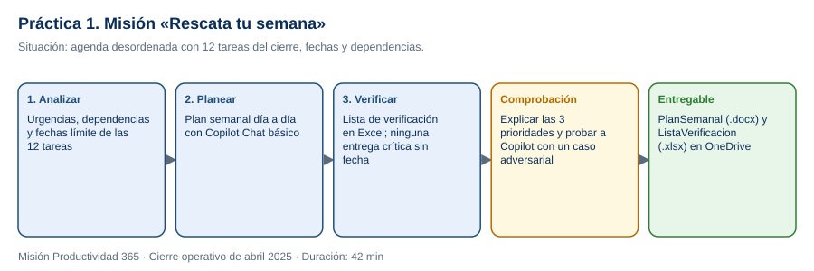

# Misión «Rescata tu semana»

## Metadatos

| Campo | Valor |
|---|---|
| **Duración** | 42 minutos |
| **Complejidad** | Fácil |
| **Nivel Bloom** | Aplicar |

## Descripción General

En esta práctica inaugural recibirás una lista desordenada de 12 tareas del cierre operativo mensual de una institución. Tu misión es analizar urgencias, dependencias y fechas límite; utilizar Copilot Chat básico para generar un plan semanal estructurado; y construir una lista de verificación digital en Excel Online donde ninguna entrega crítica quede sin fecha. Los artefactos generados se almacenarán en OneDrive for Business y servirán como insumo para la Práctica 2.

## Objetivos de Aprendizaje

- [ ] Aplicar criterios de priorización (urgencia, impacto, dependencia) a un conjunto de tareas operativas reales del cierre mensual.
- [ ] Utilizar Copilot Chat básico (https://m365.cloud.microsoft/chat) con prompts estructurados para transformar una lista de tareas desordenadas en un plan semanal con fechas y responsables.
- [ ] Construir una lista de verificación digital en Excel Online que garantice que ninguna entrega crítica del cierre mensual quede sin fecha asignada.
- [ ] Articular y justificar las tres prioridades seleccionadas con base en criterios de urgencia e impacto operativo.



## Prerrequisitos

### Conocimientos previos

- Haber revisado los contenidos de la Lección 1.1 (Hábitos digitales y organización del trabajo) y la Lección 1.2 (Gestión del tiempo, priorización y buenas prácticas).
- Comprensión del ciclo **señal → rutina → recompensa** y los principios de **captura única** y **estructura visible**.
- Familiaridad básica con el concepto de matriz de priorización (urgencia vs. impacto).

### Acceso y herramientas

| Requisito | Detalle |
|---|---|
| Cuenta Microsoft 365 | Licencia institucional activa con acceso a OneDrive for Business, Excel Online y Word Online |
| Copilot Chat básico | Acceso confirmado en https://m365.cloud.microsoft/chat con cuenta institucional (protección de datos empresariales habilitada). **No** se requiere licencia de Microsoft 365 Copilot (SKU adicional). |
| Navegador | Microsoft Edge 134.0.3124.72+ (recomendado) o Google Chrome 134.0.6998.89+ |
| Conectividad | Conexión a Internet estable para acceder a los servicios en la nube |

> **⚠️ Importante:** Si al iniciar sesión en https://m365.cloud.microsoft/chat no aparece el indicador «Protegido por tu organización» (o equivalente en inglés «Protected by your organization»), contacta al instructor antes de continuar. Esto indica que Copilot Chat con protección de datos empresariales no está habilitado en tu tenant.

## Entorno de Laboratorio

### Estructura de carpetas objetivo

Al finalizar esta práctica, tu carpeta en OneDrive for Business debe contener:

```
OneDrive for Business/
└── CierreOperativo/
    └── Semana1/
        ├── PlanSemanal_CierreOperativo_[Apellido].docx
        └── ListaVerificacion_CierreOperativo_[Apellido].xlsx
```

### Insumo proporcionado: Lista de tareas del cierre operativo

> 📥 **Descarga:** la misma lista está en [Lista_Tareas_CierreOperativo_Abr2025.docx](recursos/Lista_Tareas_CierreOperativo_Abr2025.docx).

A continuación se presenta la lista de 12 tareas que constituye el escenario de trabajo. **Copia este bloque completo**; lo necesitarás en los pasos 5 y 7.

```text
LISTA DE TAREAS — CIERRE OPERATIVO MENSUAL (ABRIL 2025)
=========================================================
1. Revisar controles internos de caja chica — Fecha límite: 07/may — Depende de: ninguna — Responsable: Analista financiero
2. Actualizar hoja Excel de conciliación bancaria — Fecha límite: 08/may — Depende de: Tarea 1 — Responsable: Asistente contable
3. Elaborar informe de gestión mensual — Fecha límite: 09/may — Depende de: Tareas 1 y 2 — Responsable: Coordinador operativo
4. Enviar recordatorio a proveedores con facturas pendientes — Fecha límite: 05/may — Depende de: ninguna — Responsable: Asistente administrativo
5. Consolidar reporte de horas extra del personal — Fecha límite: 06/may — Depende de: ninguna — Responsable: Recursos Humanos
6. Verificar estado de contratos por vencer — Fecha límite: 08/may — Depende de: ninguna — Responsable: Área legal
7. Archivar comprobantes de pago del mes — Fecha límite: 09/may — Depende de: Tarea 2 — Responsable: Asistente contable
8. Preparar presentación de resultados para dirección — Fecha límite: 12/may — Depende de: Tarea 3 — Responsable: Coordinador operativo
9. Revisar y aprobar solicitudes de viáticos pendientes — Fecha límite: 05/may — Depende de: ninguna — Responsable: Jefe de área
10. Actualizar inventario de activos fijos — Fecha límite: 10/may — Depende de: ninguna — Responsable: Encargado de activos
11. Generar respaldo de base de datos de facturación — Fecha límite: 06/may — Depende de: ninguna — Responsable: Soporte TI
12. Solicitar firma de actas de entrega de equipos — Fecha límite: 08/may — Depende de: Tarea 10 — Responsable: Encargado de activos
```

## Instrucciones Paso a Paso

### Paso 1: Crear la estructura de carpetas en OneDrive for Business

**Objetivo:** Establecer el directorio de trabajo estándar del curso para almacenar todos los artefactos.

1. Abre el navegador e ingresa a https://m365.cloud.microsoft o accede a OneDrive desde el portal https://m365.cloud.microsoft con tu cuenta institucional.
2. En la raíz de tu OneDrive, haz clic en **+ Nuevo** → **Carpeta**.
3. Nombra la carpeta:

```
CierreOperativo
```

4. Abre la carpeta recién creada y crea una subcarpeta:

```
Semana1
```

5. Confirma que la ruta visible en la barra de navegación sea: **Mis archivos > CierreOperativo > Semana1**.

**Resultado esperado:** La carpeta `/CierreOperativo/Semana1/` existe en tu OneDrive y está vacía.

**Verificación:** Haz clic en la ruta de navegación y confirma que el nombre es exactamente `CierreOperativo` (sin espacios adicionales ni tildes) y la subcarpeta `Semana1`.

---

### Paso 2: Copiar la lista de tareas al portapapeles

**Objetivo:** Tener el insumo listo para el análisis manual y para el prompt de Copilot Chat.

1. Regresa a este documento de instrucciones y localiza el bloque de texto titulado **«LISTA DE TAREAS — CIERRE OPERATIVO MENSUAL (ABRIL 2025)»** en la sección «Entorno de Laboratorio».
2. Selecciona todo el bloque de texto (desde la línea `1. Revisar controles internos…` hasta `12. Solicitar firma de actas…`) y cópialo al portapapeles (`Ctrl + C`).
3. Abre una pestaña nueva en el navegador, ingresa a https://m365.cloud.microsoft y abre **Word Online**.
4. Crea un documento en blanco y pégalo (`Ctrl + V`).
5. Guarda el documento con el nombre:

```
Borrador_Tareas_CierreOperativo.docx
```

6. Mueve o guarda este archivo en la carpeta `/CierreOperativo/Semana1/` de tu OneDrive (usa **Archivo > Guardar como > OneDrive > CierreOperativo > Semana1**).

**Resultado esperado:** El archivo `Borrador_Tareas_CierreOperativo.docx` contiene las 12 tareas y está guardado en la carpeta correcta.

**Verificación:** Abre la carpeta `Semana1` en OneDrive y confirma que el archivo aparece con la fecha de hoy.

---

### Paso 3: Analizar urgencias y dependencias manualmente

**Objetivo:** Aplicar criterios de priorización (urgencia, impacto, dependencia) antes de recurrir a la herramienta de IA.

1. En el documento de Word Online que acabas de crear, añade una sección debajo de la lista con el título:

```
## ANÁLISIS DE PRIORIZACIÓN
```

2. Identifica las tareas con **fecha límite más cercana** (05/may y 06/may). Escribe debajo del título:

```
URGENTES (vencen 05/may - 06/may):
- Tarea 4: Enviar recordatorio a proveedores (05/may) — Sin dependencia
- Tarea 9: Revisar solicitudes de viáticos (05/may) — Sin dependencia
- Tarea 5: Consolidar reporte de horas extra (06/may) — Sin dependencia
- Tarea 11: Generar respaldo de base de datos (06/may) — Sin dependencia
```

3. Identifica las tareas que son **dependencia de otras** (bloquean el avance de tareas posteriores). Escribe:

```
TAREAS BLOQUEANTES (otras dependen de ellas):
- Tarea 1: Revisar controles de caja chica → bloquea Tareas 2 y 3
- Tarea 2: Actualizar Excel conciliación → bloquea Tareas 3 y 7
- Tarea 10: Actualizar inventario de activos → bloquea Tarea 12
```

4. Identifica las **tres tareas de mayor criticidad** combinando urgencia + impacto + cadena de dependencias. Escribe:

```
TOP 3 PRIORIDADES (urgencia + impacto + dependencias):
1. Tarea 1: Revisar controles internos de caja chica (07/may) — CRÍTICA: bloquea conciliación e informe
2. Tarea 2: Actualizar hoja Excel de conciliación bancaria (08/may) — CRÍTICA: bloquea informe y archivo
3. Tarea 3: Elaborar informe de gestión mensual (09/may) — CRÍTICA: bloquea presentación a dirección
```

5. Guarda el documento (`Ctrl + S`).

**Resultado esperado:** El documento contiene tres secciones de análisis: tareas urgentes, tareas bloqueantes y las tres prioridades principales, con justificación explícita.

**Verificación:** Revisa que cada tarea del Top 3 tenga indicada su fecha límite y la razón por la que es crítica (dependencia que bloquea).

---

### Paso 4: Acceder a Copilot Chat básico y verificar la protección de datos empresariales

**Objetivo:** Confirmar que Copilot Chat está disponible con protección de datos empresariales antes de enviar información institucional.

1. Abre una pestaña nueva e ingresa a:

```
https://m365.cloud.microsoft/chat
```

2. Si se te solicita, inicia sesión con tu **cuenta institucional** de Microsoft 365 (no con una cuenta personal).
3. Busca el indicador de protección de datos empresariales. Debe aparecer un texto como:

```
"Tu información personal y de la empresa está protegida en este chat"
```

   o en inglés: `"Your personal and company data are protected in this chat"`. Este indicador suele mostrarse en la parte inferior del área de chat o junto al icono de un escudo.

4. Si el indicador **no aparece**, cierra sesión, borra la caché del navegador y vuelve a intentar. Si persiste, notifica al instructor.

**Resultado esperado:** Copilot Chat cargado con la cuenta institucional y el indicador de protección de datos empresariales visible.

**Verificación:** Captura mental (o captura de pantalla opcional) del indicador de protección. Confirma que el avatar o nombre de usuario corresponde a tu cuenta institucional.

---

### Paso 5: Enviar el prompt de planificación semanal a Copilot Chat

**Objetivo:** Utilizar un prompt estructurado para que Copilot Chat genere un plan semanal día a día a partir de la lista de tareas.

1. En la ventana de Copilot Chat, escribe el siguiente prompt **completo**. Antes de enviarlo, reemplaza `[Tu nombre]` por tu nombre real:

```
Actúa como un asistente de planificación operativa. Te proporcionaré una lista de 12 tareas del cierre operativo mensual de abril 2025 con fechas límite, dependencias y responsables.

Necesito que generes un plan semanal estructurado del lunes 5 al viernes 9 de mayo de 2025, distribuyendo las tareas día a día. Reglas:
- Respeta las fechas límite: cada tarea debe programarse al menos un día antes de su fecha límite o el mismo día si no hay margen.
- Respeta las dependencias: una tarea dependiente no puede programarse antes de que se complete la tarea de la que depende.
- Formato de salida: tabla con columnas Día, Tarea, Responsable, Fecha límite, Prioridad (Alta/Media/Baja).
- Marca con prioridad Alta las tareas que bloquean a otras o que tienen fecha límite inmediata.

Lista de tareas:
1. Revisar controles internos de caja chica — Fecha límite: 07/may — Depende de: ninguna — Responsable: Analista financiero
2. Actualizar hoja Excel de conciliación bancaria — Fecha límite: 08/may — Depende de: Tarea 1 — Responsable: Asistente contable
3. Elaborar informe de gestión mensual — Fecha límite: 09/may — Depende de: Tareas 1 y 2 — Responsable: Coordinador operativo
4. Enviar recordatorio a proveedores con facturas pendientes — Fecha límite: 05/may — Depende de: ninguna — Responsable: Asistente administrativo
5. Consolidar reporte de horas extra del personal — Fecha límite: 06/may — Depende de: ninguna — Responsable: Recursos Humanos
6. Verificar estado de contratos por vencer — Fecha límite: 08/may — Depende de: ninguna — Responsable: Área legal
7. Archivar comprobantes de pago del mes — Fecha límite: 09/may — Depende de: Tarea 2 — Responsable: Asistente contable
8. Preparar presentación de resultados para dirección — Fecha límite: 12/may — Depende de: Tarea 3 — Responsable: Coordinador operativo
9. Revisar y aprobar solicitudes de viáticos pendientes — Fecha límite: 05/may — Depende de: ninguna — Responsable: Jefe de área
10. Actualizar inventario de activos fijos — Fecha límite: 10/may — Depende de: ninguna — Responsable: Encargado de activos
11. Generar respaldo de base de datos de facturación — Fecha límite: 06/may — Depende de: ninguna — Responsable: Soporte TI
12. Solicitar firma de actas de entrega de equipos — Fecha límite: 08/may — Depende de: Tarea 10 — Responsable: Encargado de activos

Genera el plan ahora. Participante: [Tu nombre].
```

2. Presiona **Enter** o el botón de enviar para ejecutar el prompt.
3. Espera a que Copilot Chat genere la respuesta completa.

**Resultado esperado:** Copilot Chat devuelve una tabla con las 12 tareas distribuidas entre el lunes 5 y el viernes 9 de mayo (o hasta el lunes 12 de mayo para la Tarea 8), respetando dependencias y fechas límite.

**Verificación:** Confirma visualmente que:
- Las tareas 4 y 9 están programadas el lunes 05/may (fecha límite inmediata).
- La Tarea 1 aparece antes de la Tarea 2, y la Tarea 2 antes de la Tarea 3.
- La Tarea 10 aparece antes de la Tarea 12.

---

### Paso 6: Evaluar críticamente la respuesta de Copilot Chat

**Objetivo:** Aplicar supervisión humana sobre la salida de la IA, verificando coherencia con los criterios de priorización analizados en el Paso 3.

1. Lee la tabla generada por Copilot Chat y compárala con tu análisis manual del Paso 3.
2. Verifica los siguientes criterios (marca mentalmente cada uno):

```
[ ] ¿Las tareas 4 y 9 están en el día 05/may? (urgencia inmediata)
[ ] ¿La Tarea 1 se programa antes que la Tarea 2? (dependencia)
[ ] ¿La Tarea 2 se programa antes que las Tareas 3 y 7? (dependencia)
[ ] ¿La Tarea 10 se programa antes que la Tarea 12? (dependencia)
[ ] ¿Las 12 tareas aparecen en la tabla? (completitud)
[ ] ¿La Tarea 8 está programada el 12/may o antes? (fecha límite)
[ ] ¿Las prioridades Alta coinciden con las tareas bloqueantes?
```

3. Si detectas errores (por ejemplo, una dependencia invertida o una tarea faltante), envía un prompt correctivo:

```
Revisé tu plan y encontré el siguiente problema: [describe el error específico]. Por favor, corrige la tabla manteniendo el mismo formato y respetando todas las dependencias originales.
```

4. Si la respuesta es correcta, continúa al siguiente paso.

**Resultado esperado:** Has validado que la salida de Copilot Chat es coherente con las restricciones del escenario o has corregido los errores detectados.

**Verificación:** Los 7 criterios de la lista están marcados como cumplidos tras la revisión (o corrección).

---

### Paso 7: Solicitar a Copilot Chat la lista de verificación

**Objetivo:** Generar una lista de verificación (checklist) con formato tabular que incluya columnas de estado y fecha asignada.

1. En la **misma conversación** de Copilot Chat, envía el siguiente prompt:

```
Ahora, a partir del plan semanal que generaste, crea una lista de verificación en formato de tabla con las siguientes columnas:
- Nº (número de tarea)
- Tarea (nombre corto)
- Responsable
- Fecha programada (del plan semanal)
- Fecha límite (original)
- Prioridad (Alta/Media/Baja)
- Estado (dejar todas como "Pendiente")
- Observaciones (dejar vacío)

Ordena la tabla por fecha programada de forma ascendente. Asegúrate de que las tres tareas críticas (Tarea 1: Revisar controles, Tarea 2: Actualizar Excel conciliación, Tarea 3: Elaborar informe de gestión) estén marcadas con prioridad Alta.
```

2. Espera la respuesta completa.
3. Selecciona toda la tabla generada y cópiala al portapapeles (`Ctrl + C`).

**Resultado esperado:** Copilot Chat genera una tabla de 12 filas con 8 columnas, ordenada cronológicamente, con las tres tareas críticas en prioridad Alta y todas con estado «Pendiente».

**Verificación:** Cuenta las filas (deben ser 12) y confirma que las columnas «Fecha programada» y «Fecha límite» contienen valores para todas las tareas (ninguna celda vacía en esas columnas).

---

### Paso 8: Crear el plan semanal en Word Online

**Objetivo:** Documentar el plan semanal como artefacto formal del curso con la convención de nombres establecida.

1. Ve a la pestaña de Office (https://m365.cloud.microsoft) y abre **Word Online**.
2. Crea un documento en blanco.
3. Escribe el siguiente encabezado:

```
PLAN SEMANAL — CIERRE OPERATIVO ABRIL 2025
Participante: [Tu nombre y apellido]
Fecha de elaboración: [Fecha de hoy en formato AAAA-MM-DD]
```

4. Debajo del encabezado, pega la tabla del plan semanal que Copilot Chat generó en el Paso 5 (`Ctrl + V`).
5. Debajo de la tabla, añade la sección de justificación:

```
JUSTIFICACIÓN DE LAS TRES PRIORIDADES PRINCIPALES

1. Tarea 1 — Revisar controles internos de caja chica:
   Justificación: [Escribe por qué es prioritaria — bloquea la conciliación y el informe]

2. Tarea 2 — Actualizar hoja Excel de conciliación bancaria:
   Justificación: [Escribe por qué es prioritaria — bloquea el informe y el archivo de comprobantes]

3. Tarea 3 — Elaborar informe de gestión mensual:
   Justificación: [Escribe por qué es prioritaria — bloquea la presentación a dirección]
```

6. Completa las justificaciones con tus propias palabras basándote en el análisis del Paso 3.
7. Guarda el documento en `/CierreOperativo/Semana1/` con el nombre:

```
PlanSemanal_CierreOperativo_[Apellido].docx
```

   Reemplaza `[Apellido]` con tu apellido real (sin corchetes).

**Resultado esperado:** Documento Word con encabezado, tabla del plan semanal y justificación de las tres prioridades, guardado con la convención de nombres correcta.

**Verificación:** Abre el archivo desde OneDrive y confirma que el nombre sigue el patrón `PlanSemanal_CierreOperativo_Apellido.docx` y que contiene las tres secciones (encabezado, tabla, justificación).

---

### Paso 9: Crear la lista de verificación en Excel Online

**Objetivo:** Construir la lista de verificación digital en formato de hoja de cálculo con estructura funcional.

1. Desde https://m365.cloud.microsoft, abre **Excel Online** y crea un libro en blanco.
2. En la celda **A1**, escribe el título:

```
Lista de Verificación — Cierre Operativo Abril 2025
```

3. En la fila **3**, escribe los encabezados de columna (una celda por columna, de A3 a H3):

```
Nº | Tarea | Responsable | Fecha programada | Fecha límite | Prioridad | Estado | Observaciones
```

4. Pega la tabla de la lista de verificación generada por Copilot Chat (Paso 7) a partir de la celda **A4**. Si el pegado no respeta las columnas, usa **Ctrl + Shift + V** (pegar sin formato) y ajusta manualmente.
5. Verifica que las 12 filas de datos estén correctamente distribuidas en las 8 columnas.

**Resultado esperado:** Hoja de Excel con título en A1, encabezados en fila 3 y 12 filas de datos desde A4 hasta H15.

**Verificación:** Cuenta las filas con datos (deben ser 12). Confirma que ninguna celda en las columnas D (Fecha programada) y E (Fecha límite) esté vacía.

---

### Paso 10: Aplicar formato y validación a la lista de verificación

**Objetivo:** Convertir la lista en una tabla funcional con formato condicional que facilite el seguimiento visual.

1. Selecciona el rango **A3:H15** (encabezados + 12 filas de datos).
2. Ve a **Insertar > Tabla**. Confirma que la opción «La tabla tiene encabezados» esté marcada. Haz clic en **Aceptar**.
3. En la columna **G** (Estado), verifica que todas las celdas digan «Pendiente».
4. Selecciona el rango **F4:F15** (columna Prioridad). Ve a **Inicio > Formato condicional > Reglas de resaltado de celdas > Texto que contiene**. Escribe:

```
Alta
```

   Selecciona el formato **Relleno rojo claro con texto rojo oscuro** y haz clic en **Aceptar**.

5. Guarda el libro en `/CierreOperativo/Semana1/` con el nombre:

```
ListaVerificacion_CierreOperativo_[Apellido].xlsx
```

   Reemplaza `[Apellido]` con tu apellido real.

**Resultado esperado:** Tabla formateada en Excel con las celdas de prioridad «Alta» resaltadas en rojo, guardada con la convención de nombres correcta.

**Verificación:** Las tareas 1, 2 y 3 deben mostrar el resaltado rojo en la columna Prioridad. El archivo debe aparecer en la carpeta `Semana1` de OneDrive.

---

### Paso 11: Verificar completitud — Ninguna entrega crítica sin fecha

**Objetivo:** Confirmar que el requisito central de la práctica se cumple: toda tarea tiene fecha programada y las tres críticas están debidamente marcadas.

1. En Excel Online, haz clic en el encabezado de la columna **D** (Fecha programada) y aplica un filtro: **Ordenar de A a Z** (o de menor a mayor).
2. Recorre visualmente las 12 filas y confirma:

```
Criterio 1: ¿Todas las 12 tareas tienen valor en "Fecha programada"? → Sí / No
Criterio 2: ¿Todas las 12 tareas tienen valor en "Fecha límite"? → Sí / No
Criterio 3: ¿Las tareas 1, 2 y 3 están marcadas como prioridad "Alta"? → Sí / No
Criterio 4: ¿La fecha programada de cada tarea es ≤ su fecha límite? → Sí / No
```

3. Si algún criterio falla, corrige la celda correspondiente directamente en Excel.
4. En la celda **A17**, escribe:

```
Verificación completada por: [Tu nombre] — Fecha: [Hoy AAAA-MM-DD] — Los 4 criterios se cumplen.
```

5. Guarda el archivo (`Ctrl + S`).

**Resultado esperado:** Las 12 tareas tienen fechas completas, las tres críticas están en prioridad Alta, y la declaración de verificación está registrada en la fila 17.

**Verificación:** Filtra la columna «Fecha programada» por celdas vacías; el resultado debe ser 0 registros.

---

### Paso 12: Realizar la prueba adversarial con Copilot Chat

**Objetivo:** Evaluar las limitaciones de Copilot Chat ante información contradictoria, aplicando supervisión humana.

1. Regresa a la pestaña de Copilot Chat (https://m365.cloud.microsoft/chat). Inicia una **nueva conversación** (haz clic en «Nuevo chat» o «New chat»).
2. Envía el siguiente prompt que contiene información deliberadamente contradictoria:

```
Tengo una tarea de cierre operativo: "Elaborar informe de gestión mensual". Su fecha límite es el 09 de mayo, pero depende de la tarea "Actualizar conciliación bancaria" cuya fecha límite es el 13 de mayo. ¿Puedo programar el informe para el 08 de mayo?
```

3. Lee la respuesta de Copilot Chat. Analiza:
   - ¿Detectó la contradicción? (El informe depende de una tarea que vence después de él.)
   - ¿Sugirió que es imposible cumplir la fecha del informe si la dependencia se completa el 13/may?
   - ¿Ofreció una respuesta sin cuestionar la inconsistencia?

4. En tu documento de Word Online (`PlanSemanal_CierreOperativo_[Apellido].docx`), añade al final:

```
PRUEBA ADVERSARIAL — LIMITACIONES DE COPILOT CHAT
Prompt enviado: [Pega el prompt contradictorio]
Respuesta de Copilot: [Resume en 2-3 líneas lo que respondió]
Evaluación: [¿Detectó la contradicción? ¿Fue útil la respuesta? ¿Requirió supervisión humana?]
Conclusión: La supervisión humana es necesaria porque [completa con tu análisis].
```

5. Guarda el documento (`Ctrl + S`).

**Resultado esperado:** Registro documentado de la prueba adversarial con evaluación crítica de la respuesta de Copilot Chat.

**Verificación:** La sección de prueba adversarial contiene los cuatro elementos: prompt, respuesta resumida, evaluación y conclusión.

---

### Paso 13: Comprobación individual — Articular las tres prioridades

**Objetivo:** Demostrar la capacidad de justificar verbalmente (o por escrito) las decisiones de priorización.

1. Abre tu archivo `PlanSemanal_CierreOperativo_[Apellido].docx` en Word Online.
2. Revisa la sección «JUSTIFICACIÓN DE LAS TRES PRIORIDADES PRINCIPALES» que escribiste en el Paso 8.
3. Verifica que cada justificación incluya al menos:
   - El **criterio de urgencia** (proximidad de la fecha límite).
   - El **criterio de impacto** (qué se bloquea si no se completa).
   - El **criterio de dependencia** (qué tareas posteriores quedan detenidas).

4. Si alguna justificación es genérica (por ejemplo, «es importante»), reescríbela con datos específicos del escenario. Ejemplo de justificación completa:

```
Tarea 1 — Revisar controles internos de caja chica:
- Urgencia: Vence el 07/may, es la segunda fecha más cercana después de las tareas del 05/may.
- Impacto: Sin esta revisión, la conciliación bancaria (Tarea 2) no puede iniciar, lo que a su vez bloquea el informe de gestión (Tarea 3) y el archivo de comprobantes (Tarea 7).
- Dependencia: Es el primer eslabón de la cadena crítica más larga del cierre (Tarea 1 → 2 → 3 → 8), que culmina en la presentación a dirección.
```

5. Guarda el documento final (`Ctrl + S`).

**Resultado esperado:** Las tres justificaciones contienen criterios específicos de urgencia, impacto y dependencia, no frases genéricas.

**Verificación:** Cada justificación menciona explícitamente al menos una tarea que queda bloqueada y una fecha límite concreta.

---

### Paso 14: Verificación final de artefactos

**Objetivo:** Confirmar que todos los entregables están correctamente nombrados y ubicados.

1. Navega a tu OneDrive for Business, carpeta `/CierreOperativo/Semana1/`.
2. Confirma que existen los siguientes archivos:

```
✓ Borrador_Tareas_CierreOperativo.docx
✓ PlanSemanal_CierreOperativo_[Apellido].docx
✓ ListaVerificacion_CierreOperativo_[Apellido].xlsx
```

3. Abre cada archivo brevemente y verifica:
   - **Borrador**: contiene las 12 tareas originales y el análisis de priorización.
   - **PlanSemanal**: contiene encabezado, tabla del plan, justificación de 3 prioridades y prueba adversarial.
   - **ListaVerificacion**: contiene tabla formateada con 12 filas, formato condicional en prioridades Alta, y declaración de verificación en fila 17.

**Resultado esperado:** Los tres archivos existen en la ubicación correcta con contenido completo.

**Verificación:** Los tres archivos aparecen en la carpeta `Semana1` con los nombres exactos especificados (respetando la convención `[Tipo]_CierreOperativo_[Apellido].[ext]`).

## Validación y Pruebas

Utiliza la siguiente rúbrica para autoevaluar tu trabajo antes de entregarlo al instructor:

| # | Criterio de validación | Evidencia requerida | ¿Cumple? |
|---|---|---|---|
| 1 | La carpeta `/CierreOperativo/Semana1/` existe en OneDrive | Captura o navegación visible | ☐ |
| 2 | Las 12 tareas están presentes en la lista de verificación de Excel | Contar filas en la tabla (A4:A15) | ☐ |
| 3 | Ninguna celda de «Fecha programada» está vacía | Filtrar columna D por vacías → 0 resultados | ☐ |
| 4 | Ninguna celda de «Fecha límite» está vacía | Filtrar columna E por vacías → 0 resultados | ☐ |
| 5 | Las tareas 1, 2 y 3 tienen prioridad «Alta» con formato condicional rojo | Inspección visual de la columna F | ☐ |
| 6 | Las dependencias se respetan en el plan semanal (Tarea 1 antes de 2, Tarea 2 antes de 3 y 7, Tarea 10 antes de 12) | Comparar fechas programadas | ☐ |
| 7 | Las tres justificaciones mencionan urgencia, impacto y dependencia con datos específicos | Lectura del documento Word | ☐ |
| 8 | La prueba adversarial está documentada con los 4 elementos (prompt, respuesta, evaluación, conclusión) | Lectura de la sección en el documento Word | ☐ |
| 9 | Los nombres de archivo siguen la convención establecida | Verificar en OneDrive | ☐ |
| 10 | Copilot Chat se usó con protección de datos empresariales (cuenta institucional) | Indicador visible durante la sesión | ☐ |

**Criterio de aprobación:** Mínimo 8 de 10 criterios cumplidos, incluyendo obligatoriamente los criterios 3, 4, 5 y 7.

### Caso adversarial ya evaluado

El Paso 12 constituye la prueba adversarial requerida. En él se envió a Copilot Chat un escenario con fechas contradictoras (una tarea dependiente con fecha límite posterior a la tarea que depende de ella). El objetivo es verificar que el participante:
- No acepta la salida de Copilot Chat sin revisión crítica.
- Documenta explícitamente si la IA detectó o ignoró la contradicción.
- Concluye que la supervisión humana es indispensable al usar herramientas de IA generativa para planificación operativa.

## Solución de Problemas

### Problema 1: Copilot Chat no muestra el indicador de protección de datos empresariales

**Síntoma:** Al acceder a https://m365.cloud.microsoft/chat con la cuenta institucional, no aparece el texto «Tu información personal y de la empresa está protegida en este chat» ni el icono de escudo.

**Causa:** El administrador del tenant no ha habilitado Copilot Chat con protección de datos empresariales para los usuarios estándar, o el navegador está usando una sesión de cuenta personal en lugar de la institucional.

**Solución:**
1. Cierra todas las ventanas del navegador.
2. Abre una ventana **InPrivate** (Edge) o **Incógnito** (Chrome).
3. Navega a https://m365.cloud.microsoft/chat e inicia sesión explícitamente con tu correo institucional.
4. Si el indicador sigue sin aparecer, verifica en https://myaccount.microsoft.com que la sesión activa corresponde a la cuenta institucional.
5. Si el problema persiste, notifica al instructor, quien debe escalar con el área de TI. Como alternativa temporal, el instructor puede demostrar el uso de Copilot Chat en pantalla compartida mientras se resuelve el acceso.

---

### Problema 2: La tabla de Copilot Chat no se pega correctamente en Excel Online

**Síntoma:** Al pegar (`Ctrl + V`) la tabla generada por Copilot Chat en Excel Online, todo el contenido aparece en una sola columna o las columnas no se alinean correctamente.

**Causa:** Copilot Chat genera tablas en formato Markdown que el navegador copia como texto plano, perdiendo la estructura tabular al pegarlo en Excel.

**Solución:**
1. Regresa a Copilot Chat y selecciona únicamente el **contenido de la tabla** (sin los bordes Markdown `|`).
2. Pega en Excel usando **Ctrl + Shift + V** (pegar como texto sin formato).
3. Si los datos quedan en una sola columna separados por tabuladores o `|`, selecciona la columna A, ve a **Datos > Texto en columnas** (si estás en Excel de escritorio) o usa la siguiente alternativa en Excel Online:
   - Copia la tabla de Copilot Chat en un documento de Word Online primero.
   - En Word Online, selecciona la tabla renderizada (que Word interpreta correctamente).
   - Copia desde Word Online y pega en Excel Online; la estructura tabular se preserva.
4. Verifica que las 8 columnas estén correctamente separadas y ajusta manualmente cualquier celda desalineada.

## Limpieza

Esta práctica genera artefactos reutilizables en prácticas posteriores. **No elimines los archivos creados.**

| Acción | Detalle |
|---|---|
| Conservar | Todos los archivos en `/CierreOperativo/Semana1/` — serán referenciados en la Práctica 2 |
| Cerrar | Las conversaciones de Copilot Chat (no se almacenan artefactos en ellas; la información relevante ya fue copiada a Word y Excel) |
| Opcional | Si creaste archivos de prueba fuera de la carpeta `Semana1`, muévelos a dicha carpeta o elimínalos para mantener el principio de **estructura visible** |

## Resumen

En esta práctica aplicaste el ciclo completo de planificación operativa asistida por IA:

1. **Análisis manual** de urgencias, dependencias y fechas límite, aplicando los criterios de priorización de la Lección 1.2.
2. **Uso de Copilot Chat básico** con un prompt estructurado para generar un plan semanal, demostrando el principio de **captura única** (toda la información en un solo lugar de referencia).
3. **Construcción de una lista de verificación** en Excel Online con formato condicional, aplicando el principio de **estructura visible** (comprensible para cualquier miembro del equipo).
4. **Supervisión humana** de la salida de IA mediante validación de criterios y una prueba adversarial con información contradictoria.
5. **Organización de artefactos** con convenciones de nombres consistentes (`[Tipo]_CierreOperativo_[Apellido].[ext]`), reforzando los hábitos digitales de la Lección 1.1.

### Conexión con la siguiente práctica

Los artefactos generados (plan semanal y lista de verificación) constituyen el contexto operativo que utilizarás en la **Práctica 2**, donde configurarás espacios de trabajo colaborativos en Microsoft Teams con canales, archivos y mensajes de seguimiento estructurados.

### Recursos adicionales

- [Microsoft — Guía de inicio de Copilot Chat](https://learn.microsoft.com/es-es/copilot/overview)
- [Microsoft — Mejores prácticas de productividad personal con Microsoft 365](https://adoption.microsoft.com/es-es/productivity-library/)
- [Allen, D. — Getting Things Done: principios de organización del trabajo](https://gettingthingsdone.com/what-is-gtd/)
