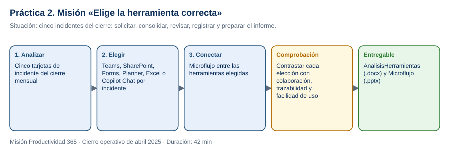

# Misión «Elige la herramienta correcta»

## Metadatos

| Campo | Detalle |
|---|---|
| **Duración** | 42 minutos |
| **Complejidad** | Media |
| **Nivel Bloom** | Crear |

## Descripción General

En esta práctica recibirás cinco incidentes operativos del cierre mensual institucional. Para cada uno, seleccionarás y justificarás la herramienta Microsoft 365 más adecuada (Teams, SharePoint, Forms, Planner, Excel o Copilot Chat básico) aplicando criterios de colaboración, trazabilidad y facilidad de uso. Como artefacto final, construirás un microflujo visual que muestre la cadena de herramientas integradas y lo almacenarás en tu directorio de trabajo existente en OneDrive for Business (`/CierreOperativo/Semana1/`).

## Objetivos de Aprendizaje

- [ ] Identificar las características diferenciadoras de cada herramienta del ecosistema Microsoft 365 (Teams, SharePoint, Forms, Planner, Excel, Copilot Chat básico) en función de escenarios operativos concretos.
- [ ] Justificar la selección de herramienta para cada uno de los cinco incidentes del cierre mensual usando criterios de colaboración, trazabilidad y facilidad de uso.
- [ ] Diseñar un microflujo que muestre cómo las herramientas seleccionadas se conectan entre sí para resolver el cierre mensual de forma integrada.
- [ ] Contrastar las elecciones propias con criterios objetivos para identificar alternativas válidas y sus compromisos (trade-offs).



## Prerrequisitos

### Conocimientos previos

| Requisito | Detalle |
|---|---|
| Práctica 1 completada | Debes tener los archivos `PlanSemanal_CierreOperativo_[Apellido].docx` y `ListaVerificacion_CierreOperativo_[Apellido].xlsx` en `/CierreOperativo/Semana1/` |
| Módulo 2 — Lecciones 2.1 y 2.2 | Haber revisado el ecosistema Microsoft 365, las capas funcionales y los criterios de selección de herramientas |
| Navegación básica en Microsoft 365 | Saber crear documentos en Word Online / PowerPoint Online y navegar OneDrive |

### Acceso requerido

| Recurso | Verificación |
|---|---|
| Cuenta institucional Microsoft 365 | Inicia sesión en https://m365.cloud.microsoft y confirma acceso al portal |
| Copilot Chat | Abre https://copilot.cloud.microsoft con tu cuenta institucional y confirma el indicador de protección de datos que muestre el tenant |
| Word Online / PowerPoint Online | Disponibles desde el lanzador de aplicaciones en office.com |
| OneDrive for Business | Carpeta `/CierreOperativo/Semana1/` visible con los artefactos de la Práctica 1 |

## Entorno de Laboratorio

### Software utilizado

| Herramienta | Versión / Acceso | Rol en esta práctica |
|---|---|---|
| Microsoft Word para la web | Servicio web vigente — https://m365.cloud.microsoft | Crear tabla de justificación y documento de análisis |
| Microsoft PowerPoint para la web | Servicio web vigente — https://m365.cloud.microsoft | Crear diagrama de microflujo (alternativa: Word para la web) |
| Microsoft Copilot Chat | Servicio en la nube — https://copilot.cloud.microsoft | Apoyo transversal para validar selecciones |
| OneDrive for Business | Evergreen (servicio en la nube) — https://m365.cloud.microsoft | Almacenamiento en `/CierreOperativo/Semana1/` |
| Navegador web | Microsoft Edge o Google Chrome estable y actualizado | Acceso a todos los servicios |

### Estructura de archivos esperada al inicio

```
OneDrive for Business/
└── CierreOperativo/
    └── Semana1/
        ├── PlanSemanal_CierreOperativo_[Apellido].docx
        ├── ListaVerificacion_CierreOperativo_[Apellido].xlsx
        └── Borrador_Tareas_CierreOperativo.docx
```

### Tarjetas de incidentes del cierre mensual

> 📥 **Descarga:** las cinco tarjetas, con una tabla para anotar la herramienta y su justificación, están en [Tarjetas_Incidentes_CierreMensual.docx](recursos/Tarjetas_Incidentes_CierreMensual.docx).

Los cinco incidentes que resolverás son los siguientes. Cópialos al documento que crearás en el Paso 2.

#### Incidente 1 — Solicitar datos faltantes

> **Situación:** Necesitas solicitar a cinco áreas diferentes (Contabilidad, Presupuesto, Recursos Humanos, Compras y Tecnología) que envíen sus cifras de ejecución del mes antes del viernes. Cada área debe completar campos específicos (monto ejecutado, monto comprometido, observaciones). Necesitas que las respuestas lleguen en un formato estandarizado para evitar reprocesos.

#### Incidente 2 — Consolidar información recibida

> **Situación:** Ya recibiste las cifras de las cinco áreas. Ahora debes integrarlas en una sola tabla resumen que incluya totales, variaciones porcentuales respecto al mes anterior y un semáforo de cumplimiento (verde ≥ 90%, amarillo 70–89%, rojo < 70%). Esta tabla será el insumo principal del informe de cierre.

#### Incidente 3 — Coordinar revisión del borrador

> **Situación:** El borrador del informe de cierre está listo. Debes coordinar una reunión de revisión con tres revisores (el jefe de área, el auditor interno y el director financiero) para la próxima semana. Necesitas enviar la convocatoria, compartir el borrador para comentarios previos y registrar las decisiones tomadas en la reunión.

#### Incidente 4 — Registrar avance diario

> **Situación:** El cierre mensual tiene 12 tareas distribuidas en dos semanas. Necesitas un tablero donde cada responsable pueda marcar el avance de sus tareas, ver las fechas límite, identificar tareas atrasadas y adjuntar evidencias de cumplimiento (capturas, archivos). El jefe de área necesita ver el estado general sin preguntar a cada persona.

#### Incidente 5 — Preparar y distribuir el informe final

> **Situación:** El informe de cierre mensual fue aprobado tras la reunión de revisión. Ahora debes publicarlo como versión definitiva, asegurar que quede registrado con control de versiones, que solo las personas autorizadas puedan editarlo y que todo el equipo pueda consultarlo. Además, debe quedar disponible para auditorías futuras.

## Instrucciones Paso a Paso

### Paso 1: Verificar el entorno y los artefactos de la Práctica 1

**Objetivo:** Confirmar que la carpeta de trabajo y los archivos previos existen antes de crear nuevos artefactos.

1. Abre el navegador e ingresa a https://m365.cloud.microsoft con tu cuenta institucional.
2. Haz clic en **OneDrive** en el lanzador de aplicaciones (cuadrícula de 9 puntos).
3. Navega a **Mis archivos > CierreOperativo > Semana1**.
4. Confirma que existen al menos estos archivos:
   - `PlanSemanal_CierreOperativo_[Apellido].docx`
   - `ListaVerificacion_CierreOperativo_[Apellido].xlsx`

**Resultado esperado:** La carpeta `/CierreOperativo/Semana1/` contiene los artefactos de la Práctica 1.

**Verificación:** Si falta algún archivo, consulta con el instructor antes de continuar. No crees archivos ficticios; la Práctica 2 referencia el contexto del cierre mensual establecido en la Práctica 1.

---

### Paso 2: Crear el documento de análisis de incidentes

**Objetivo:** Establecer el documento maestro donde registrarás todas las selecciones, justificaciones y el microflujo.

1. Desde OneDrive, estando dentro de `/CierreOperativo/Semana1/`, haz clic en **+ Nuevo** → **Documento de Word**.
2. Word Online abrirá un documento en blanco. Escribe el título en la primera línea:

```
Análisis de Herramientas — Cierre Operativo Mensual
```

3. Debajo del título, agrega tu nombre y la fecha:

```
Participante: [Tu Nombre y Apellido]
Fecha: [Fecha de hoy]
Práctica: 2 — Misión «Elige la herramienta correcta»
```

4. Guarda el documento con el nombre exacto usando **Archivo > Guardar como > Cambiar nombre**:

```
AnalisisHerramientas_CierreOperativo_[Apellido].docx
```

5. Confirma que la ubicación de guardado sea `/CierreOperativo/Semana1/`.

**Resultado esperado:** El archivo `AnalisisHerramientas_CierreOperativo_[Apellido].docx` aparece en la carpeta `Semana1` con el encabezado escrito.

**Verificación:** Regresa a OneDrive y confirma que el archivo aparece en la lista con la fecha y hora actuales.

---

### Paso 3: Transcribir los cinco incidentes al documento

**Objetivo:** Tener los incidentes dentro del documento de trabajo para consultarlos durante el análisis.

1. En el documento `AnalisisHerramientas_CierreOperativo_[Apellido].docx`, agrega un encabezado de sección:

```
SECCIÓN 1: TARJETAS DE INCIDENTES
```

2. Copia los cinco incidentes de la sección **Entorno de Laboratorio** de esta guía (Incidentes 1 al 5) y pégalos en el documento.
3. Numera cada incidente claramente:

```
Incidente 1 — Solicitar datos faltantes
[texto del incidente]

Incidente 2 — Consolidar información recibida
[texto del incidente]

Incidente 3 — Coordinar revisión del borrador
[texto del incidente]

Incidente 4 — Registrar avance diario
[texto del incidente]

Incidente 5 — Preparar y distribuir el informe final
[texto del incidente]
```

4. Guarda el documento (`Ctrl + S`).

**Resultado esperado:** El documento contiene los cinco incidentes completos, claramente separados y numerados.

**Verificación:** Lee cada incidente y confirma que no se cortó texto durante el pegado.

---

### Paso 4: Construir la tabla de criterios de selección

**Objetivo:** Crear la estructura donde evaluarás cada incidente contra los tres criterios clave del Módulo 2.

1. Debajo de los incidentes, agrega un nuevo encabezado:

```
SECCIÓN 2: TABLA DE SELECCIÓN Y JUSTIFICACIÓN
```

2. Inserta una tabla con el menú **Insertar > Tabla** de 7 columnas × 6 filas (encabezado + 5 incidentes).
3. Completa los encabezados de la tabla exactamente así:

```
| Incidente | Herramienta seleccionada | Colaboración (¿involucra a otros?) | Trazabilidad (¿deja registro auditable?) | Facilidad de uso (¿requiere configuración compleja?) | Justificación (2–3 oraciones) | Conexión con otro incidente |
```

4. Deja las filas de datos vacías por ahora; las completarás en los pasos siguientes.
5. Guarda el documento (`Ctrl + S`).

**Resultado esperado:** La tabla tiene 7 columnas con los encabezados correctos y 5 filas vacías listas para completar.

**Verificación:** Cuenta las columnas (deben ser exactamente 7) y las filas de datos (deben ser exactamente 5).

---

### Paso 5: Analizar y resolver el Incidente 1 — Solicitar datos faltantes

**Objetivo:** Seleccionar la herramienta más adecuada para recopilar datos estandarizados de múltiples áreas.

1. Relee el Incidente 1 en tu documento.
2. Analiza los requisitos clave:
   - Recopilar datos de **cinco áreas diferentes**.
   - Las respuestas deben llegar en **formato estandarizado**.
   - Se necesita **evitar reprocesos**.
3. Evalúa las opciones disponibles considerando las capas del ecosistema (lección 2.1):
   - **Forms**: formulario estandarizado, respuestas automáticas en tabla, no requiere configuración compleja.
   - **Teams**: permite solicitar por chat, pero las respuestas llegarían en formato libre.
   - **Excel**: podría compartirse, pero cada área editaría celdas sin control de flujo.
4. Completa la fila del Incidente 1 en tu tabla. Ejemplo de referencia:

```
| Incidente 1 | Forms | Sí — 5 áreas responden | Sí — respuestas en hoja de cálculo automática | Baja — crear formulario toma minutos | Forms estandariza los campos, evita formatos libres y registra cada respuesta con marca de tiempo. Las respuestas se exportan a Excel automáticamente. | Conexión → Incidente 2 (la tabla de respuestas alimenta la consolidación) |
```

5. Guarda el documento (`Ctrl + S`).

**Resultado esperado:** La fila del Incidente 1 está completa con herramienta, evaluación de los tres criterios, justificación y conexión.

**Verificación:** Confirma que la justificación menciona al menos uno de los tres criterios (colaboración, trazabilidad o facilidad de uso) de forma explícita.

---

### Paso 6: Analizar y resolver el Incidente 2 — Consolidar información recibida

**Objetivo:** Seleccionar la herramienta óptima para integrar datos numéricos, calcular variaciones y aplicar formato condicional.

1. Relee el Incidente 2 en tu documento.
2. Identifica los requisitos clave:
   - Integrar datos de cinco áreas en **una sola tabla resumen**.
   - Calcular **totales y variaciones porcentuales**.
   - Aplicar un **semáforo de cumplimiento** (formato condicional).
3. Evalúa las opciones:
   - **Excel Online**: fórmulas, tablas dinámicas, formato condicional nativo.
   - **SharePoint Lists**: podría almacenar datos, pero carece de cálculos complejos nativos.
   - **Forms**: solo recopila, no consolida.
4. Completa la fila del Incidente 2 en tu tabla:

```
| Incidente 2 | Excel Online | Sí — coautoría para validar cifras | Sí — historial de versiones en OneDrive/SharePoint | Baja — interfaz familiar de hoja de cálculo | Excel permite fórmulas para totales y variaciones, formato condicional para semáforos y coautoría en tiempo real. Recibe directamente la exportación de Forms. | Conexión ← Incidente 1 (recibe datos) → Incidente 3 (alimenta el borrador) |
```

5. Guarda el documento (`Ctrl + S`).

**Resultado esperado:** La fila del Incidente 2 está completa y muestra la conexión bidireccional con los incidentes 1 y 3.

**Verificación:** La justificación debe mencionar al menos una capacidad técnica específica de Excel (fórmulas, formato condicional o coautoría).

---

### Paso 7: Analizar y resolver el Incidente 3 — Coordinar revisión del borrador

**Objetivo:** Seleccionar la herramienta que mejor resuelve la coordinación de una reunión, el compartir documentos y el registro de decisiones.

1. Relee el Incidente 3 en tu documento.
2. Identifica los requisitos clave:
   - **Convocar** una reunión con tres personas.
   - **Compartir** el borrador para comentarios previos.
   - **Registrar** las decisiones tomadas.
3. Evalúa las opciones:
   - **Teams**: convocatoria de reunión, chat de canal para comentarios, notas de reunión, grabación.
   - **Outlook**: convocatoria por correo, pero sin espacio colaborativo persistente.
   - **SharePoint**: almacena el borrador, pero no convoca reuniones.
4. Completa la fila del Incidente 3:

```
| Incidente 3 | Teams | Sí — 3 revisores + coordinador | Sí — chat, grabación y notas de reunión quedan registrados | Baja — agendar reunión y compartir archivo desde Teams es nativo | Teams permite convocar la reunión, compartir el borrador en el canal para comentarios asincrónicos previos y registrar decisiones en las notas de reunión. | Conexión ← Incidente 2 (borrador basado en consolidación) → Incidente 5 (informe aprobado) |
```

5. Guarda el documento (`Ctrl + S`).

**Resultado esperado:** La fila del Incidente 3 está completa y refleja que Teams actúa como punto de convergencia (concepto clave de la lección 2.1).

**Verificación:** Confirma que mencionas al menos dos funcionalidades de Teams (reunión + compartir archivo, o reunión + notas).

---

### Paso 8: Analizar y resolver el Incidente 4 — Registrar avance diario

**Objetivo:** Seleccionar la herramienta adecuada para gestionar tareas con responsables, fechas, estados y evidencias.

1. Relee el Incidente 4 en tu documento.
2. Identifica los requisitos clave:
   - **Tablero visual** de tareas con responsables y fechas.
   - Cada responsable **marca avance** y **adjunta evidencias**.
   - El jefe de área ve el **estado general** sin preguntar individualmente.
3. Evalúa las opciones:
   - **Planner**: tablero Kanban, asignación de responsables, fechas, adjuntos, vista de gráficos de progreso.
   - **Excel**: podría listar tareas, pero no tiene tablero visual ni notificaciones.
   - **Teams**: muestra conversaciones, pero no estructura tareas con estados.
4. Completa la fila del Incidente 4:

```
| Incidente 4 | Planner | Sí — múltiples responsables actualizan sus tareas | Sí — cada cambio queda en el historial de la tarea, adjuntos como evidencia | Baja — tablero visual intuitivo, integrable en Teams | Planner ofrece tablero Kanban con cubos por estado, asignación de responsables, fechas límite, adjuntos de evidencia y gráficos de progreso. Se integra como pestaña en Teams. | Conexión ← Incidente 1–3 (tareas del cierre) → Incidente 5 (confirma completitud antes de publicar) |
```

5. Guarda el documento (`Ctrl + S`).

**Resultado esperado:** La fila del Incidente 4 está completa y destaca la capacidad de seguimiento visual y evidencias de Planner.

**Verificación:** La justificación debe mencionar al menos una característica diferenciadora de Planner frente a una lista simple (tablero, gráficos o adjuntos).

---

### Paso 9: Analizar y resolver el Incidente 5 — Preparar y distribuir el informe final

**Objetivo:** Seleccionar la herramienta que garantiza publicación controlada, versionado y acceso para auditorías.

1. Relee el Incidente 5 en tu documento.
2. Identifica los requisitos clave:
   - Publicar como **versión definitiva**.
   - **Control de versiones** y permisos de edición restringidos.
   - Disponible para **consulta del equipo** y **auditorías futuras**.
3. Evalúa las opciones:
   - **SharePoint**: biblioteca de documentos con versionado, permisos granulares, metadatos y auditoría.
   - **OneDrive**: almacena y versiona, pero es personal, no de equipo.
   - **Teams**: los archivos de canal se almacenan en SharePoint, pero la gestión de permisos y metadatos es más directa desde SharePoint.
4. Completa la fila del Incidente 5:

```
| Incidente 5 | SharePoint | Sí — equipo consulta, solo autorizados editan | Sí — versionado automático, metadatos, registro de auditoría | Media — requiere configurar permisos y metadatos en la biblioteca | SharePoint ofrece control de versiones, permisos por documento/biblioteca, metadatos para clasificación (TipoDocumento, Estado, Periodo) y trazabilidad completa para auditorías. | Conexión ← Incidente 3 (aprobación) ← Incidente 4 (completitud confirmada) |
```

5. Guarda el documento (`Ctrl + S`).

**Resultado esperado:** La fila del Incidente 5 está completa. La tabla de 5 incidentes muestra una cadena lógica de herramientas.

**Verificación:** Revisa que la columna «Conexión con otro incidente» de cada fila forme una secuencia coherente de principio a fin.

---

### Paso 10: Consultar a Copilot Chat básico para validar las selecciones

**Objetivo:** Usar Copilot Chat básico como herramienta transversal de apoyo para contrastar tus decisiones con criterios adicionales.

1. Abre una nueva pestaña del navegador e ingresa a https://copilot.cloud.microsoft con tu cuenta institucional.
2. Confirma que aparece el indicador de **protección de datos empresariales** (icono de escudo verde junto al campo de texto).
3. Escribe el siguiente prompt en el campo de chat:

```
Soy un profesional administrativo que gestiona el cierre operativo mensual de una institución. Tengo cinco incidentes y he seleccionado una herramienta Microsoft 365 para cada uno. Necesito que evalúes si mis selecciones son adecuadas y me indiques si hay alternativas válidas con sus ventajas y desventajas.

Mis selecciones:
1. Solicitar datos faltantes a 5 áreas → Microsoft Forms
2. Consolidar datos en tabla resumen con cálculos → Excel Online
3. Coordinar reunión de revisión con 3 revisores → Microsoft Teams
4. Registrar avance diario de 12 tareas con evidencias → Microsoft Planner
5. Publicar informe final con control de versiones y permisos → SharePoint

Criterios de evaluación: colaboración (¿involucra a otros?), trazabilidad (¿deja registro auditable?) y facilidad de uso (¿requiere configuración compleja?).

Por favor, evalúa cada selección indicando: (a) si es adecuada, (b) una alternativa viable con su principal ventaja y desventaja, y (c) un riesgo que debo considerar.
```

4. Envía el prompt y espera la respuesta completa.
5. Lee la respuesta de Copilot. **No copies la respuesta textualmente**; en su lugar, identifica:
   - ¿Copilot confirma tus selecciones o sugiere cambios?
   - ¿Qué alternativas menciona y qué trade-offs señala?
   - ¿Menciona algún riesgo que no habías considerado?

**Resultado esperado:** Copilot Chat devuelve una evaluación estructurada de las cinco selecciones con alternativas y riesgos.

**Verificación:** La respuesta debe contener al menos una alternativa por incidente. Si Copilot da respuestas genéricas sin mencionar las herramientas específicas, reformula el prompt agregando más contexto del escenario.

> **⚠️ Limitación de IA:** No presupongas que Copilot Chat tiene acceso automático a archivos o datos organizacionales. Sus respuestas dependen del contexto proporcionado, la configuración del tenant y las capacidades disponibles; valida cualquier sugerencia contra fuentes y requisitos reales.

---

### Paso 11: Registrar las observaciones de Copilot en el documento

**Objetivo:** Documentar el contraste entre tu análisis y las sugerencias de Copilot para enriquecer la justificación.

1. Regresa al documento `AnalisisHerramientas_CierreOperativo_[Apellido].docx`.
2. Debajo de la tabla de selección, agrega un nuevo encabezado:

```
SECCIÓN 3: CONTRASTE CON COPILOT CHAT BÁSICO
```

3. Para cada incidente, escribe un párrafo breve (2–3 oraciones) con este formato:

```
Incidente [N]:
- Mi selección: [herramienta]
- Observación de Copilot: [resumen en tus propias palabras]
- Mi decisión final: [Mantengo / Cambio a...] porque [razón basada en los criterios]
```

4. Si Copilot sugirió una alternativa que consideras válida, puedes cambiar tu selección en la tabla del Paso 4, pero debes actualizar también la justificación.
5. Guarda el documento (`Ctrl + S`).

**Resultado esperado:** La Sección 3 contiene cinco párrafos de contraste, uno por incidente, con decisión final justificada.

**Verificación:** Cada párrafo debe indicar explícitamente si mantienes o cambias la herramienta y por qué.

---

### Paso 12: Diseñar el microflujo visual — Crear la diapositiva

**Objetivo:** Iniciar la construcción del diagrama de microflujo que muestra la cadena integrada de herramientas.

1. Regresa a OneDrive (`/CierreOperativo/Semana1/`).
2. Haz clic en **+ Nuevo** → **Presentación de PowerPoint**.
3. PowerPoint Online abrirá una presentación en blanco. Renómbrala:

```
Microflujo_CierreOperativo_[Apellido].pptx
```

4. En la primera diapositiva, cambia el diseño a **En blanco** (clic derecho sobre la diapositiva → **Diseño** → **En blanco**).
5. Agrega un cuadro de texto en la parte superior con el título:

```
Microflujo de Herramientas — Cierre Operativo Mensual
```

6. Guarda la presentación (`Ctrl + S`).

**Resultado esperado:** La presentación `Microflujo_CierreOperativo_[Apellido].pptx` existe en `/CierreOperativo/Semana1/` con una diapositiva en blanco titulada.

**Verificación:** Confirma el nombre del archivo en la barra de título de PowerPoint Online.

---

### Paso 13: Construir el diagrama de microflujo

**Objetivo:** Representar visualmente la cadena de herramientas como un flujo de cajas y flechas que conecta los cinco incidentes.

1. En la diapositiva en blanco, usa **Insertar > Formas** para agregar cinco rectángulos (uno por incidente), dispuestos de izquierda a derecha o de arriba a abajo.
2. Dentro de cada rectángulo, escribe el nombre del incidente y la herramienta seleccionada:

```
Rectángulo 1: "Inc. 1: Solicitar datos → FORMS"
Rectángulo 2: "Inc. 2: Consolidar → EXCEL"
Rectángulo 3: "Inc. 3: Coordinar revisión → TEAMS"
Rectángulo 4: "Inc. 4: Registrar avances → PLANNER"
Rectángulo 5: "Inc. 5: Publicar informe → SHAREPOINT"
```

3. Usa **Insertar > Formas > Flechas** para conectar los rectángulos en secuencia: 1 → 2 → 3, y 4 conectado en paralelo alimentando a 5, con 3 también conectado a 5.
4. Agrega un rectángulo adicional con borde punteado que envuelva todo el diagrama o se conecte con líneas punteadas a cada caja:

```
"COPILOT CHAT BÁSICO (apoyo transversal)"
```

5. Sobre cada flecha, agrega un cuadro de texto pequeño que describa qué fluye entre herramientas:

```
Flecha 1→2: "Respuestas exportadas a Excel"
Flecha 2→3: "Tabla resumen como insumo del borrador"
Flecha 3→5: "Informe aprobado"
Flecha 4→5: "Confirmación de completitud de tareas"
```

6. Guarda la presentación (`Ctrl + S`).

**Resultado esperado:** La diapositiva muestra un diagrama con 5 cajas de herramientas, flechas de conexión con etiquetas descriptivas y Copilot Chat como elemento transversal.

**Verificación:** Confirma que cada flecha tiene una etiqueta que explica qué dato o artefacto fluye entre las herramientas. El flujo debe ser legible de principio (Forms) a fin (SharePoint).

---

### Paso 14: Agregar la tabla resumen de criterios al microflujo

**Objetivo:** Complementar el diagrama visual con una tabla resumen compacta que facilite la comprobación individual.

1. Agrega una segunda diapositiva a la presentación (clic derecho → **Nueva diapositiva** → diseño **En blanco**).
2. Inserta una tabla de 6 columnas × 6 filas (**Insertar > Tabla**).
3. Completa la tabla con el resumen de tus selecciones:

```
| Incidente | Herramienta | Colaboración | Trazabilidad | Facilidad | Decisión final |
|-----------|-------------|--------------|--------------|-----------|----------------|
| 1. Solicitar datos | Forms | Alta | Alta | Alta | Mantengo |
| 2. Consolidar | Excel | Media | Alta | Alta | Mantengo |
| 3. Coordinar revisión | Teams | Alta | Alta | Alta | Mantengo |
| 4. Registrar avances | Planner | Alta | Alta | Alta | Mantengo |
| 5. Publicar informe | SharePoint | Media | Alta | Media | Mantengo |
```

> **Nota:** Ajusta los valores según tu análisis real. Los valores de ejemplo son orientativos.

4. Guarda la presentación (`Ctrl + S`).

**Resultado esperado:** La segunda diapositiva contiene la tabla resumen con las selecciones finales y la evaluación por criterio.

**Verificación:** Confirma que la columna «Decisión final» refleja lo que documentaste en la Sección 3 del documento Word.

---

### Paso 15: Verificar la coherencia del artefacto completo

**Objetivo:** Asegurar que el documento de análisis y el microflujo son consistentes entre sí y están completos.

1. Abre simultáneamente (en pestañas separadas):
   - `AnalisisHerramientas_CierreOperativo_[Apellido].docx`
   - `Microflujo_CierreOperativo_[Apellido].pptx`
2. Compara la herramienta seleccionada en la tabla del documento Word (Sección 2) con la que aparece en cada caja del diagrama de PowerPoint. Deben coincidir.
3. Compara la columna «Conexión con otro incidente» del documento Word con las flechas del diagrama. Cada conexión documentada debe tener su flecha correspondiente.
4. Si encuentras inconsistencias, corrígelas ahora en ambos archivos.
5. Guarda ambos archivos (`Ctrl + S` en cada pestaña).

**Resultado esperado:** Las herramientas y conexiones son idénticas en ambos artefactos.

**Verificación:** Usa esta lista de comprobación rápida:

```
[ ] Las 5 herramientas del documento Word coinciden con las 5 cajas del diagrama
[ ] Cada conexión de la columna 7 del Word tiene una flecha en el diagrama
[ ] Cada flecha del diagrama tiene una etiqueta descriptiva
[ ] Copilot Chat aparece como elemento transversal en el diagrama
[ ] La Sección 3 del Word tiene 5 párrafos de contraste
```

---

### Paso 16: Verificar la estructura final de archivos en OneDrive

**Objetivo:** Confirmar que todos los artefactos de las Prácticas 1 y 2 están almacenados correctamente.

1. Navega a **OneDrive > Mis archivos > CierreOperativo > Semana1**.
2. Confirma que la carpeta contiene al menos estos archivos:

```
OneDrive for Business/
└── CierreOperativo/
    └── Semana1/
        ├── PlanSemanal_CierreOperativo_[Apellido].docx        ← Práctica 1
        ├── ListaVerificacion_CierreOperativo_[Apellido].xlsx   ← Práctica 1
        ├── Borrador_Tareas_CierreOperativo.docx                ← Práctica 1
        ├── AnalisisHerramientas_CierreOperativo_[Apellido].docx ← Práctica 2
        └── Microflujo_CierreOperativo_[Apellido].pptx          ← Práctica 2
```

3. Verifica que ningún archivo tenga un nombre incorrecto (sin espacios adicionales, con tu apellido real, sin caracteres especiales).

**Resultado esperado:** Los 5 archivos (3 de Práctica 1 + 2 de Práctica 2) están en la carpeta correcta con nombres estandarizados.

**Verificación:** Si algún archivo tiene nombre incorrecto, renómbralo ahora haciendo clic derecho → **Cambiar nombre**.

## Validación y Pruebas

Realiza las siguientes verificaciones para confirmar que tu trabajo cumple los criterios de la práctica:

### Prueba 1: Completitud de la tabla de selección

Abre `AnalisisHerramientas_CierreOperativo_[Apellido].docx` y verifica:

```
✓ La tabla tiene exactamente 5 filas de datos (una por incidente)
✓ Cada fila tiene las 7 columnas completas (ninguna celda vacía)
✓ La columna "Herramienta seleccionada" solo contiene: Teams, SharePoint, Forms, Planner, Excel o Copilot Chat básico
✓ La columna "Justificación" tiene al menos 2 oraciones por incidente
✓ La columna "Conexión" referencia al menos un incidente anterior o posterior
```

### Prueba 2: Coherencia del microflujo

Abre `Microflujo_CierreOperativo_[Apellido].pptx` y verifica:

```
✓ Diapositiva 1: contiene 5 rectángulos con nombre de incidente + herramienta
✓ Diapositiva 1: contiene al menos 4 flechas de conexión con etiquetas
✓ Diapositiva 1: Copilot Chat aparece como elemento transversal
✓ Diapositiva 2: tabla resumen con 5 filas y evaluación de 3 criterios
✓ Las herramientas del diagrama coinciden con las del documento Word
```

### Prueba 3: Calidad de la justificación (criterios del Módulo 2)

Para cada incidente, verifica que la justificación responde a estas tres preguntas:

```
✓ Colaboración: ¿La justificación explica cómo la herramienta facilita el trabajo con otros?
✓ Trazabilidad: ¿La justificación menciona qué tipo de registro auditable genera la herramienta?
✓ Facilidad de uso: ¿La justificación indica si la herramienta requiere configuración compleja o es de uso inmediato?
```

### Prueba 4: Contraste con Copilot — Caso adversarial

Regresa a https://copilot.cloud.microsoft y envía el siguiente prompt para probar una situación contradictoria:

```
Necesito publicar el informe final del cierre mensual con control de versiones, permisos de solo lectura para la mayoría del equipo y disponibilidad para auditorías. Un compañero sugiere usar Microsoft Forms para esto. ¿Es adecuado? Explica por qué sí o por qué no.
```

**Resultado esperado:** Copilot debe indicar que Forms **no es adecuado** para publicar documentos con control de versiones y permisos, y debe sugerir SharePoint u otra herramienta de gestión documental.

**Verificación:** Si Copilot valida el uso de Forms para este escenario, es una respuesta incorrecta. Documenta esta limitación en tu Sección 3 como ejemplo de que las sugerencias de IA siempre requieren validación humana.

```
Nota en Sección 3 (agregar al final):
"Prueba adversarial: al plantear un escenario contradictorio (usar Forms para publicar un informe con control de versiones), Copilot [respondió correctamente / no detectó el error]. Esto confirma que las respuestas de IA deben validarse contra los criterios técnicos de cada herramienta."
```

### Prueba 5: Verificación cruzada de alternativas

Revisa tu tabla y confirma que al menos un incidente podría resolverse razonablemente con una herramienta diferente a la que elegiste. Documéntalo:

```
Ejemplo: El Incidente 3 (coordinar revisión) podría resolverse parcialmente con Outlook (convocatoria de reunión + adjunto del borrador), pero se pierde el espacio colaborativo persistente de Teams para comentarios asincrónicos y notas de reunión. Trade-off: Outlook es más simple pero menos trazable.
```

## Solución de Problemas

### Problema 1: Copilot Chat no muestra el icono de protección de datos empresariales

**Síntoma:** Al abrir https://copilot.cloud.microsoft con la cuenta institucional, no aparece el indicador de protección de datos empresariales.

**Causa:** El administrador del tenant no ha habilitado Copilot Chat con protección de datos empresariales para tu cuenta, o has iniciado sesión con una cuenta personal en lugar de la institucional.

**Solución:**
1. Cierra sesión en Copilot haciendo clic en tu avatar → **Cerrar sesión**.
2. Cierra todas las pestañas del navegador y abre una nueva ventana en modo **InPrivate** (Edge) o **Incógnito** (Chrome).
3. Ingresa a https://copilot.cloud.microsoft e inicia sesión explícitamente con tu correo institucional.
4. Si el icono de protección de datos empresariales sigue sin aparecer, notifica al instructor. El instructor debe escalar con el área de TI para habilitar el servicio. Mientras tanto, completa los Pasos 5–9 sin Copilot y marca el Paso 10 como «pendiente por configuración del tenant».

### Problema 2: PowerPoint Online no permite insertar formas ni tablas

**Síntoma:** Al intentar usar **Insertar > Formas** en PowerPoint Online, el menú aparece grisáceo o no responde. Alternativamente, la opción de insertar tabla no está disponible.

**Causa:** Algunas configuraciones de tenant restringen funcionalidades de edición en aplicaciones web, o el navegador tiene extensiones que bloquean elementos interactivos de Office Online.

**Solución:**
1. Desactiva temporalmente las extensiones del navegador (especialmente bloqueadores de anuncios): ve a **Configuración > Extensiones** y desactiva todas.
2. Recarga la página (`Ctrl + Shift + R` para forzar recarga sin caché).
3. Si el problema persiste, usa **Word Online** como alternativa para el microflujo:
   - Crea el diagrama como una tabla en Word con flechas representadas por texto (`→`, `↓`).
   - Nombra el archivo `Microflujo_CierreOperativo_[Apellido].docx` (en lugar de `.pptx`).
4. Si necesitas un diagrama visual más elaborado, abre PowerPoint de escritorio (versión 2503, build 18623.20156 o superior) desde el menú **Abrir en aplicación de escritorio** en la barra superior de PowerPoint Online.

## Limpieza

Esta práctica no requiere eliminar recursos. Todos los artefactos creados se reutilizarán en las Prácticas 3, 4 y 5:

- `AnalisisHerramientas_CierreOperativo_[Apellido].docx` → Será el mapa de referencia de herramientas para las prácticas de configuración.
- `Microflujo_CierreOperativo_[Apellido].pptx` → Será referenciado como el diseño del flujo de trabajo del cierre mensual.

**No elimines** ningún archivo de `/CierreOperativo/Semana1/`. Si creaste archivos temporales o borradores durante la práctica, puedes eliminarlos siempre que no tengan el prefijo `AnalisisHerramientas_` o `Microflujo_`.

## Resumen

En esta práctica aplicaste los conceptos del Módulo 2 (ecosistema Microsoft 365 y criterios de selección) para resolver cinco incidentes reales del cierre operativo mensual. Los logros clave fueron:

- **Selección fundamentada:** Elegiste una herramienta Microsoft 365 para cada incidente basándote en tres criterios medibles: colaboración, trazabilidad y facilidad de uso.
- **Pensamiento integrado:** Construiste un microflujo que demuestra cómo las herramientas no operan de forma aislada, sino como una cadena donde la salida de una alimenta la entrada de otra (Forms → Excel → Teams → Planner → SharePoint).
- **Validación con IA:** Usaste Copilot Chat básico como herramienta de contraste, identificando tanto sus aportes como sus limitaciones (prueba adversarial).
- **Documentación trazable:** Generaste dos artefactos formales que servirán como mapa de referencia para las prácticas posteriores.

### Conexión con las siguientes prácticas

| Práctica siguiente | Cómo se conecta |
|---|---|
| Práctica 3 — Teams | Configurarás el espacio de trabajo que seleccionaste en el Incidente 3 |
| Práctica 4 — SharePoint | Organizarás la biblioteca documental que seleccionaste en el Incidente 5 |
| Práctica 5 — Forms + Excel | Crearás el formulario del Incidente 1 y la consolidación del Incidente 2 |
| Práctica 6 — Planner | Configurarás el tablero de seguimiento del Incidente 4 |

### Recursos adicionales

- [Elegir la herramienta de colaboración adecuada en Microsoft 365](https://learn.microsoft.com/es-es/microsoft-365/enterprise/microsoft-365-overview)
- [Introducción a Microsoft Teams como centro de trabajo en equipo](https://learn.microsoft.com/es-es/microsoftteams/teams-overview)
- [Descripción general de SharePoint en Microsoft 365](https://learn.microsoft.com/es-es/sharepoint/introduction)
- [Introducción a Microsoft Planner](https://learn.microsoft.com/es-es/office365/planner/planner-for-admins)
- [Microsoft Copilot Chat — Protección de datos comerciales](https://learn.microsoft.com/es-es/copilot/manage)
