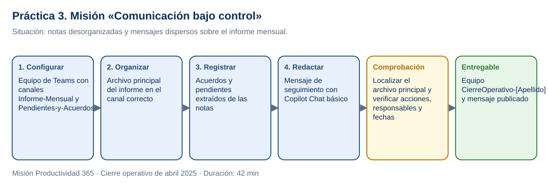

# Misión «Comunicación bajo control»

## Metadatos

| Campo | Valor |
|---|---|
| **Duración** | 42 minutos |
| **Complejidad** | Media |
| **Nivel Bloom** | Aplicar |

## Descripción General

Recibir notas desorganizadas y mensajes dispersos sobre el informe mensual; configurar individualmente un espacio de Teams de práctica, organizar canales y archivos, registrar acuerdos y pendientes y redactar con Copilot Chat básico un mensaje de seguimiento a partir de notas proporcionadas. Comprobación individual: localizar el archivo principal y verificar que el mensaje incluya acciones, responsables y fechas.

Esta práctica implementa en Microsoft Teams el espacio de trabajo cuyo diseño fue justificado en la Práctica 2 (donde Teams fue seleccionado como herramienta de coordinación para el Incidente 3). Los artefactos generados aquí serán la base de la Práctica 4 (organización documental en SharePoint).

## Objetivos de Aprendizaje

- [ ] Configurar un equipo de práctica en Microsoft Teams con canales temáticos alineados al cierre operativo mensual, aplicando criterios de organización discutidos en el módulo.
- [ ] Organizar archivos del cierre mensual en los canales de Teams correctos, vinculando los artefactos generados en las Prácticas 1 y 2.
- [ ] Usar Copilot Chat básico para redactar un mensaje de seguimiento estructurado (con acciones, responsables y fechas) a partir de notas desorganizadas proporcionadas por el instructor.
- [ ] Verificar que el mensaje de seguimiento generado cumpla los criterios de claridad: acción específica, responsable nombrado y fecha comprometida.



## Prerrequisitos

### Conocimientos previos

- Haber completado las Prácticas 1 y 2 del curso.
- Haber revisado los contenidos del Módulo 3: Lección 3.1 (Equipos, canales y criterios de organización) y Lección 3.2 (Reuniones, archivos, tareas, comunicación y colaboración).
- Comprender la diferencia entre equipo, canal estándar y canal privado en Microsoft Teams.

### Acceso y artefactos requeridos

- Cuenta institucional Microsoft 365 activa con acceso a Microsoft Teams.
- Acceso a Copilot Chat con cuenta institucional en [copilot.cloud.microsoft](https://copilot.cloud.microsoft). La disponibilidad de protección de datos y capacidades depende de la licencia y configuración del tenant.
- Permisos para crear equipos en Teams **o** equipo de práctica preconfigurado por el instructor.
- Los siguientes archivos disponibles en OneDrive for Business (`/CierreOperativo/Semana1/`):
  - `PlanSemanal_CierreOperativo_[Apellido].docx`
  - `ListaVerificacion_CierreOperativo_[Apellido].xlsx`
  - `AnalisisHerramientas_CierreOperativo_[Apellido].docx`

## Entorno de Laboratorio

### Software requerido

| Herramienta | Versión | Acceso |
|---|---|---|
| Microsoft Teams | Versión vigente de escritorio o web | `https://teams.microsoft.com` |
| Copilot Chat | Servicio en la nube | `https://copilot.cloud.microsoft` |
| OneDrive for Business | Evergreen (servicio en la nube) | `https://m365.cloud.microsoft` o integrado en Teams |
| Microsoft Edge o Google Chrome | Versión estable y actualizada | Navegador recomendado |

### Material proporcionado por el instructor

> 📥 **Descarga:** [Informe_Mensual_CierreOperativo_Plantilla.docx](recursos/Informe_Mensual_CierreOperativo_Plantilla.docx) (Recurso A) y [Notas_Reunion_Desorganizadas.docx](recursos/Notas_Reunion_Desorganizadas.docx) (Recurso B).

Antes de iniciar, el instructor entregará dos recursos que se usarán a lo largo de la práctica:

**Recurso A — Plantilla del informe mensual:**

Un archivo Word denominado `Informe_Mensual_CierreOperativo_Plantilla.docx` compartido mediante el chat de la sesión, correo electrónico o carpeta compartida indicada. Este archivo contiene la estructura base del informe con secciones vacías.

**Recurso B — Notas desorganizadas de reunión (texto plano):**

El instructor proporcionará el siguiente bloque de texto (o uno equivalente). Si no lo ha entregado, utiliza el texto de referencia del **Paso 8** de esta guía.

### Preparación inicial

Antes del Paso 1, confirma que puedes acceder a Teams y a tu carpeta de OneDrive:

1. Abre Microsoft Teams (escritorio o `https://teams.microsoft.com`).
2. Verifica que tu sesión corresponde a tu cuenta institucional (tu nombre aparece en la esquina superior derecha).
3. En otra pestaña del navegador, abre [Copilot Chat](https://copilot.cloud.microsoft) e inicia sesión con la misma cuenta institucional. Confirma que el tenant muestra la protección de datos empresariales.

## Instrucciones Paso a Paso

### Paso 1: Crear el equipo de práctica en Microsoft Teams

**Objetivo:** Crear el contenedor principal de colaboración para el cierre operativo mensual, aplicando el criterio de equipo privado con propósito definido.

**Instrucciones:**

1. En Microsoft Teams, haz clic en **Equipos** en la barra lateral izquierda.
2. Haz clic en **Unirse a un equipo o crear uno** (parte superior) y selecciona **Crear equipo**.
3. Selecciona **Desde cero** (o **From scratch**).
4. Selecciona el tipo **Privado**.
5. En el campo **Nombre del equipo**, escribe:

```
CierreOperativo-[Apellido]
```

Reemplaza `[Apellido]` con tu apellido real. Ejemplo: `CierreOperativo-Garcia`.

6. En el campo **Descripción**, escribe:

```
Espacio de trabajo para el cierre operativo mensual. Práctica 3 del curso Microsoft 365.
```

7. Haz clic en **Crear**.
8. En la pantalla de agregar miembros, haz clic en **Omitir** (en esta práctica trabajas individualmente).

> **Nota:** Si la directiva del tenant no permite crear equipos, el instructor te asignará un equipo preconfigurado con el formato `CierreOperativo-Practica-[GrupoN]`. En ese caso, omite este paso y continúa desde el Paso 2 dentro del equipo asignado.

**Resultado esperado:** El equipo `CierreOperativo-[Apellido]` aparece en tu lista de equipos con el canal `General` creado automáticamente.

**Verificación:** Haz clic en el nombre del equipo y confirma que el canal `General` es visible y que puedes escribir un mensaje de prueba.

---

### Paso 2: Crear los canales temáticos del cierre operativo

**Objetivo:** Subdividir el equipo en canales alineados al flujo de trabajo del cierre mensual, aplicando el criterio de un canal por tema funcional.

**Instrucciones:**

1. Haz clic en los **tres puntos (⋯)** junto al nombre de tu equipo `CierreOperativo-[Apellido]`.
2. Selecciona **Agregar canal**.
3. Crea el primer canal con estos datos:

```
Nombre:       Informe-Mensual
Descripción:  Canal para el borrador, revisiones y versión final del informe de cierre mensual.
Privacidad:   Estándar — Accesible para todos en el equipo
```

4. Haz clic en **Agregar**.
5. Repite el proceso para crear el segundo canal:

```
Nombre:       Pendientes-y-Acuerdos
Descripción:  Canal para registrar acuerdos de reunión, pendientes y mensajes de seguimiento.
Privacidad:   Estándar — Accesible para todos en el equipo
```

6. Haz clic en **Agregar**.

7. Repite el proceso para crear el tercer canal:

```
Nombre:       Prácticas M6-M8
Descripción:  Canal para compartir evidencias y coordinar las prácticas 6, 7 y 8.
Privacidad:   Estándar — Accesible para todos en el equipo
```

8. Haz clic en **Agregar**.

**Resultado esperado:** Tu equipo muestra cuatro canales en la barra lateral:

```
CierreOperativo-[Apellido]
├── General
├── Informe-Mensual
├── Pendientes-y-Acuerdos
└── Prácticas M6-M8
```

**Verificación:** Confirma que están los cuatro canales. En canales estándar, los archivos se consultan desde **Compartido** > **En la biblioteca**; si el tenant todavía muestra la pestaña heredada **Archivos**, también es válida.

---

### Paso 3: Publicar el propósito de cada canal en su descripción inicial

**Objetivo:** Establecer el contexto de uso de cada canal mediante una publicación inicial, facilitando que cualquier colaborador futuro entienda dónde publicar cada tipo de contenido (criterio de organización de la Lección 3.1).

**Instrucciones:**

1. Navega al canal **General** de tu equipo.
2. En el cuadro de conversación, haz clic en **Formato** (icono `A` con pincel) para abrir el editor enriquecido.
3. Escribe la siguiente publicación:

```
📋 Propósito de este equipo

Este equipo centraliza la coordinación del cierre operativo mensual.

• General → Anuncios y comunicaciones generales del equipo.
• Informe-Mensual → Borrador, revisiones y versión final del informe.
• Pendientes-y-Acuerdos → Acuerdos de reunión, seguimiento de pendientes y mensajes de coordinación.

Regla: publicar cada tema en el canal correspondiente para mantener la trazabilidad.
```

4. Haz clic en **Enviar** (icono de flecha).

**Resultado esperado:** La publicación aparece como el primer mensaje del canal General, visible para cualquier miembro del equipo.

**Verificación:** El mensaje se muestra con formato enriquecido y los nombres de los canales son legibles.

---

### Paso 4: Descargar la plantilla del informe mensual

**Objetivo:** Obtener el archivo principal del informe que será organizado en el canal correspondiente.

**Instrucciones:**

1. Localiza el archivo `Informe_Mensual_CierreOperativo_Plantilla.docx` proporcionado por el instructor (chat de la sesión, correo o carpeta compartida).
2. Descárgalo a tu carpeta local de descargas.

> **Si el instructor no ha proporcionado la plantilla**, crea un archivo Word con el siguiente contenido mínimo y guárdalo como `Informe_Mensual_CierreOperativo_Plantilla.docx`:

```
INFORME DE CIERRE OPERATIVO MENSUAL
Periodo: [Mes/Año]
Elaborado por: [Nombre del participante]
Fecha de elaboración: [Fecha]

1. RESUMEN EJECUTIVO
   [Pendiente de completar]

2. INDICADORES CLAVE
   [Pendiente de completar]

3. HALLAZGOS Y OBSERVACIONES
   [Pendiente de completar]

4. ACUERDOS Y COMPROMISOS
   [Pendiente de completar]

5. ANEXOS
   [Pendiente de completar]
```

3. Guarda el archivo también en tu carpeta de OneDrive: `/CierreOperativo/Semana1/`.

**Resultado esperado:** Tienes el archivo `Informe_Mensual_CierreOperativo_Plantilla.docx` disponible localmente y en OneDrive.

**Verificación:** Abre el archivo y confirma que contiene las secciones del informe.

---

### Paso 5: Subir archivos al canal Informe-Mensual

**Objetivo:** Organizar los artefactos del cierre operativo en el canal correcto de Teams, vinculando el trabajo de las Prácticas 1 y 2.

**Instrucciones:**

1. En tu equipo, navega al canal **Informe-Mensual**.
2. Abre la pestaña **Compartido** y selecciona **En la biblioteca** para abrir la biblioteca del canal en SharePoint. Si la interfaz muestra la pestaña heredada **Archivos**, puedes abrir SharePoint desde esa pestaña.
3. En la biblioteca de SharePoint, haz clic en **Cargar** → **Archivos**.
4. Selecciona y sube los siguientes archivos desde tu carpeta local o desde `/CierreOperativo/Semana1/` en OneDrive:

```
Informe_Mensual_CierreOperativo_Plantilla.docx
PlanSemanal_CierreOperativo_[Apellido].docx
ListaVerificacion_CierreOperativo_[Apellido].xlsx
AnalisisHerramientas_CierreOperativo_[Apellido].docx
```

5. Espera a que la carga se complete (barra de progreso al 100 % para cada archivo).

**Resultado esperado:** La biblioteca del canal Informe-Mensual muestra los cuatro archivos:

```
Informe-Mensual / Compartido / En la biblioteca
├── Informe_Mensual_CierreOperativo_Plantilla.docx
├── PlanSemanal_CierreOperativo_[Apellido].docx
├── ListaVerificacion_CierreOperativo_[Apellido].xlsx
└── AnalisisHerramientas_CierreOperativo_[Apellido].docx
```

**Verificación:** Haz clic en `Informe_Mensual_CierreOperativo_Plantilla.docx` y confirma que se abre en Word para la web mostrando las secciones del informe.

---

### Paso 6: Confirmar la ubicación de archivos en SharePoint subyacente

**Objetivo:** Comprender que los archivos subidos a un canal estándar se almacenan en una biblioteca de SharePoint del equipo (concepto de la Lección 3.1: cada canal estándar crea una carpeta en SharePoint).

**Instrucciones:**

1. En **Compartido** del canal **Informe-Mensual**, selecciona **En la biblioteca**. Si aparece la pestaña heredada **Archivos**, usa **Abrir en SharePoint** desde esa pestaña.
2. Observa la URL en la barra de direcciones del navegador. Tendrá un formato similar a:

```
https://[tenant].sharepoint.com/sites/CierreOperativo-[Apellido]/Shared Documents/Informe-Mensual/
```

3. Verifica que los cuatro archivos aparecen en la carpeta `Informe-Mensual` dentro de la biblioteca `Shared Documents` (Documentos compartidos).
4. Regresa a Microsoft Teams.

**Resultado esperado:** Los archivos son visibles tanto desde Teams como desde SharePoint Online, confirmando que el almacenamiento subyacente de los canales estándar es SharePoint.

**Verificación:** La URL de SharePoint contiene el nombre de tu equipo y la carpeta coincide con el nombre del canal.

---

### Paso 7: Publicar aviso de archivos disponibles en el canal

**Objetivo:** Comunicar al equipo (simulado) que los documentos están organizados, practicando la comunicación estructurada en canales.

**Instrucciones:**

1. Regresa al canal **Informe-Mensual** en Teams.
2. En la pestaña **Publicaciones**, haz clic en **Formato** (icono `A`).
3. Escribe la siguiente publicación:

```
📁 Archivos del cierre operativo disponibles

Se han cargado los siguientes documentos en la biblioteca de este canal:

1. Informe_Mensual_CierreOperativo_Plantilla.docx — Plantilla base del informe.
2. PlanSemanal_CierreOperativo_[Apellido].docx — Plan semanal (Práctica 1).
3. ListaVerificacion_CierreOperativo_[Apellido].xlsx — Lista de verificación (Práctica 1).
4. AnalisisHerramientas_CierreOperativo_[Apellido].docx — Análisis de herramientas (Práctica 2).

Favor revisar y confirmar que tienen acceso a todos los archivos.
```

4. Haz clic en **Enviar**.

**Resultado esperado:** El mensaje aparece en el hilo de publicaciones del canal Informe-Mensual.

**Verificación:** El mensaje es legible y lista los cuatro archivos.

---

### Paso 8: Revisar las notas desorganizadas proporcionadas por el instructor

**Objetivo:** Analizar el material de entrada (notas de reunión desordenadas) que se usará para extraer acuerdos y generar el mensaje de seguimiento.

**Instrucciones:**

1. Localiza las notas desorganizadas entregadas por el instructor. Si no las has recibido, utiliza el siguiente **texto de referencia**:

```
--- NOTAS DE REUNIÓN (sin estructura) ---

martes creo q fue... hablamos del informe, Laura dijo que le faltan los datos
de presupuesto del área de logística. Necesita eso para el viernes 16 como
máximo.

Ricardo mencionó que ya tiene la conciliación bancaria lista pero no la ha
subido a ningún lado. Quedó de subirla al canal antes del miércoles 14.

OJO: Marta preguntó si el formato del informe cambió este mes. Nadie le
contestó. Hay que confirmarle. Alguien dijo que Sofía tiene la plantilla
actualizada.

Pendiente: revisar los indicadores de gestión. Pedro se comprometió a
enviar el tablero actualizado el jueves 15 antes de las 3pm.

Laura también dijo que necesita que alguien le mande la ejecución
presupuestaria. Creo que eso lo tiene Carlos.

Se habló de la reunión de revisión del borrador, pero no se definió fecha.
Propuesta: lunes 19 a las 10am. Confirmar con todos.

Nota: el informe final debe entregarse el miércoles 21 sin falta.
---
```

2. Lee las notas completas e identifica mentalmente:
   - **Acciones** pendientes (verbos: enviar, subir, confirmar, revisar).
   - **Responsables** mencionados (Laura, Ricardo, Marta, Sofía, Pedro, Carlos).
   - **Fechas** comprometidas o propuestas.

**Resultado esperado:** Tienes las notas disponibles y has identificado al menos 5 acciones con responsable y fecha.

**Verificación:** Puedes listar de memoria o en papel al menos tres pares de acción-responsable-fecha.

---

### Paso 9: Registrar acuerdos extraídos manualmente en el canal Pendientes-y-Acuerdos

**Objetivo:** Practicar el registro estructurado de acuerdos en el canal temático correcto antes de usar Copilot Chat para la versión formal.

**Instrucciones:**

1. Navega al canal **Pendientes-y-Acuerdos** de tu equipo.
2. En la pestaña **Publicaciones**, haz clic en **Formato** (icono `A`).
3. Escribe una publicación con los acuerdos extraídos de las notas. Usa el siguiente formato como guía:

```
📝 Acuerdos extraídos de la reunión — Cierre Operativo [Mes/Año]

| # | Acción | Responsable | Fecha límite |
|---|--------|-------------|--------------|
| 1 | Enviar datos de presupuesto de logística | Carlos → Laura | Viernes 16 |
| 2 | Subir conciliación bancaria al canal | Ricardo | Miércoles 14 |
| 3 | Confirmar si el formato del informe cambió y enviar plantilla actualizada | Sofía → Marta | Por definir |
| 4 | Enviar tablero de indicadores de gestión actualizado | Pedro | Jueves 15, antes de 3:00 p.m. |
| 5 | Confirmar reunión de revisión del borrador | [Coordinador] | Propuesta: Lunes 19, 10:00 a.m. |
| 6 | Entrega del informe final | Equipo completo | Miércoles 21 |

Nota: Estas acciones se formalizarán en un mensaje de seguimiento a continuación.
```

4. Haz clic en **Enviar**.

**Resultado esperado:** La tabla de acuerdos aparece publicada en el canal Pendientes-y-Acuerdos con al menos 5 filas de acciones identificadas.

**Verificación:** Cada fila contiene los tres elementos requeridos: acción específica, responsable nombrado y fecha (o indicación de que falta definir).

---

### Paso 10: Abrir Copilot Chat básico y verificar protección de datos empresariales

**Objetivo:** Acceder a Copilot Chat con la cuenta institucional, confirmando que la sesión tiene protección de datos empresariales.

**Instrucciones:**

1. Abre una nueva pestaña en tu navegador.
2. Navega a:

```
https://copilot.cloud.microsoft
```

3. Si no has iniciado sesión, hazlo con tu cuenta institucional Microsoft 365.
4. Busca el indicador de **protección de datos empresariales**. Según la versión de la interfaz, puede aparecer como:
   - Un icono de escudo verde con el texto **"Protegido"** o **"Protected"**.
   - El texto **"Sus datos están protegidos"** en la parte inferior del chat.
   - Tu nombre institucional visible en la esquina superior.

> **Importante:** Si no ves el indicador de protección de datos empresariales, cierra sesión, borra la caché del navegador y vuelve a iniciar sesión con tu cuenta institucional. Si el problema persiste, consulta al instructor.

**Resultado esperado:** Copilot Chat está abierto con tu cuenta institucional y muestra el indicador de protección de datos empresariales.

**Verificación:** Tu nombre institucional aparece en la interfaz y el indicador de protección es visible.

---

### Paso 11: Redactar el prompt para generar el mensaje de seguimiento

**Objetivo:** Construir una instrucción (prompt) precisa para que Copilot Chat transforme las notas desorganizadas en un mensaje de seguimiento formal con acciones, responsables y fechas.

**Instrucciones:**

1. En Copilot Chat, escribe el siguiente prompt. **Copia las notas desorganizadas del Paso 8** en el lugar indicado:

```
Eres un asistente de redacción profesional. A continuación te proporciono
notas desordenadas de una reunión sobre el cierre operativo mensual de una
institución. Necesito que generes un mensaje de seguimiento formal para
publicar en un canal de Microsoft Teams.

El mensaje debe cumplir estos requisitos:
1. Tono profesional pero accesible.
2. Incluir un saludo breve al equipo.
3. Listar CADA acción pendiente en formato de tabla con tres columnas:
   Acción | Responsable | Fecha límite.
4. Si alguna fecha no está definida en las notas, indicar "Por confirmar".
5. Incluir un recordatorio de la fecha de entrega final del informe.
6. Cerrar con una solicitud de confirmación de lectura.

NOTAS DE LA REUNIÓN:
[PEGAR AQUÍ LAS NOTAS DESORGANIZADAS DEL PASO 8]
```

2. Pega las notas desorganizadas en el lugar indicado `[PEGAR AQUÍ...]`.
3. Presiona **Enter** para enviar el prompt.

**Resultado esperado:** Copilot Chat genera un mensaje de seguimiento estructurado con una tabla de acciones, responsables y fechas.

**Verificación:** El mensaje generado contiene al menos una tabla con columnas de Acción, Responsable y Fecha límite, e incluye al menos 5 acciones identificadas.

---

### Paso 12: Evaluar y ajustar la respuesta de Copilot Chat

**Objetivo:** Aplicar criterios de supervisión humana para verificar que la salida de Copilot Chat sea precisa, completa y no contenga información inventada.

**Instrucciones:**

1. Lee el mensaje generado por Copilot Chat **completo**.
2. Verifica cada fila de la tabla contra las notas originales del Paso 8:
   - ¿Cada acción corresponde a algo mencionado en las notas?
   - ¿Cada responsable está correctamente asignado?
   - ¿Las fechas coinciden con las mencionadas en las notas?
   - ¿Copilot inventó alguna acción, responsable o fecha que **no** aparece en las notas originales? (Esto es una **alucinación**; debe corregirse.)
3. Si encuentras errores o quieres ajustes, escribe un prompt de corrección. Ejemplo:

```
Ajusta el mensaje anterior con estos cambios:
- La acción de confirmar el formato del informe debe asignarse a Sofía, no a Marta. Marta es quien preguntó; Sofía es quien tiene la plantilla.
- Agrega que la reunión de revisión propuesta para el lunes 19 a las 10:00 a.m. requiere confirmación de todos los participantes.
```

4. Revisa la versión corregida.

**Resultado esperado:** Un mensaje de seguimiento verificado, sin alucinaciones, con todas las acciones, responsables y fechas alineados a las notas originales.

**Verificación:** Puedes confirmar que cada dato del mensaje tiene su origen en las notas del Paso 8 y que no hay información fabricada.

---

### Paso 13: Copiar el mensaje de seguimiento final

**Objetivo:** Preparar el mensaje verificado para su publicación en Teams.

**Instrucciones:**

1. En Copilot Chat, selecciona todo el texto del mensaje de seguimiento final (la versión corregida del Paso 12).
2. Haz clic en el icono de **Copiar** que aparece debajo de la respuesta de Copilot, o usa `Ctrl + C`.
3. Abre un editor de texto temporal (Bloc de notas o similar) y pega el contenido con `Ctrl + V` para tener una copia de respaldo.

**Resultado esperado:** El mensaje de seguimiento está copiado en el portapapeles y respaldado en un editor de texto.

**Verificación:** El texto pegado en el editor de texto contiene la tabla completa de acciones con responsables y fechas.

---

### Paso 14: Publicar el mensaje de seguimiento en el canal Pendientes-y-Acuerdos

**Objetivo:** Registrar formalmente el mensaje de seguimiento en el canal temático correcto de Teams, estableciendo trazabilidad de los compromisos del cierre operativo.

**Instrucciones:**

1. Regresa a Microsoft Teams, canal **Pendientes-y-Acuerdos**.
2. En la pestaña **Publicaciones**, haz clic en **Nueva publicación**.
3. Haz clic en **Formato** (icono `A`) para abrir el editor enriquecido.
4. En el campo **Agregar un asunto**, escribe:

```
🔔 Seguimiento — Acuerdos del cierre operativo [Mes/Año]
```

5. En el cuerpo del mensaje, pega el texto copiado de Copilot Chat (`Ctrl + V`).
6. Si el formato de la tabla no se preserva correctamente al pegar, reformatea manualmente usando el editor de Teams:
   - Usa **negrita** para los encabezados de columna.
   - Usa viñetas o numeración para listar las acciones si la tabla no se renderiza.
7. Al final del mensaje, agrega la siguiente nota de transparencia:

```
📌 Nota: Este mensaje fue redactado con apoyo de Copilot Chat básico
a partir de las notas de reunión y verificado manualmente por [Tu Nombre].
```

8. Haz clic en **Enviar**.

**Resultado esperado:** El mensaje de seguimiento aparece como una publicación con asunto en el canal Pendientes-y-Acuerdos, con la tabla de acciones visible y la nota de transparencia al final.

**Verificación:** El mensaje publicado contiene:
- Al menos **5 acciones** con responsable y fecha.
- Un recordatorio de la fecha de entrega final (miércoles 21).
- La nota de transparencia sobre el uso de Copilot Chat.

---

### Paso 15: Comprobación individual — Localizar el archivo principal desde Teams

**Objetivo:** Demostrar la capacidad de localizar rápidamente el archivo principal del informe dentro de la estructura de canales configurada.

**Instrucciones:**

1. Desde la vista de tu equipo en Teams, navega al canal **Informe-Mensual**.
2. Abre **Compartido** > **En la biblioteca**. Si la interfaz muestra la pestaña heredada **Archivos**, también puedes usarla.
3. Localiza el archivo `Informe_Mensual_CierreOperativo_Plantilla.docx`.
4. Haz clic en los **tres puntos (⋯)** junto al archivo y selecciona **Abrir en** → **Word Online** (o haz clic directamente sobre el nombre del archivo).
5. Confirma que el archivo se abre y muestra las secciones del informe (Resumen Ejecutivo, Indicadores Clave, etc.).
6. Cierra la vista previa y regresa a la biblioteca del canal.

**Resultado esperado:** El archivo principal se localiza en menos de 30 segundos desde la biblioteca del canal correcto y se abre sin errores.

**Verificación:** El archivo se abre en Word para la web mostrando el contenido de la plantilla. La ruta de navegación es: Equipo → Canal Informe-Mensual → Compartido → En la biblioteca → `Informe_Mensual_CierreOperativo_Plantilla.docx`.

---

### Paso 16: Comprobación individual — Verificar el mensaje de seguimiento

**Objetivo:** Confirmar que el mensaje de seguimiento publicado cumple los tres criterios de calidad: acción específica, responsable nombrado y fecha comprometida.

**Instrucciones:**

1. Navega al canal **Pendientes-y-Acuerdos**.
2. Localiza la publicación titulada **"🔔 Seguimiento — Acuerdos del cierre operativo"**.
3. Verifica que el mensaje cumple los siguientes **criterios de aceptación**:

```
LISTA DE VERIFICACIÓN DEL MENSAJE DE SEGUIMIENTO:

[  ] ¿Contiene al menos 3 acciones específicas (verbos de acción: enviar, subir, confirmar, revisar)?
[  ] ¿Cada acción tiene un responsable nombrado (persona concreta, no genérico)?
[  ] ¿Cada acción tiene una fecha límite o la indicación "Por confirmar"?
[  ] ¿Incluye la fecha de entrega final del informe?
[  ] ¿Incluye la nota de transparencia sobre el uso de Copilot Chat?
[  ] ¿El tono es profesional y el mensaje es comprensible sin necesidad de leer las notas originales?
```

4. Si algún criterio no se cumple, edita el mensaje (haz clic en los tres puntos del mensaje → **Editar**) y corrige.

**Resultado esperado:** Los seis criterios de la lista de verificación están marcados como cumplidos.

**Verificación:** El mensaje contiene un mínimo de 3 acciones (idealmente 5-6), cada una con responsable y fecha, más la nota de transparencia.

## Validación y Pruebas

### Criterios de validación medibles

| # | Criterio | Evidencia requerida | Cumple |
|---|----------|-------------------|--------|
| 1 | Equipo creado con nombre correcto | El equipo `CierreOperativo-[Apellido]` aparece en la lista de equipos | ☐ |
| 2 | Cuatro canales configurados | `General`, `Informe-Mensual`, `Pendientes-y-Acuerdos` y `Prácticas M6-M8` visibles | ☐ |
| 3 | Cuatro archivos en el canal Informe-Mensual | La biblioteca del canal muestra los 4 archivos del Paso 5 | ☐ |
| 4 | Archivo principal localizable en ≤ 30 segundos | Se navega a Informe-Mensual → Compartido → En la biblioteca → se abre la plantilla | ☐ |
| 5 | Tabla de acuerdos publicada en Pendientes-y-Acuerdos | Publicación con tabla de ≥ 5 acciones con responsable y fecha | ☐ |
| 6 | Mensaje de seguimiento formal publicado | Publicación con asunto, tabla de acciones, y nota de transparencia de Copilot | ☐ |
| 7 | Cada acción del mensaje tiene: acción + responsable + fecha | Revisión fila por fila contra las notas originales | ☐ |

### Prueba adversarial — Detección de alucinaciones de Copilot Chat

Para validar la supervisión humana sobre la salida de IA, realiza la siguiente prueba:

1. Regresa a [Copilot Chat](https://copilot.cloud.microsoft).
2. Escribe el siguiente prompt que incluye una **nota contradictoria** no presente en las notas originales:

```
Revisa el siguiente acuerdo de reunión y confirma si es correcto:
"El director general, Alejandro Méndez, aprobó un presupuesto adicional
de $50,000 para contratar consultores externos para el cierre operativo.
La fecha de aprobación fue el 10 de marzo."

¿Este acuerdo aparece en las notas de reunión que te proporcioné anteriormente?
```

3. Observa la respuesta de Copilot Chat.

**Resultado esperado:** Si el dato no está en la conversación actual ni en el contenido que se le proporcionó, Copilot debería indicar que no puede confirmarlo. No se debe presuponer que Copilot Chat carece siempre de acceso a contenido organizacional: las capacidades dependen de la licencia, del tenant y del contexto compartido explícitamente.

**Interpretación pedagógica:** Este ejercicio demuestra que:
- No debe asumirse memoria entre sesiones ni acceso automático a archivos; comprueba qué contexto está disponible en la sesión.
- Siempre se debe verificar manualmente la salida de IA contra las fuentes originales.
- Nunca se debe publicar un mensaje generado por IA sin revisión humana.

## Solución de Problemas

### Problema 1: No se puede crear un equipo en Microsoft Teams

**Síntomas:** Al hacer clic en "Crear equipo", la opción no aparece, está deshabilitada, o se muestra un mensaje de error indicando permisos insuficientes.

**Causa:** La directiva del tenant de Microsoft 365 restringe la creación de equipos a administradores o a un grupo de seguridad específico. Esta es una configuración común en entornos corporativos e institucionales.

**Solución:**
1. Notifica al instructor inmediatamente.
2. El instructor debe proporcionar un equipo preconfigurado con el formato `CierreOperativo-Practica-[GrupoN]` y crear canales individuales o compartidos para los participantes afectados.
3. Si el instructor no tiene un equipo preconfigurado, puede agregar al participante como miembro de un equipo existente y crear los canales `Informe-Mensual`, `Pendientes-y-Acuerdos` y `Prácticas M6-M8` dentro de ese equipo.
4. El participante continúa desde el Paso 2 dentro del equipo asignado.

### Problema 2: El formato de tabla no se preserva al pegar el mensaje de Copilot Chat en Teams

**Síntomas:** Al pegar el mensaje generado por Copilot Chat en el editor de publicaciones de Teams, la tabla aparece como texto plano sin formato, con los separadores `|` visibles como caracteres de texto o con saltos de línea incorrectos.

**Causa:** El editor de publicaciones de Teams no siempre interpreta correctamente las tablas en formato Markdown copiadas desde Copilot Chat. El formato de pegado depende de cómo el navegador transfiere el contenido del portapapeles.

**Solución:**
1. En Copilot Chat, en lugar de copiar texto plano, intenta seleccionar la tabla con el ratón y usar **clic derecho → Copiar** (esto puede preservar el formato HTML).
2. En Teams, pega usando `Ctrl + V` en el editor enriquecido (con el formato activado mediante el icono `A`).
3. Si la tabla sigue sin formatearse, reformatea manualmente:
   - Usa **negrita** para los encabezados: **Acción**, **Responsable**, **Fecha límite**.
   - Lista cada acción como viñeta numerada con el formato: `1. [Acción] — Responsable: [Nombre] — Fecha: [Fecha]`.
4. Alternativa: pega primero en Word Online, formatea la tabla allí, cópiala desde Word Online y pégala en Teams (Word preserva mejor el formato de tabla en el portapapeles).

## Limpieza

> **No elimines el equipo ni los archivos durante el curso.** El canal `Prácticas M6-M8` se reutiliza en las prácticas 6 a 8. La Práctica 4 usa un conjunto de archivos problema que el instructor publica por separado.

Acciones de limpieza recomendadas:

1. Cierra la pestaña de Copilot Chat en el navegador (no es necesario mantener la sesión abierta).
2. Verifica que los cuatro archivos permanecen en **Compartido** > **En la biblioteca** del canal **Informe-Mensual** (o en **Archivos** si esa interfaz heredada sigue habilitada).
3. Confirma que las dos publicaciones (tabla de acuerdos y mensaje de seguimiento formal) permanecen en el canal **Pendientes-y-Acuerdos**.
4. Si creaste archivos temporales en tu escritorio o carpeta de descargas durante la práctica, puedes eliminarlos; las versiones definitivas están en Teams/SharePoint.

**Inventario de artefactos para la Práctica 4:**

```
Equipo Teams: CierreOperativo-[Apellido]
├── Canal: General
│   └── Publicación: Propósito del equipo
├── Canal: Informe-Mensual
│   ├── Biblioteca del canal (Compartido > En la biblioteca):
│   │   ├── Informe_Mensual_CierreOperativo_Plantilla.docx
│   │   ├── PlanSemanal_CierreOperativo_[Apellido].docx
│   │   ├── ListaVerificacion_CierreOperativo_[Apellido].xlsx
│   │   └── AnalisisHerramientas_CierreOperativo_[Apellido].docx
│   └── Publicación: Aviso de archivos disponibles
└── Canal: Pendientes-y-Acuerdos
    ├── Publicación: Tabla de acuerdos extraídos
    └── Publicación: Mensaje de seguimiento formal (con nota Copilot)
```

## Resumen

En esta práctica aplicaste los conceptos de la Lección 3.1 (equipos, canales y criterios de organización) y la Lección 3.2 (archivos, comunicación y colaboración) para:

1. **Crear un equipo privado** con un propósito definido (cierre operativo mensual) y cuatro canales temáticos, incluido el canal de evidencias que se reutiliza en las prácticas 6 a 8.
2. **Organizar archivos** de prácticas anteriores en el canal correcto y comprobar que el almacenamiento subyacente es SharePoint. La Práctica 4 usa un conjunto de archivos problema que el instructor publica por separado; estos archivos del canal no se migran automáticamente.
3. **Extraer acuerdos** de notas desorganizadas y registrarlos de forma estructurada en el canal temático correspondiente.
4. **Usar Copilot Chat básico** como herramienta de apoyo para la redacción, aplicando supervisión humana para detectar y corregir posibles alucinaciones.
5. **Verificar la calidad** del mensaje de seguimiento contra criterios medibles: acción específica, responsable nombrado y fecha comprometida.

### Conexión con las siguientes prácticas

La Práctica 4 continúa el trabajo de organización en SharePoint, pero utiliza un conjunto de archivos problema que el instructor publica en el sitio compartido; no migra automáticamente los cuatro archivos de este canal. El canal `Prácticas M6-M8` se reutiliza para compartir evidencias de las prácticas 6, 7 y 8.

### Recursos adicionales

- [Crear un equipo en Microsoft Teams](https://support.microsoft.com/es-es/office/crear-un-equipo-desde-cero-en-microsoft-teams-174adf5f-846b-4780-b765-de1a0a737e2b)
- [Compartir archivos en Microsoft Teams](https://support.microsoft.com/es-es/teams/files/share-files-in-microsoft-teams)
- [Protección de datos empresariales para Copilot Chat](https://learn.microsoft.com/es-es/copilot/plan/enterprise-data-protection)
- [Mejores prácticas para organizar equipos en Microsoft Teams](https://learn.microsoft.com/es-es/microsoftteams/best-practices-organizing)
