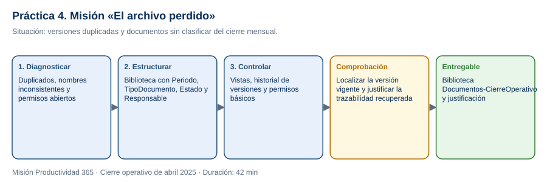

# Misión «El archivo perdido»

## Metadatos

| Campo | Valor |
|---|---|
| **Duración** | 42 minutos |
| **Complejidad** | Alta |
| **Nivel Bloom** | Crear |

## Descripción General

Investigar un conjunto de versiones duplicadas y documentos sin clasificación del cierre mensual; construir en SharePoint una biblioteca o lista con metadatos de periodo, tipo, estado y responsable, crear vistas y revisar versiones y permisos básicos. Comprobación individual: localizar la versión vigente y justificar cómo se recupera la trazabilidad.

El participante recibirá un sitio SharePoint con 8-10 archivos intencionalmente desordenados que simulan un cierre mensual caótico. Deberá diagnosticar los problemas, construir una biblioteca con metadatos estructurados, configurar vistas, verificar versiones y ajustar permisos, demostrando dominio de los temas 4.1 y 4.2.

## Objetivos de Aprendizaje

- [ ] Diagnosticar problemas de trazabilidad documental causados por versiones duplicadas y documentos sin clasificación en un escenario de cierre mensual.
- [ ] Crear una biblioteca de documentos en SharePoint Online con columnas de metadatos personalizados: Periodo (fecha), TipoDocumento (opción), Estado (opción) y Responsable (persona).
- [ ] Configurar al menos dos vistas personalizadas en la biblioteca para filtrar y ordenar documentos por metadatos relevantes.
- [ ] Revisar el historial de versiones de un documento en SharePoint e identificar la versión vigente correcta.
- [ ] Ajustar permisos básicos en la biblioteca (heredados vs. únicos) para controlar el acceso de revisores y editores.



## Prerrequisitos

### Conocimientos previos

| Requisito | Detalle |
|---|---|
| Prácticas 1, 2 y 3 completadas | Artefactos disponibles en OneDrive `/CierreOperativo/Semana1/` y en el equipo Teams `CierreOperativo-[Apellido]` con canales `General`, `Informe-Mensual` y `Pendientes-y-Acuerdos` |
| Módulo 4 revisado | Contenidos de lecciones 4.1 (Bibliotecas, listas y metadatos) y 4.2 (Permisos, versiones, búsqueda y organización) |
| Navegación básica en SharePoint Online | Saber acceder a un sitio, navegar entre páginas y bibliotecas |

### Acceso y permisos

| Requisito | Detalle |
|---|---|
| Cuenta institucional Microsoft 365 | Activa, con licencia que incluya SharePoint Online |
| Sitio SharePoint de práctica | `https://[tenant].sharepoint.com/sites/CierreOperativo-Practica` — con permisos de **Colaborador** o **Propietario** asignados por el instructor |
| Archivos problema precargados | El instructor debe haber cargado los 8-10 archivos simulados en la biblioteca **Documentos** (por defecto) del sitio antes de iniciar la práctica |

## Entorno de Laboratorio

### Software requerido

| Herramienta | Versión exacta | Acceso |
|---|---|---|
| Microsoft SharePoint Online | Servicio en la nube, Evergreen (interfaz moderna, tenant en anillo de actualización estándar, abril 2025) | `https://[tenant].sharepoint.com/sites/CierreOperativo-Practica` |
| Microsoft Edge | 134.0.3124.72 o superior | Navegador principal recomendado |
| Google Chrome (alternativa) | 134.0.6998.89 o superior | Alternativa aceptable |

### Archivos problema provistos por el instructor

> 📥 **Descarga (instructor):** los 10 archivos están en [Archivos_Problema_P4.zip](recursos/Archivos_Problema_P4.zip). El estado real de cada informe está escrito dentro del archivo.

El instructor debe cargar los siguientes archivos en la biblioteca **Documentos** (predeterminada) del sitio `CierreOperativo-Practica` **antes** de la sesión. Los nombres incluyen errores intencionados de nomenclatura y duplicación:

```
Informe_CierreOp_Abr2025_v1.xlsx
Informe_CierreOp_Abr2025_final.xlsx
Informe_CierreOp_Abr2025_DEFINITIVO.xlsx
Informe_CierreOp_Abr2025_revisado_JM.xlsx
Conciliacion_Bancaria_Abr2025.xlsx
Control_Presupuesto_Abr2025.pdf
Soporte_Factura_8832.pdf
Soporte_Factura_8833.pdf
ListaVerificacion_sinclasificar.xlsx
Notas_reunion_borrador.docx
```

> **Nota para el instructor:** Suba al menos 3 versiones del archivo `Informe_CierreOp_Abr2025_v1.xlsx` (editando y guardando cambios menores entre cada versión) para que el historial de versiones contenga un mínimo de 3 entradas. Además, rompa la herencia de permisos del archivo `Notas_reunion_borrador.docx` y otórguele permisos de **Edición** a "Todos excepto usuarios externos" para simular permisos excesivamente abiertos.

## Instrucciones Paso a Paso

### Paso 1: Acceder al sitio SharePoint de práctica y explorar el estado actual

**Objetivo:** Abrir el sitio de práctica y familiarizarse con la biblioteca predeterminada que contiene los archivos problema.

1. Abra Microsoft Edge y navegue a:

```
https://[tenant].sharepoint.com/sites/CierreOperativo-Practica
```

2. Inicie sesión con su cuenta institucional Microsoft 365 si se le solicita.

3. En el menú lateral izquierdo, haga clic en **Documentos** para abrir la biblioteca predeterminada.

4. Observe la lista de archivos cargados. Confirme que puede ver entre 8 y 10 archivos.

**Resultado esperado:** Se muestra la biblioteca **Documentos** con los archivos problema visibles en una vista plana sin metadatos personalizados — solo las columnas predeterminadas (Nombre, Modificado, Modificado por).

**Verificación:** Cuente los archivos visibles. Debe haber al menos 8. Si ve menos, notifique al instructor.

---

### Paso 2: Diagnosticar los problemas de trazabilidad documental

**Objetivo:** Identificar y documentar los problemas específicos de organización, nomenclatura, metadatos y permisos en los archivos actuales.

1. Examine los nombres de los archivos y anote en un documento de texto (o en papel) los problemas que detecte. Busque al menos estos cuatro tipos de problema:

   - **Duplicación de versiones:** Múltiples archivos que parecen ser versiones del mismo informe (`v1`, `final`, `DEFINITIVO`, `revisado_JM`).
   - **Ausencia de metadatos:** No hay columnas de Periodo, Tipo, Estado ni Responsable.
   - **Nomenclatura inconsistente:** Algunos archivos usan guiones bajos, otros no; algunos incluyen fecha, otros no.
   - **Permisos potencialmente incorrectos:** No es visible aún, pero se verificará más adelante.

2. Haga clic derecho en el archivo `Informe_CierreOp_Abr2025_v1.xlsx` → **Historial de versiones** (o haga clic en los tres puntos `⋮` → **Historial de versiones**).

3. Observe cuántas versiones existen en el historial.

4. Redacte un breve diagnóstico (3-5 líneas) con los problemas encontrados. Guárdelo como referencia para la comprobación final.

**Resultado esperado:** El historial de versiones del archivo `Informe_CierreOp_Abr2025_v1.xlsx` muestra al menos 3 versiones. El diagnóstico identifica: duplicación de nombres, ausencia de metadatos personalizados, falta de estructura de clasificación.

**Verificación:** Su diagnóstico debe mencionar al menos 3 de los 4 tipos de problema listados en la instrucción 1.

---

### Paso 3: Crear la biblioteca de documentos «Documentos-CierreOperativo-[Apellido]»

**Objetivo:** Crear una nueva biblioteca de documentos con el nombre estandarizado donde se organizará la información del cierre.

1. Regrese a la página principal del sitio haciendo clic en el nombre del sitio (**CierreOperativo-Practica**) en la barra superior.

2. Haga clic en **+ Nuevo** → **Biblioteca de documentos**.

3. En el cuadro de diálogo, ingrese:

```
Nombre: Documentos-CierreOperativo-[Apellido]
Descripción: Biblioteca principal del cierre operativo mensual con metadatos de trazabilidad.
```

4. Haga clic en **Crear**.

5. Confirme que la nueva biblioteca aparece en el menú lateral izquierdo del sitio.

**Resultado esperado:** La biblioteca `Documentos-CierreOperativo-[Apellido]` se crea exitosamente y aparece en la navegación del sitio. Inicialmente está vacía y solo muestra las columnas predeterminadas.

**Verificación:** Haga clic en la biblioteca en el menú lateral. Debe abrirse mostrando el mensaje "Arrastre archivos aquí" o una vista vacía.

---

### Paso 4: Agregar la columna de metadatos «Periodo» (tipo Fecha)

**Objetivo:** Crear la primera columna personalizada para registrar el periodo del documento.

1. Dentro de la biblioteca `Documentos-CierreOperativo-[Apellido]`, haga clic en **+ Agregar columna** (en la barra de encabezados de columna, a la derecha de las columnas existentes).

2. Seleccione el tipo **Fecha y hora**.

3. Configure los campos:

```
Nombre de columna: Periodo
Descripción:       Fecha del periodo al que corresponde el documento (usar el primer día del mes).
Incluir hora:      No
Formato:           Estándar
```

4. Haga clic en **Guardar**.

**Resultado esperado:** La columna `Periodo` aparece como un nuevo encabezado en la vista de la biblioteca, con formato de fecha.

**Verificación:** La columna `Periodo` es visible junto a las columnas predeterminadas (Nombre, Modificado, Modificado por).

---

### Paso 5: Agregar la columna «TipoDocumento» (tipo Opción)

**Objetivo:** Crear la columna de clasificación por tipo de documento con opciones controladas.

1. Haga clic en **+ Agregar columna** → **Opción**.

2. Configure:

```
Nombre de columna: TipoDocumento
Descripción:       Clasificación del documento según su naturaleza.
Opciones:
  - Informe
  - Control
  - Conciliación
  - Soporte
Valor predeterminado: (dejar vacío / Ninguno)
```

3. Haga clic en **Guardar**.

**Resultado esperado:** La columna `TipoDocumento` aparece con un selector desplegable que ofrece exactamente las cuatro opciones definidas.

**Verificación:** Haga clic en la celda de `TipoDocumento` de cualquier fila futura para confirmar que el desplegable muestra: Informe, Control, Conciliación, Soporte.

---

### Paso 6: Agregar la columna «Estado» (tipo Opción)

**Objetivo:** Crear la columna que refleja el ciclo de vida del documento.

1. Haga clic en **+ Agregar columna** → **Opción**.

2. Configure:

```
Nombre de columna: Estado
Descripción:       Estado actual del documento en su ciclo de vida.
Opciones:
  - Borrador
  - En revisión
  - Vigente
  - Obsoleto
Valor predeterminado: Borrador
```

3. Haga clic en **Guardar**.

**Resultado esperado:** La columna `Estado` aparece con valor predeterminado `Borrador` para documentos nuevos.

**Verificación:** La columna es visible en la vista de la biblioteca.

---

### Paso 7: Agregar la columna «Responsable» (tipo Persona o grupo)

**Objetivo:** Crear la columna que asocia cada documento con su responsable.

1. Haga clic en **+ Agregar columna** → **Persona**.

2. Configure:

```
Nombre de columna: Responsable
Descripción:       Persona responsable del documento.
Permitir selección múltiple: No
```

3. Haga clic en **Guardar**.

**Resultado esperado:** La biblioteca ahora muestra cinco columnas personalizadas adicionales: `Periodo`, `TipoDocumento`, `Estado`, `Responsable` (más las columnas de sistema).

**Verificación:** Cuente las columnas visibles. Deben incluir al menos: Nombre, Periodo, TipoDocumento, Estado, Responsable, Modificado.

---

### Paso 8: Habilitar el control de versiones en la biblioteca

**Objetivo:** Activar el versionado de documentos para mantener historial de cambios.

1. Dentro de la biblioteca `Documentos-CierreOperativo-[Apellido]`, haga clic en el icono de engranaje (**⚙**) en la esquina superior derecha → **Configuración de la biblioteca**.

2. Haga clic en **Configuración de versiones**.

3. Configure:

```
Historial de versiones del documento:
  ☑ Crear versiones principales y secundarias (borradores)

Número de versiones principales que se conservarán: 10
Número de borradores que se conservarán:            5

Seguridad de elementos en borrador:
  ○ Cualquier usuario que pueda leer elementos
```

4. Haga clic en **Aceptar**.

**Resultado esperado:** El control de versiones queda habilitado. Los documentos subidos a partir de ahora generarán historial automáticamente con cada edición guardada.

**Verificación:** Regrese a **Configuración de la biblioteca** → **Configuración de versiones** y confirme que las opciones están guardadas correctamente.

---

### Paso 9: Subir los archivos problema a la nueva biblioteca

**Objetivo:** Mover los archivos desde la biblioteca predeterminada a la nueva biblioteca estructurada.

1. Abra una nueva pestaña del navegador y navegue a la biblioteca **Documentos** (predeterminada) del sitio:

```
https://[tenant].sharepoint.com/sites/CierreOperativo-Practica/Shared Documents
```

2. Seleccione **todos los archivos** usando la casilla de verificación en el encabezado de la columna Nombre (o selecciónelos individualmente con Ctrl+clic).

3. Haga clic en **Descargar** en la barra de comandos. Se descargará un archivo ZIP con todos los documentos.

4. Extraiga el ZIP en una carpeta local temporal.

5. Regrese a la pestaña de la biblioteca `Documentos-CierreOperativo-[Apellido]`.

6. Haga clic en **Cargar** → **Archivos** y seleccione todos los archivos extraídos. Alternativamente, arrástrelos desde el explorador de archivos a la biblioteca.

7. Espere a que la carga se complete (barra de progreso al 100%).

**Resultado esperado:** Los 8-10 archivos aparecen en la biblioteca `Documentos-CierreOperativo-[Apellido]`. Las columnas de metadatos personalizados (`Periodo`, `TipoDocumento`, `Estado`, `Responsable`) están vacías para todos los archivos.

**Verificación:** Cuente los archivos en la nueva biblioteca. Deben coincidir con los de la biblioteca original.

---

### Paso 10: Completar los metadatos de cada documento

**Objetivo:** Clasificar cada documento asignando valores correctos a las cuatro columnas de metadatos.

1. Para cada archivo, haga clic en la fila correspondiente para seleccionarlo, luego haga clic en el icono de información (**ℹ**) en la barra de comandos (o haga clic en los tres puntos `⋮` → **Detalles**) para abrir el panel de propiedades.

2. Complete los metadatos según la siguiente tabla de referencia:

```
Archivo                                    | Periodo    | TipoDocumento | Estado      | Responsable
-------------------------------------------|------------|---------------|-------------|------------------
Informe_CierreOp_Abr2025_v1.xlsx           | 01/04/2025 | Informe       | Obsoleto    | [Su nombre]
Informe_CierreOp_Abr2025_final.xlsx        | 01/04/2025 | Informe       | Obsoleto    | [Su nombre]
Informe_CierreOp_Abr2025_DEFINITIVO.xlsx   | 01/04/2025 | Informe       | Vigente     | [Su nombre]
Informe_CierreOp_Abr2025_revisado_JM.xlsx  | 01/04/2025 | Informe       | En revisión | [Su nombre]
Conciliacion_Bancaria_Abr2025.xlsx         | 01/04/2025 | Conciliación  | Vigente     | [Su nombre]
Control_Presupuesto_Abr2025.pdf            | 01/04/2025 | Control       | Vigente     | [Su nombre]
Soporte_Factura_8832.pdf                   | 01/04/2025 | Soporte       | Vigente     | [Su nombre]
Soporte_Factura_8833.pdf                   | 01/04/2025 | Soporte       | Vigente     | [Su nombre]
ListaVerificacion_sinclasificar.xlsx       | 01/04/2025 | Control       | Borrador    | [Su nombre]
Notas_reunion_borrador.docx                | 01/04/2025 | Soporte       | Borrador    | [Su nombre]
```

3. Para cada archivo, tras completar los campos en el panel de detalles, cierre el panel o pase al siguiente archivo. Los cambios se guardan automáticamente.

> **Nota:** Reemplace `[Su nombre]` con su nombre real. El campo Responsable es autocompletable: escriba las primeras letras de su nombre y selecciónelo del directorio.

**Resultado esperado:** Todos los archivos muestran valores en las cuatro columnas de metadatos. No quedan celdas vacías en `Periodo`, `TipoDocumento`, `Estado` ni `Responsable`.

**Verificación:** Desplácese horizontalmente por la vista de la biblioteca y confirme que no hay celdas vacías en ninguna de las cuatro columnas personalizadas.

---

### Paso 11: Crear la vista personalizada «Por estado»

**Objetivo:** Crear una vista que muestre únicamente los documentos vigentes, ordenados por periodo descendente.

1. En la biblioteca `Documentos-CierreOperativo-[Apellido]`, haga clic en el menú de vista actual (generalmente dice **Todos los documentos** en la parte superior derecha de la vista) → **Crear nueva vista**.

2. Configure la vista:

```
Nombre de la vista:  Por estado
Tipo de vista:       Lista (predeterminado)
```

3. En la sección **Filtro**, configure:

```
Mostrar elementos cuando la columna:
  Estado  es igual a  Vigente
```

4. En la sección **Ordenar**, configure:

```
Ordenar primero por la columna: Periodo
Orden: Mostrar elementos en orden descendente
```

5. En la sección **Columnas**, asegúrese de que estén visibles: Nombre, Periodo, TipoDocumento, Estado, Responsable, Modificado.

6. Haga clic en **Aceptar** o **Crear**.

**Resultado esperado:** La vista `Por estado` muestra únicamente los documentos con Estado = Vigente (aproximadamente 4-5 archivos: el DEFINITIVO, la conciliación, el control de presupuesto y los soportes de factura), ordenados del periodo más reciente al más antiguo.

**Verificación:** Cuente los documentos visibles. Solo deben aparecer los marcados como `Vigente`. Ningún documento con estado `Borrador`, `En revisión` u `Obsoleto` debe ser visible.

---

### Paso 12: Crear la vista personalizada «Por responsable»

**Objetivo:** Crear una vista agrupada por responsable para visualizar la distribución de documentos.

1. Haga clic en el menú de vista → **Crear nueva vista**.

2. Configure:

```
Nombre de la vista:  Por responsable
Tipo de vista:       Lista
```

3. En la sección **Agrupar por**, configure:

```
Agrupar primero por la columna: Responsable
Orden: Ascendente
```

4. En la sección **Columnas**, incluya: Nombre, Periodo, TipoDocumento, Estado.

5. Haga clic en **Aceptar** o **Crear**.

**Resultado esperado:** La vista `Por responsable` muestra todos los documentos agrupados bajo el nombre de cada responsable, con encabezados de grupo colapsables.

**Verificación:** Debe ver al menos un grupo con su nombre y los 8-10 documentos agrupados debajo. Si hubiera otros responsables asignados, aparecerían como grupos separados.

---

### Paso 13: Verificar el historial de versiones del informe principal

**Objetivo:** Usar el historial de versiones para identificar qué cambios se realizaron y confirmar la versión vigente del informe.

1. Cambie a la vista **Todos los documentos** desde el selector de vistas.

2. Localice el archivo `Informe_CierreOp_Abr2025_v1.xlsx` (el que el instructor subió con múltiples versiones).

3. Haga clic en los tres puntos (`⋮`) junto al nombre del archivo → **Historial de versiones**.

4. En el panel de historial, observe:
   - El número de versiones disponibles (debe haber al menos 3).
   - La fecha y hora de cada versión.
   - El usuario que realizó cada modificación.
   - Los comentarios de versión (si los hay).

5. Haga clic en la fecha de una versión anterior para previsualizarla. Confirme que el contenido difiere de la versión actual.

6. **No restaure** ninguna versión en este momento — solo observe.

7. Cierre el panel de historial.

**Resultado esperado:** El historial muestra al menos 3 versiones con fechas, autores y posibilidad de previsualización. Esto demuestra que el control de versiones de SharePoint permite rastrear la evolución del documento sin necesidad de crear archivos duplicados con nombres como `v1`, `final`, `DEFINITIVO`.

**Verificación:** Anote el número de versiones y la fecha de la versión más reciente. Esta información será necesaria para la comprobación final.

---

### Paso 14: Revisar y ajustar permisos de la biblioteca

**Objetivo:** Verificar los permisos de la biblioteca e identificar configuraciones excesivamente abiertas.

1. Dentro de la biblioteca `Documentos-CierreOperativo-[Apellido]`, haga clic en el icono de engranaje (**⚙**) → **Configuración de la biblioteca**.

2. Haga clic en **Permisos de esta biblioteca de documentos** (en la sección "Permisos y administración").

3. Observe el banner superior. Si dice *"Esta biblioteca hereda permisos de su elemento primario"*, los permisos provienen del sitio.

4. Revise la lista de usuarios y grupos con acceso. Identifique si algún usuario o grupo tiene un nivel de permisos superior al necesario.

5. Ahora regrese a la biblioteca **Documentos** (predeterminada) y localice el archivo `Notas_reunion_borrador.docx`.

> **Nota para el instructor:** si varios participantes comparten el sitio, el primero que corrija el permiso lo resolverá para todos. Prepare una copia por participante (`Notas_reunion_borrador_[Apellido].docx`) con el mismo permiso abierto; cada participante corrige la suya (ver [SETUP_GUIDE.md](../SETUP_GUIDE.md)).

6. Haga clic en los tres puntos (`⋮`) → **Administrar acceso**.

7. Observe si el archivo tiene permisos únicos (no heredados). Si el instructor configuró correctamente el escenario, verá que "Todos excepto usuarios externos" tiene permisos de **Edición**.

8. Para corregir esto, haga clic en el desplegable junto a "Todos excepto usuarios externos" y cámbielo a **Puede ver** (Lector), o elimine ese acceso directo haciendo clic en la **X**.

```
Antes:  "Todos excepto usuarios externos" → Edición (Puede editar)
Después: "Todos excepto usuarios externos" → Puede ver (Lector)
         — o eliminar el acceso directo —
```

**Resultado esperado:** El archivo `Notas_reunion_borrador.docx` ya no tiene permisos de edición para todos los usuarios. El acceso queda restringido según la herencia del sitio o al nivel de solo lectura.

**Verificación:** Vuelva a hacer clic en **Administrar acceso** del archivo y confirme que "Todos excepto usuarios externos" ya no aparece con permisos de Edición.

---

### Paso 15: Comprobación individual — Localizar la versión vigente y justificar la trazabilidad

**Objetivo:** Demostrar que la biblioteca estructurada con metadatos, vistas y control de versiones resuelve los problemas de trazabilidad diagnosticados al inicio.

1. En la biblioteca `Documentos-CierreOperativo-[Apellido]`, seleccione la vista **Por estado**.

2. Identifique el documento de tipo **Informe** con estado **Vigente**. Debe ser `Informe_CierreOp_Abr2025_DEFINITIVO.xlsx`.

3. Abra el historial de versiones de `Informe_CierreOp_Abr2025_v1.xlsx` (el archivo con múltiples versiones del sistema).

4. Redacte una justificación de 5-8 líneas (en un archivo de texto, en el canal `Pendientes-y-Acuerdos` de Teams, o en papel) que responda:

```
JUSTIFICACIÓN DE TRAZABILIDAD
==============================
a) ¿Cuál es la versión vigente del informe de cierre de abril 2025?
   → [Respuesta: Informe_CierreOp_Abr2025_DEFINITIVO.xlsx, Estado = Vigente]

b) ¿Cómo se identificó sin ambigüedad?
   → [Respuesta: Mediante la vista "Por estado" filtrada por Estado = Vigente
      y la columna TipoDocumento = Informe]

c) ¿Cómo se recupera una versión anterior si se detecta un error?
   → [Respuesta: Usando el historial de versiones de SharePoint, se puede
      previsualizar y restaurar cualquier versión anterior sin depender
      de archivos duplicados con nombres como v1, final, DEFINITIVO]

d) ¿Qué problema de permisos se detectó y cómo se corrigió?
   → [Respuesta: El archivo Notas_reunion_borrador.docx tenía permisos
      de edición para "Todos excepto usuarios externos". Se restringió
      a solo lectura / se eliminó el acceso directo]
```

5. Si el instructor lo solicita, comparta su justificación publicándola como mensaje en el canal **Pendientes-y-Acuerdos** del equipo Teams `CierreOperativo-[Apellido]`.

**Resultado esperado:** El participante localiza correctamente `Informe_CierreOp_Abr2025_DEFINITIVO.xlsx` como la versión vigente, explica el método de localización (vista + metadatos), describe la capacidad de restauración de versiones y documenta la corrección de permisos.

**Verificación:** La justificación responde las cuatro preguntas (a-d) con referencias específicas a las funcionalidades de SharePoint utilizadas: vistas, metadatos, historial de versiones y gestión de permisos.

## Validación y Pruebas

Realice las siguientes verificaciones para confirmar que la práctica se completó correctamente:

### Verificación 1: Estructura de la biblioteca

Navegue a `Documentos-CierreOperativo-[Apellido]` y confirme:

```
Columnas visibles:
  ✓ Nombre
  ✓ Periodo          (tipo: Fecha)
  ✓ TipoDocumento    (tipo: Opción — Informe | Control | Conciliación | Soporte)
  ✓ Estado           (tipo: Opción — Borrador | En revisión | Vigente | Obsoleto)
  ✓ Responsable      (tipo: Persona)
  ✓ Modificado        (sistema)

Archivos cargados: 8–10 con todos los metadatos completados (sin celdas vacías)
```

### Verificación 2: Vistas personalizadas

```
Vista "Por estado":
  ✓ Filtro activo: Estado = Vigente
  ✓ Orden: Periodo descendente
  ✓ Muestra solo documentos vigentes (4–5 archivos)

Vista "Por responsable":
  ✓ Agrupación activa por columna Responsable
  ✓ Al menos un grupo visible con documentos
```

### Verificación 3: Control de versiones

```
Configuración de versiones:
  ✓ Versiones principales y secundarias habilitadas
  ✓ Límite: 10 principales, 5 borradores

Historial de Informe_CierreOp_Abr2025_v1.xlsx:
  ✓ Al menos 3 versiones registradas
  ✓ Cada versión muestra fecha, autor y posibilidad de restauración
```

### Verificación 4: Permisos corregidos

```
Archivo Notas_reunion_borrador.docx:
  ✓ "Todos excepto usuarios externos" ya NO tiene permisos de Edición
  ✓ Acceso restringido a Puede ver (Lector) o eliminado
```

### Verificación 5: Caso adverso — Trazabilidad ante información contradictoria

Esta verificación evalúa el pensamiento crítico del participante:

Considere el siguiente escenario: un colega le envía por correo un archivo llamado `Informe_CierreOp_Abr2025_FINAL_FINAL_v3.xlsx` y le dice que "esta es la versión buena". ¿Cómo determina si realmente es la versión vigente?

```
Respuesta esperada:
  ✗ NO se acepta el archivo por su nombre o por la afirmación del colega.
  ✓ Se verifica en la biblioteca Documentos-CierreOperativo-[Apellido] usando la vista
    "Por estado" filtrada por Estado = Vigente y TipoDocumento = Informe.
  ✓ Se compara el contenido con la versión vigente registrada en SharePoint.
  ✓ Si es una versión nueva legítima, se sube a la biblioteca, se le asignan
    metadatos y se actualiza el Estado de la versión anterior a Obsoleto.
  ✓ El historial de versiones de SharePoint proporciona evidencia objetiva
    frente a la afirmación subjetiva del colega.
```

> **Limitación de la trazabilidad:** Los metadatos solo son confiables si se mantienen actualizados. Un documento marcado como `Vigente` pero no actualizado en semanas podría estar desactualizado. La trazabilidad requiere disciplina de equipo, no solo configuración técnica.

## Solución de Problemas

### Problema 1: La columna «Responsable» no muestra sugerencias de personas al escribir

**Síntoma:** Al hacer clic en la celda de la columna `Responsable` y escribir un nombre, no aparece el menú desplegable con sugerencias del directorio de la organización. La celda se comporta como texto libre.

**Causa:** La columna se creó como tipo "Texto de una línea" en lugar de tipo "Persona o grupo". Esto ocurre si se seleccionó el tipo incorrecto en el paso 7 o si la interfaz de SharePoint presentó una opción diferente.

**Solución:**

1. Haga clic en el encabezado de la columna `Responsable` → **Configuración de columna** → **Editar**.
2. Verifique el tipo. Si es "Texto", no es posible cambiarlo a "Persona" directamente.
3. Elimine la columna incorrecta: encabezado de columna → **Configuración de columna** → **Eliminar**.
4. Cree una nueva columna siguiendo exactamente las instrucciones del Paso 7: **+ Agregar columna** → **Persona** → nombre `Responsable`.
5. Reasigne los valores de Responsable a los archivos que ya tenían datos.

---

### Problema 2: La vista «Por estado» muestra todos los documentos en lugar de solo los vigentes

**Síntoma:** Al seleccionar la vista `Por estado`, se muestran los 8-10 archivos sin filtrar. Documentos con estado `Borrador`, `Obsoleto` y `En revisión` siguen visibles.

**Causa:** El filtro no se configuró correctamente al crear la vista, o se guardó sin aplicar la condición de filtro. Esto puede ocurrir si el usuario hizo clic en **Aceptar** antes de desplazarse hasta la sección de filtros.

**Solución:**

1. Con la vista `Por estado` activa, haga clic en el nombre de la vista (parte superior) → **Editar vista actual**.
2. Desplácese hasta la sección **Filtro**.
3. Configure: `Mostrar elementos cuando la columna Estado es igual a Vigente`.
4. Confirme que la condición está activa (el radio button de "Mostrar elementos cuando" debe estar seleccionado, no "Mostrar todos los elementos").
5. Haga clic en **Aceptar**.
6. Verifique que ahora solo se muestran los documentos con Estado = Vigente.

## Limpieza

Al finalizar la práctica, realice las siguientes acciones para mantener el entorno ordenado:

1. **Conserve la biblioteca `Documentos-CierreOperativo-[Apellido]`** — será referenciada en la Práctica 5 cuando los resultados del formulario Forms se exporten a Excel y se vinculen a este repositorio.

2. **No elimine los archivos** de la biblioteca `Documentos-CierreOperativo-[Apellido]` ni sus metadatos.

3. **Opcional:** Si el instructor lo indica, elimine los archivos duplicados de la biblioteca **Documentos** (predeterminada) para evitar confusión futura, ya que los archivos organizados ya están en la nueva biblioteca.

4. Cierre las pestañas adicionales del navegador que haya abierto durante la práctica, conservando solo la pestaña del sitio SharePoint.

## Resumen

En esta práctica se completó el ciclo completo de organización documental en SharePoint Online para un escenario de cierre mensual:

- **Diagnóstico:** Se identificaron problemas reales de trazabilidad: versiones duplicadas con nombres inconsistentes, ausencia de metadatos, falta de control de versiones y permisos excesivamente abiertos.
- **Construcción:** Se creó la biblioteca `Documentos-CierreOperativo-[Apellido]` con cuatro columnas de metadatos personalizados (`Periodo`, `TipoDocumento`, `Estado`, `Responsable`) que reemplazan la dependencia de carpetas y nombres de archivo como mecanismo de organización.
- **Vistas:** Se configuraron dos vistas personalizadas (`Por estado` y `Por responsable`) que permiten localizar documentos por criterios de negocio sin navegar manualmente.
- **Versiones:** Se habilitó el control de versiones principales y secundarias, demostrando que el historial de SharePoint elimina la necesidad de crear archivos duplicados (`v1`, `final`, `DEFINITIVO`).
- **Permisos:** Se identificó y corrigió un archivo con permisos excesivamente abiertos, aplicando el principio de menor privilegio.

**Conexión con la Práctica 5:** La biblioteca `Documentos-CierreOperativo-[Apellido]` y su estructura de metadatos serán el repositorio de referencia cuando se diseñe el formulario en Microsoft Forms y se exporten sus resultados a Excel.

### Recursos adicionales

| Recurso | URL |
|---|---|
| Crear una biblioteca de documentos en SharePoint | https://support.microsoft.com/es-es/office/crear-una-biblioteca-de-documentos-en-sharepoint-306728fe-0325-4b28-b60d-f902e1d75939 |
| Tipos de columnas en SharePoint | https://support.microsoft.com/es-es/office/tipos-de-columnas-y-opciones-de-columna-en-listas-y-bibliotecas-de-sharepoint-0d8ddb7b-7dc7-414d-a283-ee9dca891df7 |
| Habilitar y configurar versiones en una biblioteca | https://support.microsoft.com/es-es/office/habilitar-y-configurar-el-control-de-versiones-en-una-lista-o-biblioteca-1555d642-23ee-446a-990a-bcab618c7a37 |
| Administrar permisos en SharePoint | https://learn.microsoft.com/es-es/sharepoint/understanding-permission-levels |
| Crear una vista en SharePoint | https://support.microsoft.com/es-es/sharepoint |
