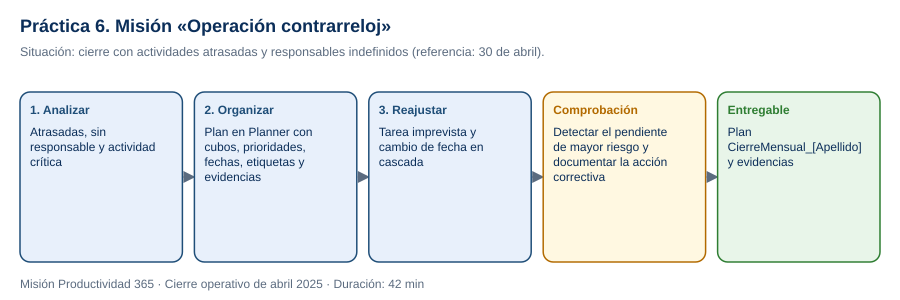

# Misión «Operación contrarreloj»

## Metadatos

| Campo | Valor |
|---|---|
| **Duración** | 42 minutos |
| **Complejidad** | Media |
| **Nivel Bloom** | Aplicar |

## Descripción General

Analizar un cierre mensual con actividades atrasadas y responsables indefinidos; organizar individualmente en Planner las tareas, responsables, prioridades, fechas, categorías y evidencias. Introducir un cambio de fecha o una tarea imprevista para reajustar el plan. Comprobación individual: detectar el pendiente de mayor riesgo y documentar la acción correctiva.

Esta práctica simula un escenario realista donde el estudiante recibe un expediente de cierre mensual con problemas típicos (tareas vencidas, responsables sin asignar, dependencias críticas) y debe organizar un plan funcional en Microsoft Planner que permita visibilidad, trazabilidad y capacidad de reacción ante imprevistos.

## Objetivos de Aprendizaje

- [ ] Identificar y clasificar actividades atrasadas y sin responsable dentro de un escenario de cierre mensual simulado.
- [ ] Crear un plan en Microsoft Planner (New Planner) con cubos temáticos, tareas completas (nombre, responsable, prioridad, fecha límite, etiqueta de categoría y archivo de evidencia adjunto) que reflejen fielmente el cierre mensual analizado.
- [ ] Simular un evento de cambio (modificación de fecha o tarea imprevista) y reajustar el plan en Planner documentando el impacto.
- [ ] Aplicar criterios de priorización para identificar el pendiente de mayor riesgo y redactar una acción correctiva estructurada.



## Prerrequisitos

**Conocimientos previos:**

- Manejo básico de computador y navegación en Microsoft 365.
- Conocimiento básico de los procesos del cierre mensual institucional.
- Haber completado las Prácticas 1–5 del curso (familiaridad con Teams, SharePoint, OneDrive, Forms).

**Acceso y configuración:**

- Cuenta institucional de Microsoft 365 activa con acceso a Microsoft Planner (New Planner habilitado en el tenant).
- Acceso al sitio SharePoint del curso: `https://[tenant].sharepoint.com/sites/CierreOperativo-Practica`.
- Archivo `Escenario_CierreMensual_P6.pdf` disponible en la biblioteca SharePoint `CierreMensual_Practicas` (publicado por el instructor antes de la sesión).
- Carpeta de trabajo en OneDrive: `/CierreOperativo/Semana1/` (creada en la Práctica 1).
- Acceso al equipo de Teams del curso con el canal `Prácticas M6-M8`.

## Entorno de Laboratorio

**Software requerido:**

| Herramienta | Versión / Acceso | Uso en esta práctica |
|---|---|---|
| Microsoft Planner (New Planner) | Servicio en la nube, Evergreen, abril 2025. Acceso: `https://planner.cloud.microsoft` o pestaña en Teams | Creación del plan, cubos, tareas, vistas |
| Microsoft SharePoint Online | Servicio en la nube, interfaz moderna, Evergreen | Descarga del archivo de escenario |
| Microsoft OneDrive for Business | Servicio en la nube, Evergreen | Almacenamiento de evidencias y capturas |
| Microsoft Teams | Teams 2.1, build 24285.x.x o superior; o `https://teams.microsoft.com` | Entrega de comprobación individual |
| Navegador web | Microsoft Edge 134.0.3124.72+ (recomendado) o Google Chrome 134.0.6998.89+ | Acceso a todos los servicios |

**Archivo de escenario proporcionado por el instructor:**

> 📥 **Descarga:** [Escenario_CierreMensual_P6.pdf](recursos/Escenario_CierreMensual_P6.pdf). El instructor lo publica también en la biblioteca `CierreMensual_Practicas`.

El documento `Escenario_CierreMensual_P6.pdf` contiene la tabla de actividades del cierre mensual. Si el instructor aún no lo ha publicado, utilice el escenario embebido en el Paso 2 de esta guía como respaldo controlado.

### Escenario de respaldo embebido: Actividades del Cierre Mensual — Abril 2025

Si el archivo PDF no está disponible en SharePoint, utilice la siguiente tabla como fuente de datos para completar la práctica. Este escenario contiene 14 actividades con los problemas deliberados que debe identificar.

#### Tabla de actividades del cierre mensual

| N.º | Actividad | Área | Responsable | Fecha límite | Estado actual | Dependencia |
|-----|-----------|------|-------------|-------------|---------------|-------------|
| 1 | Conciliación bancaria cuenta principal | Finanzas | Laura Méndez | 2025-04-25 | Atrasada | Ninguna |
| 2 | Conciliación bancaria cuenta secundaria | Finanzas | Laura Méndez | 2025-04-25 | Atrasada | Act. 1 |
| 3 | Registro de facturas pendientes | Finanzas | *Sin asignar* | 2025-04-27 | Atrasada | Ninguna |
| 4 | Cierre de nómina quincenal | RR. HH. | Pedro Salinas | 2025-04-26 | Completada | Ninguna |
| 5 | Cálculo de provisiones laborales | RR. HH. | *Sin asignar* | 2025-04-30 | Pendiente | Act. 4 |
| 6 | Reporte de gastos de viaje | Administración | Ana Torres | 2025-05-01 | En progreso | Ninguna |
| 7 | Verificación de pólizas de seguro | Jurídico | *Sin asignar* | 2025-04-30 | Pendiente | Ninguna |
| 8 | Inventario de activos fijos | Operaciones | Roberto Díaz | 2025-04-30 | En progreso | Ninguna |
| 9 | Conciliación de cuentas por cobrar | Finanzas | Laura Méndez | 2025-04-26 | Atrasada | Act. 1 |
| 10 | Generación de estados financieros preliminares | Finanzas | Carlos Ruiz | 2025-05-01 | Pendiente | Acts. 1, 2, 3, 9 |
| 11 | Revisión de contratos vigentes | Jurídico | Marta Vega | 2025-05-01 | Pendiente | Ninguna |
| 12 | Actualización del presupuesto operativo | Dirección | *Sin asignar* | 2025-05-02 | Pendiente | Act. 10 |
| 13 | Envío de reporte a Dirección General | Dirección | Carlos Ruiz | 2025-05-03 | Pendiente | Acts. 10, 12 |
| 14 | Archivo de soportes documentales | Administración | Ana Torres | 2025-05-04 | Pendiente | Todas las anteriores |

**Notas del escenario:**
- Fecha de referencia (hoy): **30 de abril de 2025**.
- Las actividades con fecha límite anterior al 30 de abril y estado distinto de "Completada" se consideran **atrasadas**.
- Las actividades marcadas *Sin asignar* no tienen responsable definido.
- La actividad 10 es **crítica** porque bloquea las actividades 12 y 13, y depende de cuatro actividades previas (tres de ellas atrasadas).

## Instrucciones Paso a Paso

### Paso 1: Descargar y analizar el escenario del cierre mensual

**Objetivo:** Obtener el archivo de escenario desde SharePoint y realizar un análisis individual para identificar actividades atrasadas, responsables indefinidos y dependencias críticas.

**Instrucciones:**

1. Abra el navegador y acceda al sitio SharePoint del curso:

```
https://[tenant].sharepoint.com/sites/CierreOperativo-Practica
```

2. Navegue a la biblioteca `CierreMensual_Practicas` en el panel lateral izquierdo.

3. Localice el archivo `Escenario_CierreMensual_P6.pdf` y descárguelo a su carpeta local de trabajo. Si el archivo no está disponible, utilice la tabla del escenario embebido en la sección **Entorno de Laboratorio** de esta guía.

4. Lea el escenario completo y, en una hoja de papel o un archivo de texto temporal, identifique y anote:
   - **Actividades atrasadas** (fecha límite vencida y no completadas): deben ser al menos 4.
   - **Actividades sin responsable**: deben ser al menos 3.
   - **La actividad con mayor número de dependencias bloqueadas** (actividad crítica).

**Resultado esperado:** Una lista escrita con al menos 4 actividades atrasadas (N.º 1, 2, 3, 9), al menos 4 sin responsable (N.º 3, 5, 7, 12) y la identificación de la actividad 10 como punto crítico del cierre.

**Verificación:** Confirme que su análisis incluye las tres categorías: atrasadas, sin responsable y dependencia crítica. Si identificó menos de 4 atrasadas o menos de 3 sin responsable, revise la tabla nuevamente comparando cada fecha límite con la fecha de referencia (30 de abril de 2025).

---

### Paso 2: Crear el plan en Microsoft Planner

**Objetivo:** Crear un plan nuevo en Planner con el nombre estandarizado del curso y vincularlo al grupo de Microsoft 365 correspondiente.

**Instrucciones:**

1. Acceda a Microsoft Planner en el navegador:

```
https://planner.cloud.microsoft
```

2. Haga clic en **+ Nuevo plan** (o **+ New plan** si su interfaz está en inglés).

3. Configure el plan con los siguientes datos:

```
Nombre del plan:  CierreMensual_[SuApellido]
Grupo:            CierreOperativo-Practica (seleccione el grupo existente del curso)
```

> **Nota:** Si el tenant no permite vincular a un grupo existente, seleccione **Crear nuevo grupo** y use el nombre `CierreOperativo-[SuApellido]`. Consulte al instructor si tiene dudas.

4. Haga clic en **Crear plan**.

**Resultado esperado:** El plan `CierreMensual_[SuApellido]` aparece en su lista de planes en Planner, con la vista de tablero (Board) vacía.

**Verificación:** El nombre del plan aparece en la barra superior de Planner. Al hacer clic en los tres puntos (`⋯`) > **Configuración del plan**, el grupo asociado debe ser el del curso.

---

### Paso 3: Crear los cubos del tablero

**Objetivo:** Estructurar el tablero con cubos que representen las fases del flujo de trabajo del cierre mensual.

**Instrucciones:**

1. En la vista de tablero del plan recién creado, haga clic en **Agregar cubo** (o **Add bucket**).

2. Cree los siguientes cubos en este orden exacto:

```
Cubo 1: Pendiente
Cubo 2: En progreso
Cubo 3: Completado
Cubo 4: Bloqueado
```

3. Para crear cada cubo: escriba el nombre y presione **Enter**. Luego haga clic en **Agregar cubo** nuevamente para el siguiente.

**Resultado esperado:** El tablero muestra cuatro columnas: Pendiente, En progreso, Completado y Bloqueado, de izquierda a derecha.

**Verificación:** Los cuatro cubos están visibles en la vista de tablero. El cubo "Bloqueado" es el último a la derecha.

---

### Paso 4: Configurar las etiquetas de categoría por color

**Objetivo:** Asignar nombres a las etiquetas de color de Planner para clasificar las tareas por área funcional del cierre.

**Instrucciones:**

1. Haga clic en **+ Agregar tarea** en cualquier cubo para crear una tarea temporal.

2. Haga clic sobre la tarea creada para abrir su panel de detalle.

3. En la sección de **Etiquetas** (Labels), haga clic en el ícono de lápiz junto a cada color para renombrarlos:

```
Rosa:      Finanzas
Rojo:      RR. HH.
Amarillo:  Administración
Verde:     Operaciones
Azul:      Jurídico
Morado:    Dirección
```

4. Cierre el panel de detalle. Puede eliminar la tarea temporal (clic derecho > **Eliminar**) o conservarla para el siguiente paso.

**Resultado esperado:** Las seis etiquetas de color tienen nombres que corresponden a las áreas funcionales del cierre mensual.

**Verificación:** Abra cualquier tarea y verifique que al pasar el cursor sobre cada etiqueta de color aparezca el nombre del área asignado.

---

### Paso 5: Crear las tareas del cierre mensual en el cubo correspondiente

**Objetivo:** Trasladar las 14 actividades del escenario como tareas de Planner, ubicándolas en el cubo correcto según su estado actual.

**Instrucciones:**

1. Para cada actividad de la tabla del escenario, cree una tarea en el cubo que corresponda a su estado:

   - Estado **Atrasada** → cubo **Pendiente** (se moverán a Bloqueado en pasos posteriores si aplica).
   - Estado **Pendiente** → cubo **Pendiente**.
   - Estado **En progreso** → cubo **En progreso**.
   - Estado **Completada** → cubo **Completado**.

2. Cree las tareas usando el botón **+ Agregar tarea** en cada cubo. Use como nombre de tarea el formato:

```
[N.º] - [Nombre de la actividad]
```

Ejemplos:

```
01 - Conciliación bancaria cuenta principal
02 - Conciliación bancaria cuenta secundaria
03 - Registro de facturas pendientes
04 - Cierre de nómina quincenal
05 - Cálculo de provisiones laborales
06 - Reporte de gastos de viaje
07 - Verificación de pólizas de seguro
08 - Inventario de activos fijos
09 - Conciliación de cuentas por cobrar
10 - Generación de estados financieros preliminares
11 - Revisión de contratos vigentes
12 - Actualización del presupuesto operativo
13 - Envío de reporte a Dirección General
14 - Archivo de soportes documentales
```

3. Distribución por cubo (según el escenario):

```
Cubo "Pendiente":    01, 02, 03, 05, 07, 09, 10, 11, 12, 13, 14
Cubo "En progreso":  06, 08
Cubo "Completado":   04
Cubo "Bloqueado":    (vacío por ahora; se usará en el Paso 8)
```

**Resultado esperado:** 14 tareas creadas y distribuidas en los cubos Pendiente (11), En progreso (2) y Completado (1).

**Verificación:** Cuente las tareas en cada cubo. El total debe ser 14. El cubo Completado debe tener exactamente 1 tarea (actividad 04).

---

### Paso 6: Asignar responsables, prioridades, fechas y etiquetas a cada tarea

**Objetivo:** Completar los metadatos de cada tarea con responsable, prioridad, fechas límite y etiqueta de categoría, reflejando fielmente el escenario y aplicando criterios de priorización para actividades atrasadas o sin responsable.

**Instrucciones:**

1. Haga clic en cada tarea para abrir su panel de detalle y configure los campos según la tabla siguiente.

2. **Responsable:** Para actividades con responsable definido en el escenario, escriba el nombre del responsable indicado. Para actividades *Sin asignar*, asígnese usted mismo como responsable provisional (su nombre aparecerá automáticamente al buscarlo).

3. **Prioridad:** Aplique estos criterios:
   - **Urgente:** Actividades atrasadas CON dependencias que bloquean otras tareas.
   - **Importante (Alta):** Actividades atrasadas sin dependencias bloqueantes, o actividades que bloquean a muchas otras.
   - **Media:** Actividades en plazo sin dependencias críticas.
   - **Baja:** Actividades completadas o con fecha holgada y sin dependencias.

4. **Fechas:** Configure la fecha límite según la tabla del escenario. Para actividades atrasadas, mantenga la fecha original (esto permitirá visualizar el atraso en la vista Programación).

5. **Etiqueta de categoría:** Active la etiqueta de color correspondiente al área:

```
Tarea 01: Responsable=Laura Méndez | Prioridad=Urgente    | Fecha=2025-04-25 | Etiqueta=Finanzas (Rosa)
Tarea 02: Responsable=Laura Méndez | Prioridad=Urgente    | Fecha=2025-04-25 | Etiqueta=Finanzas (Rosa)
Tarea 03: Responsable=[Su nombre]  | Prioridad=Importante | Fecha=2025-04-27 | Etiqueta=Finanzas (Rosa)
Tarea 04: Responsable=Pedro Salinas| Prioridad=Baja       | Fecha=2025-04-26 | Etiqueta=RR. HH. (Rojo)
Tarea 05: Responsable=[Su nombre]  | Prioridad=Media      | Fecha=2025-04-30 | Etiqueta=RR. HH. (Rojo)
Tarea 06: Responsable=Ana Torres   | Prioridad=Media      | Fecha=2025-05-01 | Etiqueta=Administración (Amarillo)
Tarea 07: Responsable=[Su nombre]  | Prioridad=Media      | Fecha=2025-04-30 | Etiqueta=Jurídico (Azul)
Tarea 08: Responsable=Roberto Díaz | Prioridad=Media      | Fecha=2025-04-30 | Etiqueta=Operaciones (Verde)
Tarea 09: Responsable=Laura Méndez | Prioridad=Urgente    | Fecha=2025-04-26 | Etiqueta=Finanzas (Rosa)
Tarea 10: Responsable=Carlos Ruiz  | Prioridad=Urgente    | Fecha=2025-05-01 | Etiqueta=Finanzas (Rosa)
Tarea 11: Responsable=Marta Vega   | Prioridad=Media      | Fecha=2025-05-01 | Etiqueta=Jurídico (Azul)
Tarea 12: Responsable=[Su nombre]  | Prioridad=Importante | Fecha=2025-05-02 | Etiqueta=Dirección (Morado)
Tarea 13: Responsable=Carlos Ruiz  | Prioridad=Importante | Fecha=2025-05-03 | Etiqueta=Dirección (Morado)
Tarea 14: Responsable=Ana Torres   | Prioridad=Baja       | Fecha=2025-05-04 | Etiqueta=Administración (Amarillo)
```

6. Para cada tarea, haga clic en **Guardar** o simplemente cierre el panel (Planner guarda automáticamente).

**Resultado esperado:** Las 14 tareas tienen responsable asignado, nivel de prioridad, fecha límite y etiqueta de color. Las tareas sin responsable original ahora lo tienen asignado provisionalmente a usted.

**Verificación:** En la vista de tablero, cada tarjeta debe mostrar: el avatar del responsable, el indicador de color de prioridad (diamante rojo para Urgente, naranja para Importante), la fecha límite y la etiqueta de color del área. Verifique al menos 3 tareas abriendo su panel de detalle.

---

### Paso 7: Adjuntar evidencia a las tareas críticas

**Objetivo:** Agregar al menos un archivo de evidencia (captura de pantalla o documento de muestra) a las tareas marcadas como Urgente, demostrando la capacidad de trazabilidad documental de Planner.

**Instrucciones:**

1. Tome una captura de pantalla de su tablero actual (vista completa con las 14 tareas distribuidas). Guárdela en su carpeta de OneDrive:

```
/CierreOperativo/Semana1/Evidencia_Tablero_P6.png
```

2. Abra la tarea `01 - Conciliación bancaria cuenta principal`.

3. En la sección **Datos adjuntos** (Attachments), haga clic en **Agregar datos adjuntos** > **OneDrive** (o **Cargar desde equipo** si prefiere subir directamente).

4. Seleccione el archivo `Evidencia_Tablero_P6.png` y adjúntelo.

5. Repita el proceso para las tareas **02**, **09** y **10** (las cuatro tareas marcadas como Urgente). Puede adjuntar la misma captura o capturas diferentes.

**Resultado esperado:** Las cuatro tareas Urgente tienen al menos un archivo adjunto visible en su panel de detalle.

**Verificación:** Abra cada una de las cuatro tareas Urgente y confirme que el ícono de clip (📎) y el nombre del archivo aparecen en la sección de datos adjuntos.

---

### Paso 8: Mover tareas bloqueadas al cubo correspondiente

**Objetivo:** Identificar las tareas cuyas dependencias no se han completado y moverlas al cubo "Bloqueado" para reflejar la realidad del cierre.

**Instrucciones:**

1. Revise las dependencias del escenario. Las siguientes tareas dependen de actividades atrasadas y por lo tanto están bloqueadas:

```
Tarea 02 → depende de Tarea 01 (atrasada) → BLOQUEADA
Tarea 09 → depende de Tarea 01 (atrasada) → BLOQUEADA
Tarea 10 → depende de Tareas 01, 02, 03, 09 (todas atrasadas) → BLOQUEADA
Tarea 12 → depende de Tarea 10 (bloqueada) → BLOQUEADA
Tarea 13 → depende de Tareas 10 y 12 (bloqueadas) → BLOQUEADA
```

2. Arrastre cada una de estas cinco tareas desde el cubo **Pendiente** al cubo **Bloqueado**.

3. En cada tarea movida, abra el panel de detalle y agregue una **nota** (en el campo Notas/Notes) indicando el motivo del bloqueo:

```
BLOQUEADA: Depende de la tarea [N.º] que se encuentra atrasada.
No puede iniciar hasta que se resuelvan las dependencias previas.
```

**Resultado esperado:** El cubo "Bloqueado" contiene 5 tareas (02, 09, 10, 12, 13). El cubo "Pendiente" ahora tiene 6 tareas (01, 03, 05, 07, 11, 14 — nota: la tarea 14 depende de todas las anteriores pero su fecha es la más lejana, puede dejarse en Pendiente o moverla a Bloqueado según su criterio; ambas opciones son válidas).

**Verificación:** Cuente las tareas por cubo: Pendiente (6), En progreso (2), Completado (1), Bloqueado (5). Total = 14.

---

### Paso 9: Introducir un cambio imprevisto — tarea nueva y modificación de fecha

**Objetivo:** Simular un evento de cambio que obliga a reajustar el plan, documentando el impacto en los comentarios de las tareas afectadas.

**Instrucciones:**

1. **Agregar tarea imprevista:** En el cubo **Pendiente**, cree una nueva tarea:

```
Nombre:       15 - Revisión extraordinaria de conciliación
Responsable:  [Su nombre]
Prioridad:    Urgente
Fecha límite: 2025-05-01
Etiqueta:     Finanzas (Rosa)
```

2. Abra el panel de detalle de la tarea 15 y en el campo **Notas**, escriba:

```
TAREA IMPREVISTA: Auditoría interna solicitó revisión extraordinaria
de la conciliación bancaria del mes anterior. Esta tarea no estaba
en el plan original y afecta la disponibilidad de Laura Méndez
para completar las tareas 01, 02 y 09.
```

3. **Modificar fecha límite de tarea crítica:** Abra la tarea `10 - Generación de estados financieros preliminares` y cambie la fecha límite:

```
Fecha límite original: 2025-05-01
Fecha límite nueva:    2025-05-04
```

4. En la sección de **Comentarios** de la tarea 10, escriba:

```
CAMBIO DE FECHA: La fecha límite se extiende 3 días (de 01/05 a 04/05)
debido a la incorporación de la tarea imprevista 15 (Revisión extraordinaria
de conciliación) que consume recursos del área de Finanzas.
Impacto: Las tareas 12 y 13 también se retrasan proporcionalmente.
```

5. Abra las tareas **12** y **13** y actualice sus fechas límite sumando 3 días:

```
Tarea 12: Fecha nueva = 2025-05-05
Tarea 13: Fecha nueva = 2025-05-06
```

6. En los comentarios de las tareas 12 y 13, agregue:

```
AJUSTE EN CASCADA: Fecha modificada (+3 días) por impacto de la tarea
imprevista 15 sobre la tarea 10 de la cual depende esta actividad.
```

**Resultado esperado:** El plan ahora tiene 15 tareas. Las tareas 10, 12 y 13 tienen fechas actualizadas. La tarea 15 aparece como Urgente en el cubo Pendiente. Todos los cambios están documentados en comentarios.

**Verificación:** Abra las tareas 10, 12, 13 y 15. Confirme que (a) las fechas son las nuevas, (b) los comentarios documentan el motivo del cambio, y (c) la tarea 15 tiene prioridad Urgente y etiqueta Finanzas.

---

### Paso 10: Analizar el plan con la vista Gráficos

**Objetivo:** Usar la vista de gráficos de Planner para obtener una visión consolidada del estado del plan y confirmar la distribución de tareas por estado, prioridad y responsable.

**Instrucciones:**

1. En la barra superior del plan, haga clic en la pestaña **Gráficos** (Charts).

2. Observe los gráficos generados automáticamente:
   - **Estado:** Distribución de tareas por estado (No iniciada, En progreso, Atrasada, Completada).
   - **Cubo:** Cantidad de tareas por cubo.
   - **Prioridad:** Distribución por nivel de prioridad.
   - **Miembros:** Carga de trabajo por responsable.

3. Tome una captura de pantalla de la vista Gráficos completa y guárdela:

```
/CierreOperativo/Semana1/Evidencia_Graficos_P6.png
```

4. Identifique en el gráfico de Prioridad cuántas tareas son **Urgente**. Debe haber **5** (tareas 01, 02, 09, 10 y 15).

**Resultado esperado:** La vista Gráficos muestra que la mayoría de las tareas están en estado "No iniciada" o "Atrasada", que hay 5 tareas Urgente, y que Laura Méndez y usted son los responsables con mayor carga.

**Verificación:** El gráfico de prioridad muestra 5 tareas Urgente. El gráfico de miembros muestra al menos 2 personas con 3 o más tareas asignadas.

---

### Paso 11: Analizar el plan con la vista Programación (Schedule)

**Objetivo:** Visualizar la línea temporal de las tareas para identificar acumulaciones de trabajo y el pendiente de mayor riesgo.

**Instrucciones:**

1. Haga clic en la pestaña **Programación** (Schedule) en la barra superior del plan.

2. Observe el calendario con las tareas distribuidas por fecha. Las tareas atrasadas aparecerán en rojo o con indicadores de vencimiento.

3. Identifique visualmente:
   - Las fechas con mayor acumulación de tareas.
   - Las tareas que aparecen en el pasado (antes del 30 de abril) y no están completadas.
   - La tarea que, por su combinación de atraso + dependencias bloqueadas + prioridad, representa el **mayor riesgo** para el cierre.

4. Tome una captura de pantalla de la vista Programación y guárdela:

```
/CierreOperativo/Semana1/Evidencia_Programacion_P6.png
```

**Resultado esperado:** La vista Programación muestra claramente las tareas 01, 02, 03 y 09 en fechas pasadas. La tarea 10 aparece como el cuello de botella principal porque bloquea a 12 y 13 (y transitivamente a 14).

**Verificación:** Las tareas atrasadas son visibles en el calendario en fechas anteriores al 30 de abril. La tarea 10, aunque tiene fecha 04/05, está en el cubo Bloqueado y es identificable como el punto de mayor riesgo.

---

### Paso 12: Documentar la acción correctiva en la tarea de mayor riesgo

**Objetivo:** Redactar una acción correctiva estructurada en la tarea identificada como el pendiente de mayor riesgo del cierre mensual.

**Instrucciones:**

1. Abra la tarea `10 - Generación de estados financieros preliminares` (identificada como la de mayor riesgo por ser el cuello de botella del cierre).

2. En el campo **Notas** de la tarea, redacte la acción correctiva con el siguiente formato exacto:

```
═══════════════════════════════════════════════
ACCIÓN CORRECTIVA — TAREA DE MAYOR RIESGO
═══════════════════════════════════════════════

Riesgo identificado:
La generación de estados financieros preliminares no puede iniciar
porque depende de 4 tareas previas (01, 02, 03, 09), de las cuales
3 están atrasadas y 1 no tenía responsable asignado. Adicionalmente,
la tarea imprevista 15 consume recursos del área de Finanzas.

Impacto estimado:
Si esta tarea no se completa a tiempo, se retrasan en cascada
las tareas 12 (Actualización del presupuesto) y 13 (Envío de
reporte a Dirección General), comprometiendo el cierre mensual
completo. Riesgo de incumplimiento del plazo institucional.

Acción propuesta:
1. Priorizar la tarea 01 (conciliación cuenta principal) de
   forma inmediata — es la dependencia raíz.
2. Asignar recurso temporal a la tarea 03 (registro de facturas)
   que no tenía responsable.
3. Solicitar extensión de 3 días al plazo de entrega del reporte
   final (tarea 13) a Dirección General.

Responsable de la acción correctiva:
[Su nombre completo]

Fecha de resolución propuesta:
2025-05-04
═══════════════════════════════════════════════
```

3. Haga clic en el área fuera del campo Notas para guardar.

**Resultado esperado:** La tarea 10 contiene una acción correctiva completa con los cinco campos: Riesgo identificado, Impacto estimado, Acción propuesta, Responsable y Fecha de resolución.

**Verificación:** Abra la tarea 10 y lea las notas. Los cinco campos deben estar presentes y completos. La acción propuesta debe ser coherente con el análisis de dependencias del escenario.

---

### Paso 13: Crear la lista de verificación (checklist) en la tarea crítica

**Objetivo:** Agregar una lista de verificación dentro de la tarea 10 que permita rastrear el avance de las sub-acciones correctivas.

**Instrucciones:**

1. En el panel de detalle de la tarea `10 - Generación de estados financieros preliminares`, localice la sección **Lista de comprobación** (Checklist).

2. Agregue los siguientes elementos:

```
☐ Verificar que tarea 01 esté completada
☐ Verificar que tarea 02 esté completada
☐ Verificar que tarea 03 esté completada y tenga responsable
☐ Verificar que tarea 09 esté completada
☐ Confirmar disponibilidad de Carlos Ruiz para iniciar
☐ Recopilar insumos de todas las conciliaciones
☐ Generar borrador de estados financieros
☐ Enviar borrador a revisión de Dirección
```

3. Marque como completado (✓) solo el primer ítem si la tarea 01 ya estuviera resuelta. En este escenario, **no marque ninguno** porque todas las dependencias siguen pendientes.

**Resultado esperado:** La tarea 10 muestra "0 de 8" en el indicador de progreso de la lista de verificación.

**Verificación:** En la vista de tablero, la tarjeta de la tarea 10 debe mostrar el indicador `0/8` junto al ícono de checklist.

---

### Paso 14: Capturar evidencia final y preparar entrega

**Objetivo:** Tomar las capturas de pantalla finales del plan completo para la comprobación individual.

**Instrucciones:**

1. Regrese a la vista **Tablero** (Board) del plan.

2. Tome una captura de pantalla panorámica del tablero completo mostrando los 4 cubos con todas las tareas. Guárdela:

```
/CierreOperativo/Semana1/Evidencia_Tablero_Final_P6.png
```

3. Abra la tarea 10 y tome una captura de pantalla del panel de detalle completo (mostrando notas, checklist, comentarios, adjuntos, prioridad y fecha). Guárdela:

```
/CierreOperativo/Semana1/Evidencia_Tarea10_Detalle_P6.png
```

4. Abra la tarea 15 (imprevista) y tome una captura de pantalla de su panel de detalle. Guárdela:

```
/CierreOperativo/Semana1/Evidencia_Tarea15_Imprevista_P6.png
```

**Resultado esperado:** Tres archivos de evidencia guardados en OneDrive: tablero final, detalle de tarea 10 y detalle de tarea 15.

**Verificación:** Navegue a `/CierreOperativo/Semana1/` en OneDrive y confirme que los tres archivos existen y se abren correctamente.

---

### Paso 15: Entregar la comprobación individual en Teams

**Objetivo:** Publicar la evidencia de la práctica completada en el canal designado de Teams para la revisión del instructor.

**Instrucciones:**

1. Abra Microsoft Teams y navegue al equipo del curso.

2. Acceda al canal **Prácticas M6-M8**.

3. Inicie una nueva publicación con el siguiente formato:

```
Asunto: Comprobación P6 — [Su Apellido] — Operación Contrarreloj

Cuerpo:
✅ Plan creado: CierreMensual_[Apellido]
✅ Tareas totales: 15 (14 del escenario + 1 imprevista)
✅ Cubos: Pendiente | En progreso | Completado | Bloqueado
✅ Tarea de mayor riesgo: 10 - Generación de estados financieros
✅ Acción correctiva documentada en notas de tarea 10

Enlace al plan:
[Pegue aquí la URL del plan de Planner]

Evidencias adjuntas:
1. Evidencia_Tablero_Final_P6.png
2. Evidencia_Tarea10_Detalle_P6.png
3. Evidencia_Tarea15_Imprevista_P6.png
4. Evidencia_Graficos_P6.png
5. Evidencia_Programacion_P6.png
```

4. Para obtener la URL del plan: en Planner, haga clic en los tres puntos (`⋯`) junto al nombre del plan > **Copiar vínculo al plan**.

5. Adjunte las 5 capturas de pantalla a la publicación de Teams (use el ícono de clip 📎).

6. Publique el mensaje.

**Resultado esperado:** Una publicación en el canal Prácticas M6-M8 con el resumen estructurado, el enlace al plan y las 5 evidencias adjuntas.

**Verificación:** Abra el enlace al plan desde la publicación de Teams y confirme que se abre el tablero con las 15 tareas. Verifique que las 5 imágenes se visualizan correctamente en la publicación.

## Validación y Pruebas

Utilice la siguiente lista de comprobación para validar que la práctica se completó correctamente:

| N.º | Criterio de validación | Resultado esperado | ¿Cumple? |
|-----|------------------------|-------------------|-----------|
| 1 | El plan existe en Planner con el nombre `CierreMensual_[Apellido]` | Plan visible en `planner.cloud.microsoft` | ☐ |
| 2 | Existen exactamente 4 cubos: Pendiente, En progreso, Completado, Bloqueado | 4 columnas visibles en vista Tablero | ☐ |
| 3 | El plan contiene exactamente 15 tareas | Contar tareas en todos los cubos = 15 | ☐ |
| 4 | Todas las tareas tienen responsable asignado (ninguna sin responsable) | Abrir 5 tareas al azar y verificar avatar | ☐ |
| 5 | Todas las tareas tienen fecha límite configurada | Verificar en vista Programación que todas aparecen en el calendario | ☐ |
| 6 | Todas las tareas tienen etiqueta de categoría (color) | Verificar colores en tarjetas del tablero | ☐ |
| 7 | Las tareas Urgente son exactamente 5 (01, 02, 09, 10, 15) | Filtrar por prioridad Urgente en el tablero | ☐ |
| 8 | El cubo Bloqueado contiene al menos 5 tareas | Contar tareas en cubo Bloqueado | ☐ |
| 9 | La tarea 10 tiene acción correctiva con 5 campos en Notas | Abrir tarea 10 > Notas > verificar campos | ☐ |
| 10 | La tarea 10 tiene checklist con 8 elementos (0/8) | Abrir tarea 10 > verificar indicador 0/8 | ☐ |
| 11 | La tarea 15 (imprevista) existe con prioridad Urgente y documentación | Abrir tarea 15 > verificar notas y prioridad | ☐ |
| 12 | Las tareas 10, 12 y 13 tienen fechas actualizadas (+3 días) | Verificar fechas: 04/05, 05/05, 06/05 | ☐ |
| 13 | Los comentarios de tareas 10, 12, 13 documentan el motivo del cambio | Abrir cada tarea > sección Comentarios | ☐ |
| 14 | Al menos 4 tareas Urgente tienen archivo adjunto | Verificar ícono de clip en tareas 01, 02, 09, 10 | ☐ |
| 15 | Las 5 evidencias están en OneDrive `/CierreOperativo/Semana1/` | Navegar a la carpeta y contar archivos | ☐ |

**Caso adverso — Validación de coherencia del plan:**

Abra su plan y verifique el siguiente escenario contradictorio: la tarea 04 (Cierre de nómina quincenal) está en el cubo "Completado" con prioridad "Baja". Si alguien moviera esta tarea al cubo "Bloqueado" sin cambiar su estado, ¿el plan seguiría siendo coherente? **No**, porque una tarea completada no puede estar bloqueada. Este tipo de inconsistencia es un error común en la gestión de planes. Verifique que en su plan **ninguna tarea en el cubo Completado tenga prioridad Urgente o Importante**, y que **ninguna tarea en el cubo Bloqueado esté marcada como completada** (progreso 100%).

## Solución de Problemas

**Problema 1: No aparece la opción "Nuevo plan" o no se puede vincular al grupo del curso**

- **Síntoma:** Al acceder a `planner.cloud.microsoft`, no aparece el botón "+ Nuevo plan", o al intentar crear el plan no se muestra el grupo `CierreOperativo-Practica` en la lista de grupos disponibles.
- **Causa:** El administrador del tenant no ha habilitado New Planner para los usuarios, o el estudiante no es miembro del grupo de Microsoft 365 asociado al equipo del curso.
- **Solución:**
  1. Verifique que puede acceder a Planner desde Teams: abra Teams > haga clic en el ícono de **Planner** (o **Tasks by Planner**) en la barra lateral izquierda. Si aparece allí, úselo desde Teams.
  2. Si el grupo del curso no aparece, solicite al instructor que lo agregue como miembro del grupo `CierreOperativo-Practica` desde el Centro de administración de Microsoft 365 o desde la configuración del equipo en Teams.
  3. Como alternativa temporal, cree el plan con un grupo nuevo personal (`CierreOperativo-[SuApellido]`) e informe al instructor para que lo vincule posteriormente.

**Problema 2: Las etiquetas de color no muestran los nombres personalizados**

- **Síntoma:** Después de renombrar las etiquetas (Rosa = Finanzas, Rojo = RR. HH., etc.), al abrir otra tarea las etiquetas siguen mostrando solo el color sin el nombre asignado.
- **Causa:** Las etiquetas de categoría en Planner son específicas de cada plan, pero a veces la interfaz tarda en sincronizar los nombres si se navega rápidamente entre tareas. También puede ocurrir si se usó la versión móvil de Planner, que tiene un comportamiento de sincronización diferente.
- **Solución:**
  1. Cierre completamente la pestaña del navegador y vuelva a abrir `planner.cloud.microsoft`.
  2. Abra cualquier tarea y verifique que los nombres aparecen al hacer clic en la sección de Etiquetas.
  3. Si persiste el problema, renombre las etiquetas nuevamente desde una tarea diferente. Los nombres se guardan a nivel del plan, no de la tarea individual.
  4. Asegúrese de usar el navegador de escritorio (Edge o Chrome), no la aplicación móvil, para esta práctica.

## Limpieza

> **⚠️ No elimine el plan ni las tareas creadas.** El plan `CierreMensual_[Apellido]` y todos sus artefactos serán insumo directo de la **Práctica 7** (automatización del seguimiento) y la **Práctica 8** (auditoría del expediente).

Acciones de limpieza permitidas:

1. Elimine la tarea temporal creada en el Paso 4 si no la reutilizó (la que se usó solo para configurar las etiquetas).
2. Elimine archivos duplicados o borradores en `/CierreOperativo/Semana1/` que no sean las 5 evidencias finales.
3. No modifique las fechas, prioridades ni comentarios de las tareas después de la entrega, ya que serán verificados en las prácticas siguientes.

## Resumen

En esta práctica aplicó los conceptos fundamentales de Microsoft Planner para gestionar un escenario realista de cierre mensual bajo presión. Los aprendizajes clave fueron:

- **Análisis de escenario:** Identificó actividades atrasadas, responsables indefinidos y dependencias críticas como paso previo indispensable a la planificación.
- **Estructura del plan:** Creó cubos temáticos (Pendiente, En progreso, Completado, Bloqueado) que reflejan el flujo real de trabajo.
- **Tareas completas:** Cada tarea incluyó los seis atributos de trazabilidad: nombre descriptivo, responsable, prioridad, fecha límite, etiqueta de categoría y evidencia adjunta.
- **Gestión del cambio:** Introdujo una tarea imprevista y un ajuste de fechas en cascada, documentando el impacto en comentarios — una habilidad crítica en entornos operativos reales.
- **Visualización y análisis:** Usó las vistas Gráficos y Programación para identificar el pendiente de mayor riesgo de forma visual y objetiva.
- **Acción correctiva estructurada:** Documentó el riesgo con un formato reproducible (Riesgo / Impacto / Acción / Responsable / Fecha).

**Conexión con las prácticas siguientes:** El plan creado aquí será el insumo de la Práctica 7, donde automatizará notificaciones de seguimiento con Power Automate, y de la Práctica 8, donde auditará la calidad del expediente completo del cierre mensual.

**Recursos adicionales:**

- [Documentación oficial de Microsoft Planner — Introducción y conceptos básicos](https://support.microsoft.com/es-es/planner)
- [Usar Planner en Microsoft Teams](https://support.microsoft.com/es-es/office/usar-planner-en-microsoft-teams-62798a9f-e8f7-4722-a700-27dd28a06ee0)
- [Centro de adopción de Microsoft 365 — Gestión de tareas con Planner](https://adoption.microsoft.com/es-es/microsoft-planner/)
