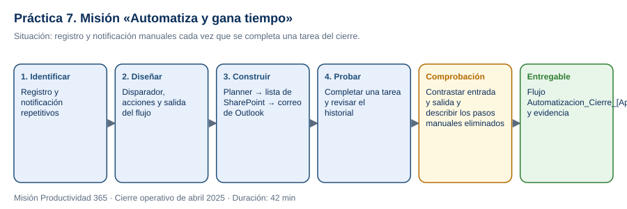

# Misión «Automatiza y gana tiempo»

## Metadatos

| Campo | Valor |
|---|---|
| **Duración** | 42 minutos |
| **Complejidad** | Alta |
| **Nivel Bloom** | Crear |

## Descripción General

En esta práctica identificarás dos tareas repetitivas del cierre mensual (un registro y una notificación), diseñarás su lógica de automatización y construirás un flujo funcional en Power Automate usando exclusivamente conectores estándar. Partirás del plan de Planner `CierreMensual_[Apellido]` creado en la Práctica 6 y crearás una lista de SharePoint que servirá como registro automático de tareas completadas, además de configurar una notificación por correo electrónico cuando una tarea cambie de estado. La práctica concluye con una prueba documentada que demuestra los pasos manuales eliminados.

## Objetivos de Aprendizaje

- [ ] Identificar al menos dos tareas repetitivas del cierre mensual (un registro y una notificación) que sean automatizables con conectores estándar de Power Automate.
- [ ] Diseñar el flujo de automatización mediante un diagrama de pasos (disparador → acciones → salida) antes de construirlo en la plataforma.
- [ ] Construir y configurar en Power Automate un flujo de nube automatizado usando exclusivamente conectores estándar autorizados (Planner, SharePoint, Outlook, Teams, Office 365 Users).
- [ ] Ejecutar una prueba del flujo, verificar la entrada y salida, y documentar al menos tres pasos manuales eliminados.



## Prerrequisitos

**Conocimiento previo:**

- Haber completado la Práctica 6 y disponer del plan `CierreMensual_[Apellido]` en Planner con al menos 12 tareas configuradas.
- Comprensión del concepto disparador → acción → resultado (cubierto en la lección 7.1).
- Familiaridad con SharePoint Online (listas, bibliotecas, columnas) de las Prácticas 4 y 5.

**Acceso y permisos:**

- Cuenta institucional de Microsoft 365 con licencia que incluya Power Automate estándar (sin conectores premium).
- Acceso de edición al sitio SharePoint `https://[tenant].sharepoint.com/sites/CierreOperativo-Practica`.
- Confirmación del administrador TI de que los conectores estándar Planner, SharePoint, Outlook (Office 365) y Teams están habilitados en el tenant.
- Plan de Planner `CierreMensual_[Apellido]` vinculado al grupo `CierreOperativo-Practica`.

## Entorno de Laboratorio

**Software requerido:**

| Herramienta | Versión / Build | URL de acceso |
|---|---|---|
| Microsoft Power Automate | Servicio en la nube, release de servicio abril 2025 | https://make.powerautomate.com |
| Microsoft Planner | Experiencia unificada, Evergreen abril 2025 | https://planner.cloud.microsoft |
| SharePoint Online | Interfaz moderna, Evergreen abril 2025 | `https://[tenant].sharepoint.com/sites/CierreOperativo-Practica` |
| Microsoft Edge | 134.0.3124.72 o superior | Instalado localmente |
| Office 365 Outlook | Conector estándar integrado en Power Automate | N/A |

**Estructura de archivos (de la Práctica 6, ya existente):**

```
OneDrive for Business
└── /CierreOperativo/Semana1/
    ├── Evidencia_Tablero_P6.png
    └── (artefactos nuevos de esta práctica se guardarán aquí)
```

**Artefactos nuevos que se crearán en esta práctica:**

| Artefacto | Tipo | Ubicación |
|---|---|---|
| `Registro_Cierre_[Apellido]` | Lista de SharePoint | Sitio CierreOperativo-Practica |
| `Automatizacion_Cierre_[Apellido]` | Flujo de Power Automate | make.powerautomate.com |
| `Diagrama_Flujo_P7.png` | Captura del diseño | `/CierreOperativo/Semana1/` |
| `Evidencia_Ejecucion_P7.png` | Captura del historial de ejecución | `/CierreOperativo/Semana1/` |
| `Comprobacion_P7.md` o mensaje en Teams | Documento de comprobación | Canal Teams o `/CierreOperativo/Semana1/` |

## Instrucciones Paso a Paso

### Paso 1: Identificar las dos tareas repetitivas candidatas a automatización

**Objetivo:** Analizar el plan de Planner del cierre mensual y seleccionar un proceso de registro y uno de notificación que se repitan de forma predecible.

**Instrucciones:**

1. Abra el navegador y acceda a https://planner.cloud.microsoft con su cuenta institucional.
2. Localice el plan `CierreMensual_[Apellido]` creado en la Práctica 6.
3. Revise las 14 tareas configuradas y responda mentalmente para cada una las tres preguntas de identificación:
   - ¿Con qué frecuencia ocurre esta actividad en un cierre real?
   - ¿Siempre sigue los mismos pasos?
   - ¿Requiere criterio humano en cada ejecución?
4. Seleccione las dos tareas candidatas que usará como base para el flujo. Use estas asignaciones concretas:

```
TAREA DE REGISTRO (automatización A):
  Evento: Cuando cualquier tarea del plan se marca como "Completado"
  Acción deseada: Registrar automáticamente en una lista de SharePoint:
    - Nombre de la tarea
    - Responsable
    - Fecha de completado
  Ejemplo concreto: Tarea 04 "Cierre de nómina quincenal" → Pedro Salinas → 2025-04-26

TAREA DE NOTIFICACIÓN (automatización B):
  Evento: El mismo evento de la automatización A (tarea marcada como "Completado")
  Acción deseada: Enviar correo electrónico al responsable confirmando
    que su tarea quedó registrada en la lista del cierre
  Ejemplo concreto: Tarea 08 "Inventario de activos fijos" → Roberto Díaz → correo de confirmación
```

> **Importante:** el conector estándar de Planner ofrece los desencadenadores *Cuando se crea una tarea*, *Cuando se me asigna una tarea* y *Cuando se completa una tarea*; no detecta el cambio de cubo. Por eso, el registro (A) y la notificación (B) se resuelven en un solo flujo que inicia al completar una tarea.

**Resultado esperado:** Dos procesos repetitivos claramente identificados con su evento disparador, acción esperada y ejemplo concreto.

**Verificación:** Confirme que ambos procesos cumplen el criterio de alta frecuencia × tiempo invertido: en un cierre real con 14+ tareas, cada completado y cada cambio de estado generaría trabajo manual de registro y notificación.

---

### Paso 2: Diseñar el diagrama del flujo antes de construirlo

**Objetivo:** Documentar la lógica completa del flujo (disparador → condiciones → acciones → salida) en un diagrama antes de abrir Power Automate.

**Instrucciones:**

1. Abra un documento nuevo en Word Online, OneNote o use papel físico.
2. Dibuje o escriba el diagrama del flujo usando la siguiente estructura como referencia:

```
╔══════════════════════════════════════════════════════════════╗
║  FLUJO: Automatizacion_Cierre_[Apellido]                    ║
╠══════════════════════════════════════════════════════════════╣
║                                                              ║
║  DISPARADOR: "Cuando se completa una tarea" (Planner)        ║
║       │                                                      ║
║       ▼                                                      ║
║  ACCIÓN 1: Obtener detalles de la tarea (Planner)            ║
║       │                                                      ║
║       ▼                                                      ║
║  ACCIÓN 2: Obtener perfil del usuario (Office 365 Users)     ║
║       │                                                      ║
║       ▼                                                      ║
║  ACCIÓN 3: Crear elemento en lista SharePoint                ║
║       │    (Registro_Cierre_[Apellido])                      ║
║       │    Campos: NombreTarea, Responsable,                 ║
║       │            FechaCompletado, Cubo                     ║
║       ▼                                                      ║
║  ACCIÓN 4: Enviar correo electrónico (Outlook)               ║
║       │    Para: responsable de la tarea                     ║
║       │    Asunto: "Tarea completada - [NombreTarea]"        ║
║       │    Cuerpo: Confirmación con datos del registro       ║
║       ▼                                                      ║
║  FIN                                                         ║
║                                                              ║
╚══════════════════════════════════════════════════════════════╝
```

3. Anote junto al diagrama los conectores estándar que usará:

```
Conectores estándar autorizados:
  ✓ Microsoft Planner (disparador + obtener detalles)
  ✓ Office 365 Users (obtener perfil de usuario)
  ✓ SharePoint (crear elemento en lista)
  ✓ Office 365 Outlook (enviar correo)
  ✗ HTTP, SQL, Salesforce → NO AUTORIZADOS (premium)
```

4. Guarde una captura de pantalla del diagrama como `Diagrama_Flujo_P7.png` en `/CierreOperativo/Semana1/`.

**Resultado esperado:** Un diagrama legible con el disparador, cuatro acciones en secuencia, los conectores identificados y los campos de datos especificados.

**Verificación:** Verifique que el diagrama responde estas preguntas: ¿Qué lo inicia? ¿Qué datos necesita? ¿Qué produce? ¿Cómo se verifica el éxito?

---

### Paso 3: Crear la lista de SharePoint para el registro automático

**Objetivo:** Crear la lista `Registro_Cierre_[Apellido]` en SharePoint que recibirá los datos del flujo automatizado.

**Instrucciones:**

1. Navegue a `https://[tenant].sharepoint.com/sites/CierreOperativo-Practica`.
2. En el menú lateral izquierdo, haga clic en **Nuevo** → **Lista**.
3. Seleccione **Lista en blanco**.
4. Configure el nombre:

```
Nombre de la lista: Registro_Cierre_[Apellido]
Descripción: Registro automático de tareas completadas del cierre mensual - Práctica 7
```

5. Haga clic en **Crear**.
6. La lista se creará con la columna predeterminada `Título`. Ahora agregue las columnas adicionales. Haga clic en **+ Agregar columna** y cree las siguientes:

```
Columna 1:
  Nombre: NombreTarea
  Tipo: Línea de texto
  Requerido: Sí

Columna 2:
  Nombre: Responsable
  Tipo: Línea de texto
  Requerido: Sí

Columna 3:
  Nombre: FechaCompletado
  Tipo: Fecha y hora (solo fecha)
  Requerido: Sí

Columna 4:
  Nombre: CuboOrigen
  Tipo: Opción
  Opciones: Pendiente | En progreso | Completado | Bloqueado
  Requerido: No
```

7. Tras crear las cuatro columnas, verifique que la vista predeterminada muestra: Título, NombreTarea, Responsable, FechaCompletado, CuboOrigen.

**Resultado esperado:** Lista `Registro_Cierre_[Apellido]` creada en el sitio SharePoint con cinco columnas visibles (Título + 4 personalizadas), sin elementos aún.

**Verificación:** Abra la lista y confirme que las cuatro columnas personalizadas aparecen en la vista. Haga clic en **+ Nuevo** para verificar que el formulario muestra todos los campos; no guarde el elemento (cancele).

---

### Paso 4: Acceder a Power Automate y crear un flujo automatizado nuevo

**Objetivo:** Iniciar la creación del flujo en Power Automate seleccionando el tipo correcto y el disparador de Planner.

**Instrucciones:**

1. Abra una nueva pestaña y navegue a:

```
https://make.powerautomate.com
```

2. Inicie sesión con su cuenta institucional de Microsoft 365.
3. En el panel izquierdo, haga clic en **+ Crear**.
4. Seleccione **Flujo de nube automatizado**.
5. En el cuadro de diálogo de configuración inicial, ingrese:

```
Nombre del flujo: Automatizacion_Cierre_[Apellido]
```

6. En el campo de búsqueda de disparadores, escriba:

```
Planner
```

7. De la lista de disparadores, seleccione:

```
"Cuando se completa una tarea" (Microsoft Planner)
```

8. Haga clic en **Crear**.

**Resultado esperado:** Se abre el diseñador de flujos con el disparador "Cuando se completa una tarea" ya colocado como primer bloque.

**Verificación:** El bloque del disparador debe mostrar el ícono de Planner y el texto "When a task is completed" (o su equivalente en español "Cuando se completa una tarea").

---

### Paso 5: Configurar el disparador con el plan de Planner correcto

**Objetivo:** Vincular el disparador al plan `CierreMensual_[Apellido]` específico para que solo reaccione a tareas de ese plan.

**Instrucciones:**

1. Haga clic en el bloque del disparador para expandirlo.
2. En el campo **Id. de grupo** (Group Id), seleccione de la lista desplegable:

```
CierreOperativo-Practica
```

3. En el campo **Id. de plan** (Plan Id), seleccione:

```
CierreMensual_[Apellido]
```

> **Nota:** Si los desplegables no cargan, espere 10 segundos y haga clic de nuevo. Power Automate consulta la API de Planner y puede tardar en entornos con muchos grupos.

**Resultado esperado:** El disparador muestra el grupo y el plan seleccionados correctamente.

**Verificación:** Confirme que los campos Group Id y Plan Id no están vacíos y corresponden a su plan de la Práctica 6.

---

### Paso 6: Agregar la acción «Obtener detalles de la tarea»

**Objetivo:** Recuperar todos los campos de la tarea completada (nombre, asignaciones, fechas) para usarlos en las acciones posteriores.

**Instrucciones:**

1. Debajo del disparador, haga clic en **+ Nuevo paso**.
2. En el buscador de acciones, escriba:

```
Planner obtener tarea
```

3. Seleccione la acción **Obtener detalles de la tarea** (Get task details) del conector Microsoft Planner.
4. Configure los campos:

```
Id. de tarea (Task Id):  [Contenido dinámico] → "Id. de tarea" (del disparador)
```

> **Importante:** Haga clic en el campo y seleccione el contenido dinámico del disparador (icono de rayo). No escriba texto estático.

**Resultado esperado:** Bloque de acción "Obtener detalles de la tarea" configurado con el Id. de tarea dinámico del disparador.

**Verificación:** Al hacer clic en el campo Task Id, debe aparecer una etiqueta dinámica con el texto "Id. de tarea" proveniente del paso anterior.

---

### Paso 7: Agregar la acción «Crear elemento» en la lista de SharePoint

**Objetivo:** Registrar automáticamente los datos de la tarea completada en la lista `Registro_Cierre_[Apellido]`.

**Instrucciones:**

1. Haga clic en **+ Nuevo paso**.
2. Busque:

```
SharePoint crear elemento
```

3. Seleccione **Crear elemento** (Create item) del conector SharePoint.
4. Configure los campos de conexión:

```
Dirección del sitio: https://[tenant].sharepoint.com/sites/CierreOperativo-Practica
Nombre de lista:     Registro_Cierre_[Apellido]
```

5. Una vez seleccionada la lista, aparecerán los campos de las columnas. Mapéelos con contenido dinámico:

```
Título:           [Contenido dinámico] → "Título" (de Obtener detalles de la tarea)
NombreTarea:      [Contenido dinámico] → "Título" (de Obtener detalles de la tarea)
Responsable:      [Contenido dinámico] → "Asignado a" (de Obtener detalles de la tarea)
FechaCompletado:  [Contenido dinámico] → "Fecha de finalización" (de Obtener detalles de la tarea)
CuboOrigen:       Completado
```

> **Nota sobre el campo "Asignado a":** Planner devuelve un array de usuarios asignados. Si el campo muestra un error, Power Automate puede agregar automáticamente un bucle "Aplicar a cada uno". Esto es normal; dentro del bucle, use el elemento actual como valor del campo Responsable. Alternativamente, si la tarea solo tiene un responsable, puede usar la expresión:

```
first(body('Obtener_detalles_de_la_tarea')?['assignments'])
```

> Si el campo Responsable devuelve un ID en lugar de un nombre legible, no se preocupe en este momento; lo resolveremos opcionalmente con el conector Office 365 Users en el Paso 8.

**Resultado esperado:** Bloque "Crear elemento" configurado con los cinco campos mapeados a contenido dinámico del paso anterior.

**Verificación:** Todos los campos obligatorios (Título, NombreTarea, Responsable, FechaCompletado) deben mostrar etiquetas dinámicas (no texto estático).

---

### Paso 8: (Opcional) Agregar la acción «Obtener perfil de usuario» para nombre legible

**Objetivo:** Convertir el identificador del usuario asignado en un nombre legible usando el conector Office 365 Users.

**Instrucciones:**

1. Si en el Paso 7 el campo "Asignado a" devolvió un ID de usuario en lugar de un nombre, agregue un nuevo paso **antes** de "Crear elemento". Para ello, haga clic en el signo **+** entre "Obtener detalles de la tarea" y "Crear elemento", y seleccione **Agregar una acción**.
2. Busque:

```
Office 365 Users obtener perfil
```

3. Seleccione **Obtener perfil de usuario (V2)** del conector Office 365 Users.
4. Configure:

```
Usuario (UPN): [Contenido dinámico] → ID del usuario asignado del paso de Planner
```

5. Regrese al bloque "Crear elemento" y actualice el campo Responsable:

```
Responsable: [Contenido dinámico] → "Nombre para mostrar" (de Obtener perfil de usuario)
```

> **Nota:** Este paso es opcional. Si el campo Responsable ya muestra un nombre legible directamente desde Planner, puede omitirlo. El flujo funcionará con o sin este paso.

**Resultado esperado:** Si se agregó, el bloque "Obtener perfil de usuario" aparece entre "Obtener detalles" y "Crear elemento", y el campo Responsable de la lista ahora usa el nombre para mostrar.

**Verificación:** Confirme que la secuencia de bloques en el diseñador es: Disparador → Obtener detalles → (Obtener perfil) → Crear elemento.

---

### Paso 9: Agregar la acción de notificación por correo electrónico

**Objetivo:** Enviar un correo de confirmación al responsable cuando su tarea se registra como completada, cumpliendo el requisito de automatizar una notificación.

**Instrucciones:**

1. Haga clic en **+ Nuevo paso** (después de "Crear elemento").
2. Busque:

```
Outlook enviar correo
```

3. Seleccione **Enviar un correo electrónico (V2)** del conector Office 365 Outlook.
4. Configure los campos:

```
Para:    [Contenido dinámico] → "Correo" (de Obtener perfil de usuario)
         O si no usó el Paso 8: escriba su propio correo institucional para la prueba

Asunto:  Tarea completada - [Contenido dinámico → "Título" de Obtener detalles]

Cuerpo:
```

5. En el campo **Cuerpo**, escriba el siguiente contenido combinando texto estático y contenido dinámico:

```
Estimado/a [Contenido dinámico → "Nombre para mostrar"],

La siguiente tarea del cierre mensual ha sido completada y registrada automáticamente:

• Tarea: [Contenido dinámico → "Título"]
• Fecha de completado: [Contenido dinámico → "Fecha de finalización"]
• Registrada en: Lista Registro_Cierre en SharePoint

Este mensaje fue generado automáticamente por el flujo Automatizacion_Cierre.

Saludos,
Sistema de Cierre Operativo
```

> **Nota para la prueba:** Si no tiene acceso al correo de otros usuarios ficticios, use su propio correo institucional en el campo "Para". Esto es suficiente para validar que la notificación funciona.

**Resultado esperado:** Bloque "Enviar un correo electrónico (V2)" configurado con destinatario, asunto y cuerpo que incluyen contenido dinámico.

**Verificación:** El campo "Para" debe contener una dirección de correo válida (dinámica o estática). El asunto debe incluir la etiqueta dinámica del título de la tarea.

---

### Paso 10: Guardar el flujo y revisar la estructura completa

**Objetivo:** Guardar el flujo y verificar visualmente que la secuencia de bloques es correcta antes de ejecutar la prueba.

**Instrucciones:**

1. Haga clic en **Guardar** en la barra superior del diseñador.
2. Espere la confirmación "El flujo está listo" o "Flow is ready".
3. Revise la estructura completa del flujo en el diseñador. Debe verse así:

```
[Disparador] Cuando se completa una tarea (Planner)
       │
       ▼
[Acción 1] Obtener detalles de la tarea (Planner)
       │
       ▼
[Acción 2] Obtener perfil de usuario V2 (Office 365 Users)  ← opcional
       │
       ▼
[Acción 3] Crear elemento (SharePoint → Registro_Cierre_[Apellido])
       │
       ▼
[Acción 4] Enviar un correo electrónico V2 (Outlook)
```

4. Si detecta errores (campos vacíos, conexiones rotas), corríjalos antes de continuar.

**Resultado esperado:** Flujo guardado sin errores, con 4-5 bloques en secuencia correcta.

**Verificación:** El botón de guardar no muestra errores. En la parte superior del diseñador, el indicador de estado del flujo aparece como **Activado** (On).

---

### Paso 11: Ejecutar la prueba manual del flujo

**Objetivo:** Disparar el flujo mediante una prueba manual y completar una tarea en Planner para generar el evento.

**Instrucciones:**

1. En el diseñador del flujo, haga clic en **Probar** (esquina superior derecha).
2. Seleccione **Manualmente** y haga clic en **Probar**.
3. Power Automate mostrará el mensaje: "El flujo se está ejecutando. Realice la acción del disparador."
4. **Sin cerrar la pestaña de Power Automate**, abra una nueva pestaña y navegue a https://planner.cloud.microsoft.
5. En el plan `CierreMensual_[Apellido]`, localice una tarea que esté en el cubo **Pendiente**. Use la tarea:

```
03 - Registro de facturas pendientes
```

6. Haga clic en la tarea para abrirla.
7. Cambie el cubo de **Pendiente** a **Completado** (arrastre la tarea o use el menú desplegable de cubo/bucket).
8. Marque también la casilla de **Completada** (checkbox) en el detalle de la tarea si está disponible.
9. Regrese a la pestaña de Power Automate y espere hasta 60 segundos. El flujo debería ejecutarse automáticamente.

> **Nota:** El disparador "Cuando se completa una tarea" de Planner tiene un intervalo de sondeo (polling) que puede tardar entre 1 y 3 minutos. Si después de 3 minutos no se ejecuta, consulte la sección de Solución de Problemas.

**Resultado esperado:** El flujo se ejecuta y todos los bloques muestran una marca verde (✓) indicando éxito.

**Verificación:** En la pantalla de prueba de Power Automate, cada bloque debe mostrar el estado "Correcto" (Succeeded) con marca verde.

---

### Paso 12: Verificar el registro creado en la lista de SharePoint

**Objetivo:** Confirmar que el flujo creó correctamente un nuevo elemento en la lista `Registro_Cierre_[Apellido]`.

**Instrucciones:**

1. Abra una nueva pestaña y navegue a `https://[tenant].sharepoint.com/sites/CierreOperativo-Practica`.
2. En el menú lateral, haga clic en **Contenidos del sitio** y luego en la lista `Registro_Cierre_[Apellido]`.
3. Verifique que existe un nuevo elemento con los siguientes datos:

```
Título:          03 - Registro de facturas pendientes
NombreTarea:     03 - Registro de facturas pendientes
Responsable:     [Su nombre]
FechaCompletado: 2025-04-27 (o la fecha actual de la prueba)
CuboOrigen:      Completado
```

**Resultado esperado:** Un elemento nuevo visible en la lista con los cinco campos correctamente poblados.

**Verificación:** Los campos NombreTarea y Responsable no deben estar vacíos ni contener IDs técnicos ilegibles. Si el campo Responsable muestra un GUID, consulte la sección de Solución de Problemas.

---

### Paso 13: Verificar la notificación por correo electrónico

**Objetivo:** Confirmar que el flujo envió el correo de notificación al destinatario configurado.

**Instrucciones:**

1. Abra Outlook (https://outlook.office.com) con su cuenta institucional.
2. Busque en la bandeja de entrada un correo con asunto:

```
Tarea completada - 03 - Registro de facturas pendientes
```

3. Abra el correo y verifique que el cuerpo contiene:
   - Nombre de la tarea
   - Fecha de completado
   - Referencia a la lista de SharePoint

> **Nota:** Si usó su propio correo como destinatario de prueba, el correo aparecerá en su propia bandeja. En un escenario real, llegaría al responsable asignado en Planner.

**Resultado esperado:** Correo electrónico recibido con el asunto y cuerpo correctos, conteniendo datos dinámicos de la tarea.

**Verificación:** El correo no debe mostrar etiquetas dinámicas sin resolver (por ejemplo, no debe decir `@{triggerOutputs()...}` sino el valor real).

---

### Paso 14: Capturar el historial de ejecución del flujo

**Objetivo:** Documentar la evidencia de la ejecución exitosa mostrando entradas y salidas de cada acción.

**Instrucciones:**

1. Regrese a la pestaña de Power Automate (https://make.powerautomate.com).
2. Navegue a **Mis flujos** → `Automatizacion_Cierre_[Apellido]`.
3. En la sección **Historial de ejecuciones de 28 días**, haga clic en la ejecución más reciente (debe mostrar estado **Correcto**).
4. En la vista de detalle de la ejecución, expanda cada bloque haciendo clic en él para ver las entradas y salidas:

```
Verificar en cada bloque:
  ✓ Disparador: muestra el ID de la tarea completada
  ✓ Obtener detalles: muestra título, asignaciones, fechas
  ✓ Crear elemento: muestra el ID del nuevo elemento en SharePoint
  ✓ Enviar correo: muestra destinatario, asunto, estado 200/202
```

5. Capture una pantalla completa del historial de ejecución mostrando todos los bloques en verde.
6. Guarde la captura como `Evidencia_Ejecucion_P7.png` en:

```
/CierreOperativo/Semana1/Evidencia_Ejecucion_P7.png
```

**Resultado esperado:** Captura de pantalla que muestra el flujo completo con todos los pasos en estado "Correcto" y las entradas/salidas visibles.

**Verificación:** La captura debe mostrar claramente: (a) el nombre del flujo, (b) la fecha/hora de ejecución, (c) el estado de cada acción, y (d) al menos una acción expandida mostrando datos de entrada y salida.

---

### Paso 15: Documentar la comprobación individual — pasos manuales eliminados

**Objetivo:** Contrastar entrada y salida del flujo y listar los pasos manuales que la automatización elimina.

**Instrucciones:**

1. En el canal de Teams `Prácticas M6-M8` del equipo `CierreOperativo-[Apellido]` (o en un documento Word en `/CierreOperativo/Semana1/`), publique un mensaje con el siguiente formato:

```
## Comprobación Individual — Práctica 7
### Nombre: [Su nombre completo]
### Fecha: [Fecha actual]

### 1. Entrada del flujo (evento disparador):
- Evento: Se completó la tarea "03 - Registro de facturas pendientes" en Planner
- Plan: CierreMensual_[Apellido]
- Responsable asignado: [Su nombre]
- Fecha de completado: [Fecha]

### 2. Salida del flujo (acciones ejecutadas):
- Registro creado en lista SharePoint "Registro_Cierre_[Apellido]"
  con campos: NombreTarea, Responsable, FechaCompletado, CuboOrigen
- Correo enviado a [destinatario] con asunto "Tarea completada - 03 - ..."

### 3. Pasos manuales eliminados (mínimo 3):
1. Abrir la lista de SharePoint manualmente y crear un nuevo elemento
2. Copiar el nombre de la tarea, el responsable y la fecha desde Planner
   a los campos de la lista
3. Abrir Outlook, redactar un correo nuevo, escribir el asunto y cuerpo
   con los datos de la tarea, buscar el correo del responsable y enviar
4. Verificar que el registro quedó guardado correctamente en SharePoint
5. Mantener un seguimiento manual de qué tareas ya fueron registradas
   para no duplicar entradas

### 4. Tiempo estimado ahorrado por ejecución:
- Manual: ~5-7 minutos por tarea completada
- Automatizado: 0 minutos (ejecución automática en ~30 segundos)
- Con 14 tareas en el cierre: ahorro de ~70-98 minutos por ciclo
```

2. Adjunte al mensaje las capturas `Diagrama_Flujo_P7.png` y `Evidencia_Ejecucion_P7.png`.

**Resultado esperado:** Mensaje publicado en Teams (o documento guardado) con las cuatro secciones completas, incluyendo al menos tres pasos manuales eliminados y la estimación de tiempo.

**Verificación:** El mensaje debe contener datos reales de la ejecución (no genéricos), las dos capturas adjuntas, y al menos tres pasos manuales distintos y específicos.

## Validación y Pruebas

Ejecute las siguientes verificaciones para confirmar que la práctica se completó correctamente:

**Verificación 1 — Lista de SharePoint:**

| Criterio | Resultado esperado |
|---|---|
| La lista `Registro_Cierre_[Apellido]` existe | ✓ Visible en Contenidos del sitio |
| Tiene 4 columnas personalizadas | ✓ NombreTarea, Responsable, FechaCompletado, CuboOrigen |
| Contiene al menos 1 elemento creado por el flujo | ✓ Datos de la tarea 03 visibles |
| El campo Responsable muestra un nombre legible | ✓ No es un GUID ni está vacío |

**Verificación 2 — Flujo de Power Automate:**

| Criterio | Resultado esperado |
|---|---|
| El flujo `Automatizacion_Cierre_[Apellido]` existe | ✓ Visible en "Mis flujos" |
| Estado del flujo: Activado | ✓ Indicador "On" |
| Historial muestra al menos 1 ejecución exitosa | ✓ Estado "Correcto" |
| Usa solo conectores estándar | ✓ Planner, SharePoint, Outlook, Office 365 Users |

**Verificación 3 — Notificación:**

| Criterio | Resultado esperado |
|---|---|
| Correo recibido en Outlook | ✓ Con asunto dinámico correcto |
| Cuerpo del correo contiene datos reales | ✓ Nombre de tarea, fecha, no etiquetas sin resolver |

**Verificación 4 — Caso adverso (prueba de limitaciones):**

Para evaluar la robustez del flujo, realice la siguiente prueba adicional:

1. En Planner, cree una tarea temporal sin asignar responsable:

```
Nombre: PRUEBA-SinResponsable
Cubo: Pendiente
Responsable: (ninguno)
Fecha límite: (ninguna)
```

2. Mueva la tarea a **Completado**.
3. Observe el historial de ejecución del flujo en Power Automate.
4. **Resultado esperado:** El flujo puede fallar en la acción "Obtener perfil de usuario" o en "Enviar correo" porque no hay responsable asignado. Esto demuestra una limitación real: el flujo asume que toda tarea tiene un responsable.
5. Documente este hallazgo en su comprobación: "El flujo no maneja tareas sin responsable asignado. En un escenario productivo, se debería agregar una condición que verifique si el campo de asignación está vacío antes de intentar obtener el perfil del usuario."
6. Elimine la tarea temporal `PRUEBA-SinResponsable` de Planner después de la prueba.

> **Nota pedagógica:** Esta prueba adversa demuestra que la automatización no es infalible. Un flujo bien diseñado debe contemplar excepciones, y documentar las limitaciones es parte del proceso profesional.

## Solución de Problemas

**Problema 1: El flujo no se dispara después de completar la tarea en Planner**

- **Síntoma:** Después de marcar una tarea como completada en Planner y esperar más de 3 minutos, el flujo no aparece en el historial de ejecuciones. La prueba manual en Power Automate muestra "Esperando el disparador..."
- **Causa:** El conector de Planner usa un mecanismo de sondeo (polling) con intervalos de 1 a 3 minutos. Además, si el plan seleccionado en el disparador no coincide exactamente con el plan donde se completó la tarea, el flujo nunca se activará. Otra causa frecuente es que la tarea se movió al cubo "Completado" pero no se marcó la casilla de completada en el detalle de la tarea — el disparador requiere que el campo `percentComplete` sea 100%.
- **Solución:**
  1. Abra el flujo en modo edición y verifique que el Group Id y Plan Id del disparador corresponden exactamente a su grupo y plan.
  2. En Planner, abra la tarea y confirme que la casilla de completada está marcada (no solo que esté en el cubo Completado).
  3. Espere hasta 5 minutos completos antes de asumir que hay un error.
  4. Si persiste, cancele la prueba, guarde el flujo nuevamente y reinicie la prueba con **Probar** → **Manualmente**.

**Problema 2: El campo Responsable en la lista de SharePoint muestra un GUID en lugar de un nombre**

- **Síntoma:** El elemento creado en la lista `Registro_Cierre_[Apellido]` muestra en el campo Responsable un valor como `a1b2c3d4-e5f6-7890-abcd-ef1234567890` en lugar del nombre de la persona.
- **Causa:** El conector de Planner devuelve las asignaciones como un objeto JSON donde las claves son los IDs de usuario de Azure AD, no los nombres para mostrar. Si no se incluyó el paso "Obtener perfil de usuario (V2)" del conector Office 365 Users (Paso 8), el flujo registra el ID técnico directamente.
- **Solución:**
  1. Abra el flujo en modo edición.
  2. Agregue la acción **Obtener perfil de usuario (V2)** del conector Office 365 Users entre "Obtener detalles de la tarea" y "Crear elemento".
  3. En el campo Usuario (UPN), use la expresión para extraer el primer ID de usuario asignado. Si Power Automate creó un bucle "Aplicar a cada uno", use el elemento actual del bucle.
  4. En "Crear elemento", cambie el campo Responsable para usar `[Contenido dinámico] → "Nombre para mostrar"` de la acción Obtener perfil.
  5. Guarde y ejecute una nueva prueba con otra tarea (por ejemplo, la tarea 05).

## Limpieza

Al finalizar la práctica, realice las siguientes acciones de mantenimiento:

1. **No elimine** la lista `Registro_Cierre_[Apellido]` ni el flujo `Automatizacion_Cierre_[Apellido]` — serán insumos de la Práctica 8.
2. **No desactive** el flujo — debe permanecer activado para la siguiente práctica.
3. Elimine la tarea temporal `PRUEBA-SinResponsable` de Planner si no lo hizo durante la verificación adversa.
4. Verifique que las capturas están guardadas en la ruta correcta:

```
/CierreOperativo/Semana1/
├── Diagrama_Flujo_P7.png          ← diseño del flujo (Paso 2)
├── Evidencia_Ejecucion_P7.png     ← historial de ejecución (Paso 14)
└── Evidencia_Tablero_P6.png       ← (de la Práctica 6, ya existente)
```

5. Confirme que la tarea 03 de Planner permanece en el cubo **Completado** (no la revierta).

## Resumen

En esta práctica aplicaste el ciclo completo de automatización de procesos: desde la identificación analítica de tareas repetitivas, pasando por el diseño lógico en papel, hasta la construcción y prueba de un flujo funcional en Power Automate.

**Lo que lograste:**

- **Identificaste** dos procesos repetitivos del cierre mensual (registro de completado + notificación al responsable) usando el criterio frecuencia × tiempo.
- **Diseñaste** el flujo antes de construirlo, documentando disparador, acciones, conectores y datos esperados.
- **Construiste** un flujo automatizado con 4 acciones usando exclusivamente conectores estándar (Planner, SharePoint, Office 365 Users, Outlook).
- **Probaste** el flujo con datos reales de tu plan de Planner y verificaste tanto el registro en SharePoint como la notificación por correo.
- **Documentaste** los pasos manuales eliminados y las limitaciones del flujo (caso adverso sin responsable).

**Artefactos que servirán como insumo para la Práctica 8:**

| Artefacto | Uso en Práctica 8 |
|---|---|
| Lista `Registro_Cierre_[Apellido]` | Auditoría de trazabilidad del cierre |
| Flujo `Automatizacion_Cierre_[Apellido]` | Verificación de automatización activa |
| Capturas de evidencia | Soporte documental de la auditoría |

**Recursos adicionales:**

- [Documentación oficial de Power Automate — Crear flujos automatizados](https://learn.microsoft.com/es-es/power-automate/get-started-logic-flow)
- [Referencia del conector Microsoft Planner](https://learn.microsoft.com/es-es/connectors/planner/)
- [Referencia del conector SharePoint](https://learn.microsoft.com/es-es/connectors/sharepointonline/)
- [Referencia del conector Office 365 Outlook](https://learn.microsoft.com/es-es/connectors/office365/)
- [Buenas prácticas para flujos de Power Automate](https://learn.microsoft.com/es-es/power-automate/guidance/planning/introduction)
