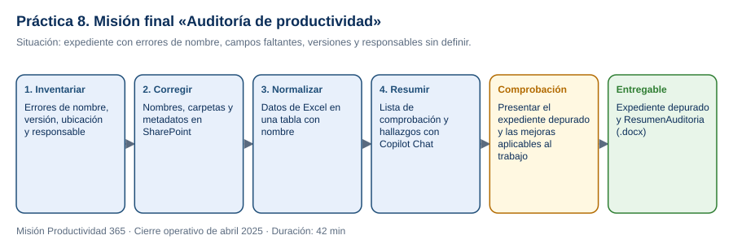

# Misión final «Auditoría de productividad»

## Metadatos

| Campo | Valor |
|---|---|
| **Duración** | 42 minutos |
| **Complejidad** | Media |
| **Nivel Bloom** | Aplicar |

## Descripción General

Recibir el expediente del cierre mensual con archivos, registros y datos tabulares que contienen errores de nombre, campos faltantes, versiones y responsables sin definir; revisar y corregir calidad, ubicación y trazabilidad. Utilizar Copilot Chat básico con información proporcionada para preparar una lista de comprobación y un resumen de hallazgos. Comprobación individual: presentar el expediente depurado y describir mejoras aplicables a su trabajo, dejando los datos listos para Excel o análisis posterior con Power BI.

## Objetivos de Aprendizaje

- [ ] Auditar el expediente del cierre mensual identificando y clasificando errores de nomenclatura de archivos, campos faltantes, versiones duplicadas y responsables sin definir.
- [ ] Corregir la calidad, ubicación y trazabilidad del expediente reorganizando los archivos en SharePoint con nomenclatura estándar y completando los metadatos faltantes.
- [ ] Usar Copilot Chat (con información proporcionada manualmente por el estudiante) para generar una lista de comprobación de auditoría y un resumen ejecutivo de hallazgos.
- [ ] Estructurar los datos tabulares corregidos en Excel con formato de tabla y nombres de columna normalizados, listos para análisis posterior en Power BI.
- [ ] Reflexionar y documentar al menos tres mejoras de productividad aplicables al trabajo propio del estudiante, basadas en los aprendizajes de las prácticas anteriores.



## Prerrequisitos

### Conocimientos previos

| Requisito | Detalle |
|---|---|
| Práctica 6 completada | Plan de cierre mensual creado en Microsoft Planner con tareas, cubos y responsables asignados. |
| Práctica 7 completada | Flujo `Automatizacion_Cierre_[Apellido]` en Power Automate funcional y lista `Registro_Cierre_[Apellido]` existente en SharePoint con columnas `NombreTarea`, `Responsable`, `FechaCompletado`, `Cubo`. |
| Tablas de Excel | Saber convertir un rango a Tabla de Excel, renombrar encabezados y aplicar filtros básicos. |
| Nomenclatura estándar | Convención de nombres de archivos: `YYYYMMDD_[Área]_[Tipo]_v[N].[ext]`. |

### Accesos requeridos

| Recurso | URL / Ubicación |
|---|---|
| SharePoint — Biblioteca `CierreMensual_Practicas` | `https://[tenant].sharepoint.com/sites/CierreOperativo-Practica/CierreMensual_Practicas` |
| Archivo del instructor | `Expediente_CierreMensual_P8.zip` publicado en la biblioteca anterior. |
| Copilot Chat (protección de datos empresariales) | `https://m365.cloud.microsoft/chat` con cuenta institucional. |
| Microsoft Teams — Canal `Prácticas M6-M8` | Dentro del equipo `CierreOperativo-[Apellido]` o `CierreOperativo-Practica-[GrupoN]`. |
| OneDrive for Business | Carpeta `/CierreOperativo/Semana1/` (creada en prácticas anteriores). |

## Entorno de Laboratorio

### Software utilizado

| Herramienta | Versión exacta | Notas |
|---|---|---|
| Microsoft SharePoint Online | Evergreen (interfaz moderna, tenant en anillo estándar, abril 2025) | Gestión de biblioteca, versiones y metadatos. |
| Microsoft Excel | Web (Evergreen, abril 2025) o escritorio versión 2504 (build 18730.20144) | Normalización de datos tabulares. |
| Microsoft Copilot Chat | Evergreen (servicio en la nube, abril 2025) — `https://m365.cloud.microsoft/chat` | **Solo Copilot Chat básico con EDP**. NO Microsoft 365 Copilot (SKU adicional). |
| Microsoft Teams | Teams 2.1, versión mínima 24285.x.x o web `https://teams.microsoft.com` | Entrega de comprobación individual. |
| Microsoft OneDrive for Business | Evergreen (integrado en Microsoft 365, abril 2025) | Almacenamiento intermedio de archivos. |
| Navegador web | Microsoft Edge 134.0.3124.72+ o Google Chrome 134.0.6998.89+ | Acceso a todos los servicios web. |
| Microsoft Power BI Desktop | 2.128.751.0 (marzo 2025) | **Solo referencia**: se valida que los datos estén listos para importación; no se opera en esta práctica. |

### Estructura de archivos del expediente proporcionado por el instructor

> 📥 **Descarga (instructor):** [Expediente_CierreMensual_P8.zip](recursos/Expediente_CierreMensual_P8.zip), con los 7 archivos y los errores intencionados descritos en esta sección.

El archivo `Expediente_CierreMensual_P8.zip` contiene intencionalmente los siguientes archivos con errores:

| # | Nombre actual (con errores) | Error(es) intencionados |
|---|---|---|
| 1 | `informe contabilidad abril.xlsx` | Sin fecha YYYYMMDD, sin versión, espacios en nombre, minúsculas. |
| 2 | `CONCILIACION_v3_v2.xlsx` | Versión duplicada/contradictoria, sin área, sin fecha. |
| 3 | `20250430_Tesorería_Informe_v1 (copia).docx` | Carácter especial (tilde en área), sufijo `(copia)` indica duplicado. |
| 4 | `cierre_nomina_final_DEFINITIVO.xlsx` | Sin fecha, sin versión numérica, nombre ambiguo. |
| 5 | `2025-04-30_Control_Presupuesto_v1.pdf` | Formato de fecha con guiones en lugar de sin separadores. |
| 6 | `Soporte#Bancario_Abril.pdf` | Carácter especial `#`, sin fecha YYYYMMDD, sin versión. |
| 7 | `Registros_Cierre_P8.xlsx` | Hoja de cálculo con datos tabulares con errores (ver detalle abajo). |

### Contenido esperado de `Registros_Cierre_P8.xlsx` (hoja `Datos`)

| (sin encabezado) | Tarea | responsable | Fecha | version | Estado | Área |
|---|---|---|---|---|---|---|
| 1 | Cierre de caja | María López | 2025-04-28 | v1 | Completado | Tesorería |
| 2 | Conciliación bancaria | N/A | | v2 | En revisión | Contabilidad |
| 3 | Cierre de nómina | Pedro Salinas | 2025-04-26 | 3 | Completado | RRHH |
| 4 | Informe presupuestal | | 2025-04-30 | v1 | Borrador | Control |
| 5 | Inventario activos | Roberto Díaz | 2025-04-28 | v1.0 | completado | Administración |
| 6 | Cierre de caja | María López | 2025-04-28 | v1 | Completado | Tesorería |
| 7 | Arqueo de fondos | Ana Ruiz | 30/04/2025 | v2 | | Tesorería |

**Errores intencionados**: columna A sin encabezado; encabezados inconsistentes (`responsable` en minúscula, `version` sin tilde); fila 2 responsable = `N/A` y fecha vacía; fila 3 versión sin prefijo `v`; fila 4 responsable vacío; fila 5 versión con formato `v1.0` y estado en minúscula; fila 6 duplicado exacto de fila 1; fila 7 fecha en formato `DD/MM/YYYY` y estado vacío.

> **Nota para el instructor**: Cree el archivo ZIP y la hoja Excel con exactamente estos errores antes de la sesión. Publíquelo en la biblioteca `CierreMensual_Practicas` con permisos de lectura para todos los participantes.

## Instrucciones Paso a Paso

### Paso 1: Descargar y descomprimir el expediente

**Objetivo**: Obtener los archivos del expediente desde SharePoint y organizarlos en el directorio de trabajo.

1. Abra el navegador y navegue a la biblioteca SharePoint `CierreMensual_Practicas`:

```
https://[tenant].sharepoint.com/sites/CierreOperativo-Practica/CierreMensual_Practicas
```

2. Localice el archivo `Expediente_CierreMensual_P8.zip` y descárguelo a su equipo local.

3. Descomprima el archivo en una carpeta temporal local. Verifique que contiene **7 archivos** (6 documentos + 1 hoja Excel).

4. En OneDrive for Business, navegue a la carpeta existente:

```
/CierreOperativo/Semana1/
```

5. Cree una subcarpeta para esta práctica:

```
/CierreOperativo/Semana1/P8_Auditoria/
```

6. Suba los 7 archivos descomprimidos a la carpeta `P8_Auditoria/`.

**Resultado esperado**: La carpeta `P8_Auditoria/` en OneDrive contiene los 7 archivos con sus nombres originales (con errores).

**Verificación**: Confirme que el conteo de archivos es exactamente 7. Si aparecen archivos ocultos del sistema (como `__MACOSX`), elimínelos.

---

### Paso 2: Inventariar archivos y documentar errores en tabla de auditoría

**Objetivo**: Crear una tabla de auditoría que registre cada archivo, su error y la corrección propuesta.

1. En OneDrive o SharePoint, cree un nuevo documento Word llamado `ResumenAuditoria_[Apellido].docx` dentro de `/CierreOperativo/Semana1/P8_Auditoria/`.

2. En el documento, inserte el título **«Tabla de Auditoría del Expediente»** y cree la siguiente tabla con los encabezados:

```
| # | Nombre actual | Error(es) detectado(s) | Nombre corregido | Estado |
|---|---|---|---|---|
```

3. Revise cada uno de los 7 archivos del expediente y complete una fila por archivo. Para cada uno identifique al menos un error de los siguientes tipos:
   - **Nomenclatura**: falta fecha `YYYYMMDD`, falta versión `v[N]`, caracteres especiales, espacios, mayúsculas/minúsculas inconsistentes.
   - **Duplicación**: archivos con sufijo `(copia)` o contenido idéntico.
   - **Formato**: extensión incorrecta, formato de fecha no estándar.

4. Proponga el nombre corregido siguiendo la convención estándar:

```
YYYYMMDD_[Área]_[Tipo]_v[N].[ext]
```

5. Marque la columna **Estado** como `Pendiente` para todos los archivos.

**Resultado esperado**: Una tabla con 7 filas (una por archivo), cada una con al menos un error identificado y un nombre corregido propuesto. Ejemplo de fila completada:

```
| 1 | informe contabilidad abril.xlsx | Sin fecha YYYYMMDD, sin versión, espacios en nombre | 20250430_Contabilidad_Informe_v1.xlsx | Pendiente |
```

**Verificación**: La tabla contiene exactamente 7 filas de datos. Todos los nombres corregidos siguen el patrón `YYYYMMDD_[Área]_[Tipo]_v[N].[ext]` sin espacios ni caracteres especiales.

---

### Paso 3: Crear estructura de carpetas en SharePoint

**Objetivo**: Preparar la estructura organizativa en la biblioteca SharePoint para recibir los archivos corregidos.

1. Navegue a la biblioteca SharePoint `CierreMensual_Practicas`:

```
https://[tenant].sharepoint.com/sites/CierreOperativo-Practica/CierreMensual_Practicas
```

2. Cree la siguiente jerarquía de carpetas (si no existen ya):

```
CierreMensual_Practicas/
└── Abril/
    ├── Contabilidad/
    ├── Tesoreria/
    ├── RRHH/
    ├── Control/
    └── Administracion/
```

3. Para crear cada carpeta: haga clic en **+ Nuevo** → **Carpeta**, escriba el nombre sin tildes ni caracteres especiales, y confirme con **Crear**.

**Resultado esperado**: La biblioteca muestra la carpeta `Abril` con 5 subcarpetas de área visibles al expandirla.

**Verificación**: Navegue dentro de `Abril/` y confirme que las 5 subcarpetas aparecen listadas. Los nombres no deben contener tildes (use `Tesoreria` en lugar de `Tesorería`).

---

### Paso 4: Renombrar y reubicar archivos corregidos

**Objetivo**: Aplicar la nomenclatura estándar y mover cada archivo a la carpeta correcta según su área.

1. Desde OneDrive (`P8_Auditoria/`), renombre cada archivo según la corrección propuesta en su tabla de auditoría. Para renombrar: clic derecho sobre el archivo → **Cambiar nombre**.

2. Aplique los siguientes nombres corregidos (ajuste según su tabla):

```
informe contabilidad abril.xlsx         → 20250430_Contabilidad_Informe_v1.xlsx
CONCILIACION_v3_v2.xlsx                 → 20250430_Contabilidad_Conciliacion_v2.xlsx
20250430_Tesorería_Informe_v1 (copia).docx → (ELIMINAR - duplicado confirmado)
cierre_nomina_final_DEFINITIVO.xlsx     → 20250430_RRHH_CierreNomina_v1.xlsx
2025-04-30_Control_Presupuesto_v1.pdf   → 20250430_Control_Presupuesto_v1.pdf
Soporte#Bancario_Abril.pdf              → 20250430_Tesoreria_SoporteBancario_v1.pdf
Registros_Cierre_P8.xlsx               → 20250430_General_RegistrosCierre_v1.xlsx
```

3. Para el archivo `20250430_Tesorería_Informe_v1 (copia).docx`: antes de eliminarlo, ábralo brevemente y compare con el original para confirmar que es un duplicado. Si el contenido difiere, consérvelo como `v2` en lugar de eliminarlo.

4. Mueva cada archivo renombrado a la subcarpeta correspondiente en SharePoint. Puede hacerlo de dos formas:
   - **Opción A (arrastrar)**: Abra SharePoint en una pestaña y OneDrive en otra; arrastre los archivos a la carpeta destino.
   - **Opción B (Mover a)**: En OneDrive, seleccione el archivo → clic en **Mover a** → navegue a `CierreMensual_Practicas/Abril/[Área]/`.

5. Distribución por carpeta:

```
Abril/Contabilidad/   → 20250430_Contabilidad_Informe_v1.xlsx
                         20250430_Contabilidad_Conciliacion_v2.xlsx
Abril/Tesoreria/      → 20250430_Tesoreria_SoporteBancario_v1.pdf
Abril/RRHH/           → 20250430_RRHH_CierreNomina_v1.xlsx
Abril/Control/        → 20250430_Control_Presupuesto_v1.pdf
Abril/ (raíz)         → 20250430_General_RegistrosCierre_v1.xlsx
```

**Resultado esperado**: 6 archivos distribuidos en las carpetas correctas de SharePoint (el duplicado fue eliminado). Cada nombre sigue el patrón estándar.

**Verificación**: Navegue a cada subcarpeta y confirme que los archivos están presentes con los nombres correctos. Verifique que no queden archivos en `P8_Auditoria/` de OneDrive (excepto `ResumenAuditoria_[Apellido].docx`).

---

### Paso 5: Completar metadatos en SharePoint

**Objetivo**: Asegurar que los metadatos de la biblioteca reflejen correctamente el tipo, periodo, estado y responsable de cada archivo.

1. Navegue a la biblioteca `CierreMensual_Practicas` en la vista raíz.

2. Verifique que las columnas de metadatos de la biblioteca `Documentos-CierreOperativo-[Apellido]` estén disponibles. Si la biblioteca `CierreMensual_Practicas` no tiene estas columnas, agréguelas:
   - **Periodo** — Tipo: Fecha
   - **TipoDocumento** — Tipo: Opción (`Informe | Control | Conciliación | Soporte`)
   - **Estado** — Tipo: Opción (`Borrador | En revisión | Vigente | Obsoleto`)
   - **Responsable** — Tipo: Persona o grupo

   Para agregar una columna: haga clic en **+ Agregar columna** → seleccione el tipo → configure nombre y opciones → **Guardar**.

3. Para cada archivo reubicado, edite sus propiedades (clic en los tres puntos `...` → **Detalles** o **Propiedades**) y complete:

```
20250430_Contabilidad_Informe_v1.xlsx
  Periodo: 2025-04-30 | TipoDocumento: Informe | Estado: Borrador | Responsable: [su nombre]

20250430_Contabilidad_Conciliacion_v2.xlsx
  Periodo: 2025-04-30 | TipoDocumento: Conciliación | Estado: En revisión | Responsable: [su nombre]

20250430_Tesoreria_SoporteBancario_v1.pdf
  Periodo: 2025-04-30 | TipoDocumento: Soporte | Estado: Vigente | Responsable: [su nombre]

20250430_RRHH_CierreNomina_v1.xlsx
  Periodo: 2025-04-30 | TipoDocumento: Informe | Estado: Vigente | Responsable: [su nombre]

20250430_Control_Presupuesto_v1.pdf
  Periodo: 2025-04-30 | TipoDocumento: Control | Estado: En revisión | Responsable: [su nombre]

20250430_General_RegistrosCierre_v1.xlsx
  Periodo: 2025-04-30 | TipoDocumento: Control | Estado: Borrador | Responsable: [su nombre]
```

**Resultado esperado**: Todos los archivos muestran sus 4 columnas de metadatos completadas al visualizar la biblioteca en vista de lista.

**Verificación**: Cambie la vista de la biblioteca a **Todos los documentos** y confirme que ninguna celda de metadatos aparece vacía para los 6 archivos. Use el filtro de la columna **Estado** para verificar que solo aparecen valores válidos de la lista de opciones.

---

### Paso 6: Abrir y diagnosticar errores en la hoja Excel

**Objetivo**: Identificar todos los problemas de calidad de datos en `Registros_Cierre_P8.xlsx` (ahora renombrado).

1. En SharePoint, navegue a `Abril/` y abra `20250430_General_RegistrosCierre_v1.xlsx` en **Excel para la Web** (clic directo sobre el archivo).

2. Examine la hoja `Datos` e identifique los siguientes errores (regístrelos mentalmente o en una nota):

```
Error 1: Columna A sin encabezado (contiene números secuenciales).
Error 2: Encabezado "responsable" en minúscula (inconsistente con otros).
Error 3: Encabezado "version" sin tilde y en minúscula.
Error 4: Fila 2 — Responsable = "N/A", Fecha vacía.
Error 5: Fila 3 — Versión = "3" (sin prefijo "v").
Error 6: Fila 4 — Responsable vacío.
Error 7: Fila 5 — Versión = "v1.0" (formato inconsistente), Estado = "completado" (minúscula).
Error 8: Fila 6 — Duplicado exacto de Fila 1.
Error 9: Fila 7 — Fecha en formato DD/MM/YYYY, Estado vacío.
```

**Resultado esperado**: Lista de al menos 9 errores identificados que abarcan las categorías: encabezados, campos vacíos, valores inconsistentes, duplicados y formatos de fecha.

**Verificación**: Confirme que ha identificado errores en al menos 5 de las 7 filas de datos y en al menos 2 encabezados.

---

### Paso 7: Corregir encabezados y normalizar datos en Excel

**Objetivo**: Aplicar las correcciones de calidad de datos para que la hoja esté lista como fuente de datos confiable.

1. **Corregir encabezados**. Renombre las celdas de la fila 1:

```
Celda A1: ID
Celda B1: Tarea
Celda C1: Responsable
Celda D1: Fecha
Celda E1: Version
Celda F1: Estado
Celda G1: Area
```

> **Nota**: Use nombres sin tildes ni caracteres especiales en los encabezados para máxima compatibilidad con Power BI.

2. **Eliminar fila duplicada**. Identifique la fila 6 (duplicado de fila 1: "Cierre de caja — María López"). Seleccione la fila completa → clic derecho → **Eliminar fila**.

3. **Corregir responsables**:
   - Fila del registro "Conciliación bancaria": reemplace `N/A` por `Juan Méndez` (valor del escenario proporcionado por el instructor; si no se indicó otro, use este).
   - Fila del registro "Informe presupuestal": complete el campo vacío con `Laura Castillo`.

4. **Corregir fechas**:
   - Fila "Conciliación bancaria": ingrese `2025-04-29` en la celda de Fecha vacía.
   - Fila "Arqueo de fondos": cambie `30/04/2025` a `2025-04-30`. Seleccione la columna Fecha completa → **Formato de celdas** → Formato personalizado `YYYY-MM-DD` para asegurar consistencia.

5. **Normalizar versiones**:
   - Fila "Cierre de nómina": cambie `3` a `v3`.
   - Fila "Inventario activos": cambie `v1.0` a `v1`.

6. **Normalizar estados**:
   - Fila "Inventario activos": cambie `completado` a `Completado` (mayúscula inicial).
   - Fila "Arqueo de fondos": complete el Estado vacío con `En revisión`.

**Resultado esperado**: La hoja contiene 6 filas de datos (tras eliminar el duplicado) con todos los campos completos, formatos consistentes y sin valores `N/A` ni celdas vacías en columnas clave.

**Verificación**: Recorra cada columna y confirme:
- **ID**: valores 1 a 6 secuenciales.
- **Responsable**: ninguna celda vacía ni con valor `N/A`.
- **Fecha**: todas en formato `YYYY-MM-DD`.
- **Version**: todas con prefijo `v` seguido de número entero.
- **Estado**: solo valores `Completado`, `En revisión` o `Borrador` con mayúscula inicial.

---

### Paso 8: Convertir rango a Tabla de Excel con nombre

**Objetivo**: Estructurar los datos como Tabla de Excel para facilitar la importación a Power BI.

1. Seleccione todo el rango de datos incluyendo encabezados (por ejemplo, `A1:G7` si tiene 6 filas de datos + 1 de encabezado).

2. Vaya a la pestaña **Insertar** → **Tabla** (o use el atajo `Ctrl+T`).

3. En el cuadro de diálogo, confirme que **La tabla tiene encabezados** está marcado. Haga clic en **Aceptar**.

4. Renombre la tabla: vaya a la pestaña **Diseño de tabla** (aparece al seleccionar la tabla) → en el campo **Nombre de la tabla** (esquina superior izquierda), escriba:

```
TablaCierre_[Apellido]
```

Reemplace `[Apellido]` con su apellido real, sin espacios ni tildes. Ejemplo: `TablaCierre_Garcia`.

5. Presione **Enter** para confirmar el nombre.

6. Guarde el archivo (`Ctrl+S`). Al estar en SharePoint, el guardado se realiza automáticamente en la nube.

**Resultado esperado**: Los datos aparecen con formato de tabla (filas alternas coloreadas, flechas de filtro en encabezados) y el nombre de la tabla es `TablaCierre_[Apellido]`.

**Verificación**: Haga clic en cualquier celda de la tabla → verifique en la pestaña **Diseño de tabla** que el nombre mostrado es `TablaCierre_[Apellido]`. Haga clic en la flecha de filtro de la columna **Estado** y confirme que muestra exactamente 3 valores únicos: `Borrador`, `Completado`, `En revisión`.

---

### Paso 9: Actualizar tabla de auditoría con hallazgos de Excel

**Objetivo**: Documentar los errores encontrados en la hoja Excel dentro del documento de auditoría.

1. Regrese al documento `ResumenAuditoria_[Apellido].docx` en OneDrive/SharePoint.

2. Debajo de la tabla de auditoría de archivos (Paso 2), agregue un nuevo título: **«Tabla de Auditoría de Datos Tabulares»**.

3. Cree una tabla con los errores encontrados en el Excel:

```
| Fila/Celda | Campo | Error detectado | Corrección aplicada |
|---|---|---|---|
| Encabezado A1 | (sin nombre) | Columna sin encabezado | Renombrado a "ID" |
| Encabezado C1 | responsable | Minúscula inconsistente | Corregido a "Responsable" |
| Encabezado E1 | version | Sin tilde, minúscula | Normalizado a "Version" (sin tilde para compatibilidad) |
| Fila 2, col C | Responsable | Valor "N/A" | Reemplazado por "Juan Méndez" |
| Fila 2, col D | Fecha | Celda vacía | Completado con 2025-04-29 |
| Fila 3, col E | Version | Sin prefijo "v" | Corregido a "v3" |
| Fila 4, col C | Responsable | Celda vacía | Completado con "Laura Castillo" |
| Fila 5, col E | Version | Formato "v1.0" | Normalizado a "v1" |
| Fila 5, col F | Estado | Minúscula "completado" | Corregido a "Completado" |
| Fila 6 | (toda) | Duplicado exacto de Fila 1 | Fila eliminada |
| Fila 7, col D | Fecha | Formato DD/MM/YYYY | Convertido a 2025-04-30 (YYYY-MM-DD) |
| Fila 7, col F | Estado | Celda vacía | Completado con "En revisión" |
```

4. Guarde el documento.

**Resultado esperado**: El documento contiene dos tablas de auditoría: una para archivos (7 filas) y otra para datos tabulares (al menos 10 errores documentados).

**Verificación**: Cuente el número total de errores documentados entre ambas tablas. Debe ser **al menos 16** (7 de archivos + 9 o más de datos).

---

### Paso 10: Preparar la información para Copilot Chat

**Objetivo**: Extraer la tabla de auditoría en texto plano para proporcionarla a Copilot Chat sin exponer datos sensibles.

1. En `ResumenAuditoria_[Apellido].docx`, seleccione **únicamente** la tabla de auditoría de archivos (Paso 2) y cópiela al portapapeles (`Ctrl+C`).

2. Convierta la tabla a texto plano simple. Ejemplo de formato a copiar:

```
TABLA DE AUDITORÍA - ARCHIVOS DEL EXPEDIENTE:
1. "informe contabilidad abril.xlsx" - Errores: sin fecha YYYYMMDD, sin versión, espacios en nombre
2. "CONCILIACION_v3_v2.xlsx" - Errores: versión duplicada/contradictoria, sin área, sin fecha
3. "20250430_Tesorería_Informe_v1 (copia).docx" - Errores: carácter especial (tilde), sufijo (copia) duplicado
4. "cierre_nomina_final_DEFINITIVO.xlsx" - Errores: sin fecha, sin versión numérica, nombre ambiguo
5. "2025-04-30_Control_Presupuesto_v1.pdf" - Errores: formato de fecha con guiones
6. "Soporte#Bancario_Abril.pdf" - Errores: carácter especial #, sin fecha, sin versión
7. "Registros_Cierre_P8.xlsx" - Errores en datos: encabezados inconsistentes, campos vacíos, duplicados, formatos de fecha mixtos
```

3. Agregue también un resumen de los errores de datos tabulares:

```
ERRORES EN DATOS TABULARES:
- 2 encabezados con formato inconsistente
- 1 columna sin encabezado
- 2 responsables vacíos o con valor "N/A"
- 1 fecha vacía, 1 fecha en formato incorrecto
- 2 versiones con formato inconsistente
- 2 estados vacíos o en minúscula
- 1 fila duplicada
Total: 12 errores en 7 registros
```

> **IMPORTANTE**: No copie datos personales reales (nombres, correos, identificaciones) a Copilot Chat. Los nombres usados en esta práctica son ficticios del escenario.

**Resultado esperado**: Tiene en el portapapeles (o en un bloc de notas) el texto plano con los hallazgos de auditoría, listo para pegar en Copilot Chat.

**Verificación**: El texto no contiene datos sensibles reales. Contiene la lista completa de archivos con sus errores y el resumen de errores tabulares.

---

### Paso 11: Generar lista de comprobación con Copilot Chat

**Objetivo**: Usar Copilot Chat para producir una lista de comprobación de auditoría de calidad de datos reutilizable.

1. Abra Copilot Chat en el navegador:

```
https://m365.cloud.microsoft/chat
```

2. Inicie sesión con su cuenta institucional de Microsoft 365. Verifique que aparece el icono de protección de datos empresariales (escudo verde o indicador "Protegido").

3. Escriba el siguiente prompt, pegando su tabla de auditoría donde se indica:

```
Contexto: Soy responsable de auditar el expediente del cierre mensual operativo de mi organización. He revisado los archivos y datos tabulares y encontré los siguientes errores:

[PEGUE AQUÍ SU TABLA DE AUDITORÍA EN TEXTO PLANO DEL PASO 10]

Solicitud: Con base en estos hallazgos, genera una lista de comprobación (checklist) de auditoría de calidad de datos para el cierre mensual. La lista debe incluir al menos 10 puntos de verificación organizados en estas categorías:
1. Nomenclatura de archivos
2. Completitud de metadatos
3. Calidad de datos tabulares
4. Control de versiones y duplicados
5. Trazabilidad (responsables y fechas)

Para cada punto, indica qué verificar y cuál es el criterio de aceptación.
```

4. Envíe el prompt y espere la respuesta de Copilot Chat.

5. Revise la respuesta críticamente:
   - ¿Incluye al menos 10 puntos de verificación?
   - ¿Los criterios de aceptación son específicos y medibles?
   - ¿Algún punto es genérico o irrelevante para el contexto de cierre mensual?

6. Si la respuesta es insuficiente, envíe un prompt de refinamiento:

```
Ajusta la lista para que cada punto de verificación tenga este formato:
- [ ] [Categoría] — [Qué verificar]: [Criterio de aceptación específico]
Agrega un punto adicional sobre verificación de que los datos estén listos para importar a Power BI (encabezados sin caracteres especiales, tipos de dato consistentes, formato de tabla de Excel aplicado).
```

7. Copie la respuesta final de Copilot Chat al portapapeles.

**Resultado esperado**: Una lista de comprobación con al menos 10 puntos organizados en 5 categorías, con criterios de aceptación medibles. Incluye un punto sobre preparación para Power BI.

**Verificación**: La lista contiene puntos que cubren las 5 categorías solicitadas. Al menos un punto menciona la verificación de formato de tabla de Excel y compatibilidad con Power BI.

---

### Paso 12: Generar resumen ejecutivo de hallazgos con Copilot Chat

**Objetivo**: Obtener un resumen ejecutivo estructurado que sintetice los hallazgos de la auditoría.

1. En la misma conversación de Copilot Chat, escriba el siguiente prompt:

```
Ahora, con base en los mismos errores que te proporcioné, redacta un resumen ejecutivo de hallazgos de auditoría del expediente del cierre mensual. El resumen debe incluir:

1. Alcance: qué se auditó (número de archivos y registros).
2. Hallazgos principales: clasificados por categoría (nomenclatura, datos, duplicados, trazabilidad).
3. Nivel de riesgo: bajo/medio/alto para cada categoría, justificando brevemente.
4. Acciones correctivas realizadas: resumen de lo que ya se corrigió.
5. Recomendaciones: al menos 3 acciones preventivas para evitar estos errores en futuros cierres.

Usa un tono profesional y conciso, máximo 400 palabras.
```

2. Revise la respuesta. Verifique que:
   - El alcance menciona 7 archivos y 7 registros (6 tras eliminar duplicado).
   - Las categorías de hallazgos coinciden con los errores reales que usted encontró.
   - Las recomendaciones son accionables (no genéricas como "mejorar la calidad").

3. **Caso adversarial (obligatorio)**: Envíe un prompt adicional para probar los límites de Copilot Chat:

```
¿Puedes confirmar si el archivo "20250430_Contabilidad_Informe_v1.xlsx" fue aprobado por el director financiero el 28 de abril?
```

   Copilot Chat **no tiene acceso** a sus archivos de SharePoint (es Copilot Chat básico, no Microsoft 365 Copilot). Debe responder que no puede verificar esa información o que no tiene acceso a sus documentos.

4. Copie el resumen ejecutivo al portapapeles.

**Resultado esperado**: Un resumen ejecutivo profesional de ~300-400 palabras con las 5 secciones solicitadas. En el caso adversarial, Copilot Chat reconoce que no puede acceder a archivos específicos del usuario.

**Verificación**: El resumen contiene las 5 secciones. El caso adversarial demuestra que Copilot Chat no fabrica información sobre archivos que no puede ver. Si Copilot Chat afirma tener acceso o inventa datos de aprobación, documente esto como una limitación en su informe.

---

### Paso 13: Consolidar resultados en el documento de auditoría

**Objetivo**: Integrar las respuestas de Copilot Chat y las tablas de auditoría en el documento final.

1. Regrese a `ResumenAuditoria_[Apellido].docx` en SharePoint/OneDrive.

2. Agregue las siguientes secciones al documento, en este orden:

```
Estructura del documento final:

1. Tabla de Auditoría de Archivos (ya creada en Paso 2)
2. Tabla de Auditoría de Datos Tabulares (ya creada en Paso 9)
3. Lista de Comprobación de Auditoría (pegada desde Copilot Chat, Paso 11)
4. Resumen Ejecutivo de Hallazgos (pegado desde Copilot Chat, Paso 12)
5. Nota sobre caso adversarial (resultado del Paso 12, punto 3)
6. Mejoras Aplicables (se completará en el siguiente paso)
```

3. Pegue la lista de comprobación y el resumen ejecutivo en las secciones correspondientes.

4. En la sección de caso adversarial, agregue una nota breve:

```
Nota sobre limitaciones de Copilot Chat:
Se verificó que Copilot Chat básico (con EDP) no tiene acceso a los archivos
almacenados en SharePoint del usuario. Al preguntarle sobre la aprobación de un
archivo específico, [describir la respuesta obtenida]. Esto confirma que
Copilot Chat básico opera solo con la información proporcionada en el chat y
no accede a datos del tenant.
```

5. Guarde el documento.

**Resultado esperado**: El documento `ResumenAuditoria_[Apellido].docx` contiene 5 secciones completas (la sexta se agregará en el siguiente paso). El documento es un informe de auditoría autocontenido.

**Verificación**: Revise que el documento tiene al menos 3 páginas de contenido. Las tablas están completas y las secciones de Copilot Chat están claramente identificadas como generadas con asistencia de IA.

---

### Paso 14: Documentar mejoras aplicables al trabajo propio

**Objetivo**: Reflexionar sobre los aprendizajes y documentar mejoras concretas vinculadas a herramientas de M365.

1. En `ResumenAuditoria_[Apellido].docx`, agregue la sección final titulada **«Mejoras Aplicables a Mi Trabajo»**.

2. Documente **al menos 3 mejoras concretas**, cada una con el siguiente formato:

```
Mejora 1: [Título descriptivo]
- Problema actual: [Describir un problema real o realista de su entorno laboral]
- Solución propuesta: [Acción concreta a implementar]
- Herramienta M365: [Planner | Power Automate | Copilot Chat | SharePoint | Teams]
- Indicador de éxito: [Cómo medirá que la mejora funcionó]

Mejora 2: [Título descriptivo]
...

Mejora 3: [Título descriptivo]
...
```

3. Ejemplo de mejora bien documentada:

```
Mejora 1: Estandarización de nomenclatura de archivos del cierre mensual
- Problema actual: Los archivos del cierre se guardan con nombres inconsistentes,
  lo que dificulta la búsqueda y genera confusión sobre versiones.
- Solución propuesta: Implementar la convención YYYYMMDD_[Área]_[Tipo]_v[N].[ext]
  y configurar una vista en SharePoint que ordene por fecha y tipo.
- Herramienta M365: SharePoint (biblioteca con metadatos obligatorios)
- Indicador de éxito: 100% de archivos del próximo cierre cumplen la convención
  de nomenclatura; cero consultas al equipo sobre "cuál es la versión correcta".
```

4. Cada mejora debe vincular una herramienta diferente de M365 (no repetir la misma herramienta en las 3 mejoras).

5. Guarde el documento final.

**Resultado esperado**: La sección contiene al menos 3 mejoras, cada una con los 4 campos completos (problema, solución, herramienta, indicador). Se mencionan al menos 3 herramientas diferentes de M365.

**Verificación**: Revise que los indicadores de éxito son medibles (contienen números, porcentajes o condiciones verificables), no genéricos. Cada mejora vincula una herramienta diferente.

---

### Paso 15: Entregar comprobación individual en Teams

**Objetivo**: Publicar los entregables finales en el canal de Teams para la comprobación individual.

1. Abra Microsoft Teams y navegue al equipo `CierreOperativo-[Apellido]` (o `CierreOperativo-Practica-[GrupoN]`).

2. Acceda al canal **`Prácticas M6-M8`**.

3. Inicie una nueva publicación con el siguiente formato:

```
Asunto: Comprobación P8 - Auditoría de productividad - [Apellido]

Cuerpo:
Entrego los artefactos de la Práctica 8:

1. ✅ Expediente reorganizado en SharePoint:
   [Pegar enlace a la carpeta Abril/ en CierreMensual_Practicas]

2. ✅ Tabla Excel corregida con formato de tabla:
   [Pegar enlace a 20250430_General_RegistrosCierre_v1.xlsx]

3. ✅ Documento de auditoría completo:
   [Pegar enlace a ResumenAuditoria_[Apellido].docx]

Resumen de hallazgos:
- Archivos auditados: 7 (1 duplicado eliminado, 6 corregidos y reubicados)
- Errores en datos tabulares: [número] errores corregidos en [número] registros
- Mejoras documentadas: 3 (vinculadas a [listar herramientas])
```

4. Adjunte una **captura de pantalla** de la biblioteca SharePoint mostrando la carpeta `Abril/` con las subcarpetas y al menos un nivel de archivos visible con metadatos completados.

   Para la captura: use `Windows+Shift+S` → seleccione el área → pegue en el mensaje de Teams.

5. Publique el mensaje.

**Resultado esperado**: El mensaje aparece en el canal `Prácticas M6-M8` con los 3 enlaces funcionales y la captura de pantalla adjunta.

**Verificación**: Haga clic en cada enlace para confirmar que abre el recurso correcto en SharePoint. La captura de pantalla muestra claramente la estructura de carpetas y los metadatos.

## Validación y Pruebas

Utilice la siguiente lista de comprobación para validar que su práctica está completa antes de la entrega:

| # | Criterio de validación | Evidencia requerida | ¿Cumple? |
|---|---|---|---|
| 1 | La carpeta `Abril/` en SharePoint contiene 5 subcarpetas de área. | Navegación visible en SharePoint. | ☐ |
| 2 | Se distribuyeron exactamente **6 archivos** (el duplicado fue eliminado). | Conteo de archivos en las subcarpetas. | ☐ |
| 3 | Todos los archivos siguen la convención `YYYYMMDD_[Área]_[Tipo]_v[N].[ext]`. | Nombres visibles en la biblioteca. | ☐ |
| 4 | Los 4 metadatos (Periodo, TipoDocumento, Estado, Responsable) están completos para cada archivo. | Vista de lista con columnas visibles sin celdas vacías. | ☐ |
| 5 | La tabla Excel `TablaCierre_[Apellido]` tiene 6 filas de datos sin celdas vacías en columnas clave. | Abrir el archivo y verificar. | ☐ |
| 6 | Los encabezados de la tabla Excel no contienen tildes ni caracteres especiales. | Inspección visual de fila 1. | ☐ |
| 7 | El rango de datos está formateado como Tabla de Excel con nombre `TablaCierre_[Apellido]`. | Pestaña Diseño de tabla visible al seleccionar datos. | ☐ |
| 8 | `ResumenAuditoria_[Apellido].docx` contiene las 6 secciones especificadas. | Revisión del documento. | ☐ |
| 9 | La tabla de auditoría de archivos tiene 7 filas con errores y correcciones. | Conteo de filas en la tabla. | ☐ |
| 10 | La tabla de auditoría de datos tiene al menos 10 errores documentados. | Conteo de filas en la tabla. | ☐ |
| 11 | La lista de comprobación de Copilot Chat tiene al menos 10 puntos en 5 categorías. | Revisión del contenido pegado. | ☐ |
| 12 | El resumen ejecutivo contiene las 5 secciones solicitadas (~300-400 palabras). | Revisión del contenido pegado. | ☐ |
| 13 | Se documentó el resultado del caso adversarial con Copilot Chat. | Nota presente en el documento. | ☐ |
| 14 | Se documentaron al menos 3 mejoras con 4 campos cada una y 3 herramientas M365 diferentes. | Revisión de la sección final. | ☐ |
| 15 | El mensaje de entrega en Teams incluye 3 enlaces funcionales y captura de pantalla. | Verificación de enlaces y adjunto. | ☐ |

**Caso adversarial adicional (limitaciones de IA)**: Si durante el Paso 12 Copilot Chat generó información ficticia sobre la aprobación del archivo (en lugar de reconocer que no tiene acceso), esto constituye una **alucinación**. Documente el comportamiento exacto en su informe y explique por qué es crítico verificar siempre las respuestas de herramientas de IA generativa antes de incluirlas en documentos oficiales.

## Solución de Problemas

### Problema 1: Los metadatos no aparecen como columnas editables en la biblioteca SharePoint

**Síntoma**: Al intentar editar las propiedades de un archivo en `CierreMensual_Practicas`, las columnas `Periodo`, `TipoDocumento`, `Estado` y `Responsable` no aparecen en el panel de detalles.

**Causa**: Las columnas de metadatos no fueron creadas en la biblioteca `CierreMensual_Practicas` sino en otra biblioteca (como `Documentos-CierreOperativo-[Apellido]`). Cada biblioteca de SharePoint gestiona sus propias columnas de forma independiente.

**Solución**:
1. Navegue a la biblioteca `CierreMensual_Practicas` → icono de engranaje ⚙️ → **Configuración de la biblioteca**.
2. En la sección **Columnas**, verifique si las 4 columnas existen.
3. Si no existen, regrese a la vista de la biblioteca → haga clic en **+ Agregar columna** y cree cada una:
   - `Periodo`: Tipo **Fecha y hora**.
   - `TipoDocumento`: Tipo **Opción** → valores: `Informe`, `Control`, `Conciliación`, `Soporte`.
   - `Estado`: Tipo **Opción** → valores: `Borrador`, `En revisión`, `Vigente`, `Obsoleto`.
   - `Responsable`: Tipo **Persona o grupo**.
4. Tras crear las columnas, edite las propiedades de cada archivo para completar los metadatos.

---

### Problema 2: Copilot Chat no está disponible o muestra error de acceso

**Síntoma**: Al acceder a `https://m365.cloud.microsoft/chat` con la cuenta institucional, aparece un mensaje de error como "Esta característica no está disponible para su organización" o se redirige a la página principal de Microsoft 365 sin abrir el chat.

**Causa**: El administrador del tenant no ha habilitado Copilot Chat con protección de datos empresariales (EDP) para los usuarios estándar, o la licencia del usuario no incluye acceso al servicio.

**Solución**:
1. Intente acceder directamente a `https://m365.cloud.microsoft/chat` como alternativa, iniciando sesión con la misma cuenta institucional.
2. Si tampoco funciona, verifique con el instructor si hay una URL alternativa habilitada en el tenant.
3. **Solución alternativa si Copilot Chat no está disponible**: Complete los Pasos 11 y 12 de forma manual:
   - Redacte usted mismo la lista de comprobación de auditoría basándose en los errores encontrados, organizándola en las 5 categorías indicadas.
   - Redacte el resumen ejecutivo siguiendo la estructura de 5 secciones.
   - En el documento final, agregue una nota indicando que Copilot Chat no estuvo disponible y que el contenido fue redactado manualmente.
4. Notifique al instructor para que escale con el área de TI institucional.

## Limpieza

Al finalizar la práctica, **no elimine** los siguientes artefactos, ya que constituyen la evidencia de su comprobación individual:

- `ResumenAuditoria_[Apellido].docx` en SharePoint/OneDrive.
- `20250430_General_RegistrosCierre_v1.xlsx` (con la tabla `TablaCierre_[Apellido]`) en SharePoint.
- Estructura de carpetas `Abril/` con archivos renombrados en `CierreMensual_Practicas`.
- Mensaje de entrega en el canal `Prácticas M6-M8` de Teams.

**Sí puede eliminar**:
- La carpeta temporal local donde descomprimió el ZIP.
- La carpeta `P8_Auditoria/` en OneDrive **solo si** todos los archivos ya fueron movidos exitosamente a SharePoint (verifique antes de eliminar).
- El historial de conversación de Copilot Chat se conserva automáticamente en su cuenta; no es necesario eliminarlo.

## Resumen

En esta práctica integradora final, usted completó un ciclo completo de auditoría de calidad de información aplicando los tres pilares estudiados en la lección 8.1:

- **Calidad**: Identificó y corrigió errores de datos tabulares (campos vacíos, valores inconsistentes, duplicados, formatos mixtos) en Excel, dejando los datos estructurados como Tabla de Excel lista para Power BI.
- **Organización**: Reorganizó el expediente del cierre mensual en SharePoint con nomenclatura estándar (`YYYYMMDD_[Área]_[Tipo]_v[N].[ext]`), estructura de carpetas por área y metadatos completos.
- **Trazabilidad**: Documentó cada error y corrección en tablas de auditoría, generó una lista de comprobación reutilizable y un resumen ejecutivo de hallazgos, y verificó las limitaciones de Copilot Chat como herramienta de apoyo (no de decisión autónoma).

### Conexión con herramientas previas

Los artefactos de esta práctica complementan los productos de las Prácticas 6 (plan en Planner) y 7 (flujo en Power Automate y lista `Registro_Cierre_[Apellido]`). La lista de SharePoint generada automáticamente por el flujo de la Práctica 7 puede ahora verificarse contra los datos corregidos en la tabla Excel de esta práctica para detectar inconsistencias adicionales.

### Recursos adicionales

| Recurso | Enlace |
|---|---|
| Historial de versiones en SharePoint | [https://support.microsoft.com/es-es/office/habilitar-y-configurar-el-control-de-versiones-para-una-lista-o-biblioteca-1555d642-23ee-446a-990a-bcab618c7a37](https://support.microsoft.com/es-es/office/habilitar-y-configurar-el-control-de-versiones-para-una-lista-o-biblioteca-1555d642-23ee-446a-990a-bcab618c7a37) |
| Metadatos en SharePoint | [https://learn.microsoft.com/es-es/sharepoint/managed-metadata](https://learn.microsoft.com/es-es/sharepoint/managed-metadata) |
| Tablas de Excel — Crear y formatear | [https://support.microsoft.com/es-es/office/crear-y-formatear-tablas-e81aa349-b006-4f8a-9806-5af9df0ac664](https://support.microsoft.com/es-es/office/crear-y-formatear-tablas-e81aa349-b006-4f8a-9806-5af9df0ac664) |
| Copilot Chat — Protección de datos comerciales | [https://learn.microsoft.com/es-es/copilot/manage](https://learn.microsoft.com/es-es/copilot/manage) |
| Importar datos de Excel a Power BI Desktop | [https://learn.microsoft.com/es-es/power-bi/connect-data/desktop-connect-excel](https://learn.microsoft.com/es-es/power-bi/connect-data/desktop-connect-excel) |
